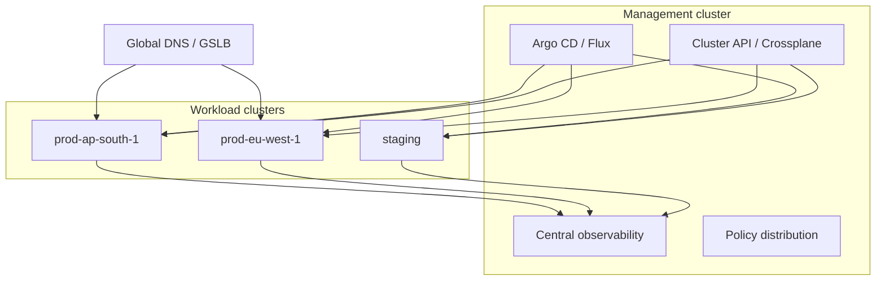
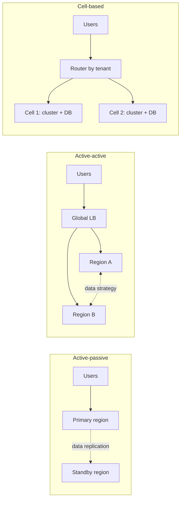

<!-- devopsshack:header -->
> ☸️ **Kubernetes Mastery: Zero to Production** · by **DevOps Shack** · [YouTube](https://www.youtube.com/@devopsshack) · [Hindi channel](https://www.youtube.com/@shackverse) · [devopsshack.com](https://devopsshack.com)
<!-- /devopsshack:header -->

# Module 31 · Multi-Cluster Kubernetes

## Why more than one cluster

- **Blast radius:** a bad upgrade, CRD or webhook takes down one cluster, not everything.
- **Regions:** latency, data residency, regional DR.
- **Isolation:** prod vs non-prod, regulated workloads, tenants.
- **Scale limits:** very large clusters are hard to operate.

## The building blocks

| Problem | Options |
|---|---|
| Create and upgrade many clusters | Terraform/OpenTofu modules, Cluster API, Crossplane, managed fleet features |
| Deploy apps to many clusters | Argo CD ApplicationSets (cluster generator), Flux with per-cluster entry points |
| Policy everywhere | GitOps-distributed Kyverno/Gatekeeper policies |
| Route users to the right cluster | GeoDNS, global load balancers, Gateway API multi-cluster implementations |
| Services calling across clusters | Multi-Cluster Services API (`ServiceExport`/`ServiceImport`), Cilium Cluster Mesh, Istio multi-cluster, Linkerd multicluster |
| Observe everything | Prometheus with remote write to Mimir/Thanos, central logs and traces, cluster label on every series |

## Patterns

The hard problem is never the clusters; it's the **data**. Stateless services go active-active easily; databases need a replication and conflict strategy, or you route each tenant to a home region.

## Practice

- Assignment [A107 · Multi-Cluster GitOps](../06-assignments/A107-multi-cluster-gitops.md)

Next: [Module 32 · Kubernetes for AI/ML Workloads](32-ai-ml-workloads.md)

<!-- devopsshack:footer -->
---

  Made with ❤️ by <b><a href="https://devopsshack.com">DevOps Shack</a></b> · Part of <b>Kubernetes Mastery: Zero to Production</b> 
  <a href="https://www.youtube.com/@devopsshack">YouTube · DevOps Shack</a> · <a href="https://www.youtube.com/@shackverse">YouTube · DevOps Shack Hindi</a> · <a href="https://devopsshack.com">devopsshack.com</a> · <a href="https://www.instagram.com/devopsshack">Instagram · @devopsshack</a> 
  © DevOps Shack. Original content created by DevOps Shack. Free to learn from and share with credit to DevOps Shack. See <a href="../LICENSE">LICENSE</a>.

<!-- /devopsshack:footer -->
