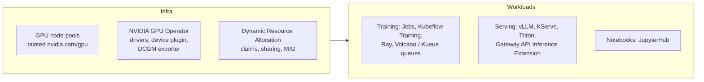

<!-- devopsshack:header -->
> ☸️ **Kubernetes Mastery: Zero to Production** · by **DevOps Shack** · [YouTube](https://www.youtube.com/@devopsshack) · [Hindi channel](https://www.youtube.com/@shackverse) · [devopsshack.com](https://devopsshack.com)
<!-- /devopsshack:header -->

# Module 32 · Kubernetes for AI/ML Workloads

Kubernetes has become the default platform for training and serving models. GPUs change the economics: one idle GPU node can cost more than a whole web tier.



## Requesting a GPU

```yaml
apiVersion: v1
kind: Pod
metadata: { name: cuda-check }
spec:
  restartPolicy: Never
  tolerations:
    - { key: nvidia.com/gpu, operator: Exists, effect: NoSchedule }
  nodeSelector:
    nvidia.com/gpu.product: NVIDIA-L4
  containers:
    - name: cuda
      image: nvidia/cuda:12.6.0-base-ubuntu24.04
      command: ["nvidia-smi"]
      resources:
        limits:
          nvidia.com/gpu: 1      # GPUs are requested in limits; whole devices by default
```

GPU sharing options: **MIG** (hardware partitions on A100/H100-class GPUs), **time-slicing** (no memory isolation), **MPS**. DRA makes these first-class and lets workloads request devices by attributes.

## Batch scheduling and queues

Training jobs need **all-or-nothing** (gang) scheduling: 8 workers that each need a GPU are useless if only 6 start. Tools: **Kueue** (Kubernetes-native job queueing, quotas and fair sharing between teams), **Volcano**, and **JobSet** for multi-pod training jobs.

## Serving LLMs

```yaml
apiVersion: apps/v1
kind: Deployment
metadata: { name: llm, namespace: ai }
spec:
  replicas: 2
  selector: { matchLabels: { app: llm } }
  template:
    metadata: { labels: { app: llm } }
    spec:
      tolerations: [{ key: nvidia.com/gpu, operator: Exists, effect: NoSchedule }]
      containers:
        - name: vllm
          image: vllm/vllm-openai:latest   # pin a specific version in production
          args: ["--model", "Qwen/Qwen2.5-7B-Instruct", "--max-model-len", "8192"]
          ports: [{ containerPort: 8000 }]
          resources:
            limits: { nvidia.com/gpu: 1 }
          readinessProbe:
            httpGet: { path: /health, port: 8000 }
            initialDelaySeconds: 60
          volumeMounts:
            - { name: cache, mountPath: /root/.cache/huggingface }
      volumes:
        - name: cache
          persistentVolumeClaim: { claimName: hf-cache }
```

Production concerns: model download time (cache models on volumes or bake into images), cold starts, autoscaling on queue depth or tokens/second rather than CPU, and GPU utilisation monitoring with the DCGM exporter.

## Cost control

- Separate, tainted GPU pools so nothing else lands on expensive nodes.
- Scale GPU pools to zero when idle (Karpenter/NAP).
- Right-size GPU type to the model; share small inference workloads via MIG or time-slicing.

## Practice

- Assignment [A108 · GPU Workloads](../06-assignments/A108-gpu-workload.md)

Next: [Module 33 · Production Readiness](33-production-readiness.md)

<!-- devopsshack:footer -->
---

<p align="center">
  Made with ❤️ by <b><a href="https://devopsshack.com">DevOps Shack</a></b> · Part of <b>Kubernetes Mastery: Zero to Production</b><br/>
  <a href="https://www.youtube.com/@devopsshack">YouTube · DevOps Shack</a> · <a href="https://www.youtube.com/@shackverse">YouTube · DevOps Shack Hindi</a> · <a href="https://devopsshack.com">devopsshack.com</a> · <a href="https://www.instagram.com/devopsshack">Instagram · @devopsshack</a><br/>
  <sub>© DevOps Shack. Original content created by DevOps Shack. Free to learn from and share with credit to DevOps Shack. See <a href="../LICENSE">LICENSE</a>.</sub>
</p>
<!-- /devopsshack:footer -->
