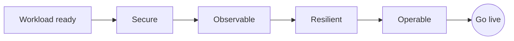

<!-- devopsshack:header -->
> ☸️ **Kubernetes Mastery: Zero to Production** · by **DevOps Shack** · [YouTube](https://www.youtube.com/@devopsshack) · [Hindi channel](https://www.youtube.com/@shackverse) · [devopsshack.com](https://devopsshack.com)
<!-- /devopsshack:header -->

# Module 33 · Production Readiness

This module pulls the whole repository together into checklists you can use before anything goes live.

## Workload checklist

- [ ] At least 2 replicas (3+ customer-facing), spread across zones with topology spread constraints
- [ ] Resource requests set from measured usage; memory limit set
- [ ] Startup, readiness and liveness probes designed separately ([Module 11](11-health-probes-lifecycle.md))
- [ ] Graceful shutdown: SIGTERM handling, `preStop` sleep, sensible `terminationGracePeriodSeconds`
- [ ] PodDisruptionBudget that still allows at least one disruption
- [ ] HPA (or KEDA) with sane min/max and scale-down stabilisation
- [ ] Image pinned by tag + digest; no `latest`
- [ ] Config via ConfigMaps; secrets from a secrets manager; config changes roll pods
- [ ] Stateful data on the right storage class with backups and tested restores

## Security checklist

- [ ] Runs as non-root, read-only root FS, all capabilities dropped, seccomp RuntimeDefault
- [ ] Namespace enforces Pod Security `restricted` (or documented exception)
- [ ] Dedicated ServiceAccount; token automount disabled unless needed; workload identity for cloud access
- [ ] Default-deny NetworkPolicies with explicit allows
- [ ] Image scanned (no critical CVEs), signed and verified at admission
- [ ] RBAC reviewed: no wildcard permissions for the app or its pipeline

## Observability checklist

- [ ] Structured logs to stdout, shipped centrally
- [ ] RED metrics exposed and scraped; dashboards with golden signals
- [ ] Traces for request paths across services
- [ ] SLOs defined, burn-rate alerts route to the owning team, runbooks linked

## Resilience checklist

- [ ] Survives losing a pod, a node and a zone (tested, not assumed)
- [ ] Timeouts and retries with backoff on every outbound call; circuit breaking for critical dependencies
- [ ] Load-tested at expected peak × safety factor
- [ ] Dependencies' failure modes understood (what happens when the DB is slow?)
- [ ] DR plan with agreed RPO/RTO, rehearsed

## Operability checklist

- [ ] Deployed via GitOps; rollback is a revert
- [ ] Progressive delivery for risky changes
- [ ] Ownership labels (`team`, `cost-center`) and on-call rotation
- [ ] Runbooks for the top 5 failure modes
- [ ] Capacity and cost reviewed

## Cluster-level checklist

- [ ] Control plane HA (managed or 3 nodes), etcd backups tested
- [ ] Supported Kubernetes version with an upgrade plan
- [ ] Node auto-repair / replacement; node OS patched
- [ ] Audit logs on, shipped off-cluster
- [ ] Admission policies for baseline guardrails
- [ ] Cluster add-ons (CNI, CSI, DNS, ingress, autoscalers, cert-manager) monitored and version-tracked

## Practice

- Assignment [A109 · Production Readiness Review](../06-assignments/A109-production-readiness-review.md)
- Capstones [A110](../06-assignments/A110-capstone-microservices-platform.md)–[A112](../06-assignments/A112-capstone-migrate-vm-app.md)
- [Lab 25 · End-to-End Microservices](../04-labs/lab-25-end-to-end-microservices/README.md)

Back to [Modules index](README.md)

<!-- devopsshack:footer -->
---

  Made with ❤️ by <b><a href="https://devopsshack.com">DevOps Shack</a></b> · Part of <b>Kubernetes Mastery: Zero to Production</b> 
  <a href="https://www.youtube.com/@devopsshack">YouTube · DevOps Shack</a> · <a href="https://www.youtube.com/@shackverse">YouTube · DevOps Shack Hindi</a> · <a href="https://devopsshack.com">devopsshack.com</a> · <a href="https://www.instagram.com/devopsshack">Instagram · @devopsshack</a> 
  © DevOps Shack. Original content created by DevOps Shack. Free to learn from and share with credit to DevOps Shack. See <a href="../LICENSE">LICENSE</a>.

<!-- /devopsshack:footer -->
