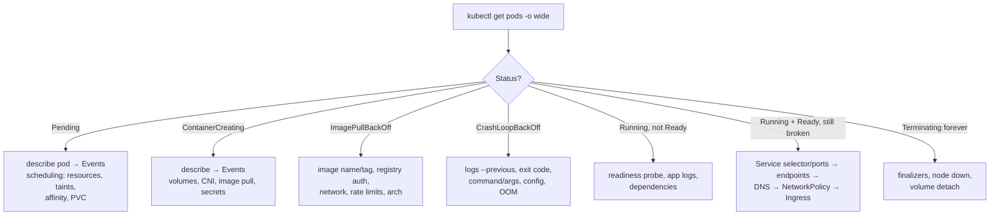

<!-- devopsshack:header -->
> ☸️ **Kubernetes Mastery: Zero to Production** · by **DevOps Shack** · [YouTube](https://www.youtube.com/@devopsshack) · [Hindi channel](https://www.youtube.com/@shackverse) · [devopsshack.com](https://devopsshack.com)
<!-- /devopsshack:header -->

# Cheat Sheet · Troubleshooting

## The universal order



## Status → meaning → first command

| Status / reason | Usually means | First command |
|---|---|---|
| Pending | Can't be scheduled | `kubectl describe pod` (FailedScheduling) |
| ContainerCreating (long) | Volume mount, CNI, secret missing | `kubectl describe pod` |
| ErrImagePull / ImagePullBackOff | Bad image ref or auth | `kubectl describe pod` (Failed to pull) |
| CreateContainerConfigError | Missing ConfigMap/Secret/key | `kubectl describe pod` |
| CrashLoopBackOff | Process keeps exiting | `kubectl logs --previous` |
| OOMKilled (137) | Memory limit exceeded | `kubectl describe pod` → Last State |
| Error (exit 1) | App error | `kubectl logs --previous` |
| Completed (server app) | Process exited 0 | Check command/entrypoint |
| Evicted | Node pressure | `kubectl describe pod` · node conditions |
| Running 0/1 Ready | Readiness failing | `kubectl describe pod` (probe failures) |
| Unknown | Node unreachable | `kubectl get nodes` |
| Terminating (stuck) | Finalizer / unreachable node | `kubectl get pod -o yaml` (finalizers) |

## Exit codes

| Code | Meaning |
|---|---|
| 0 | Success (bad for long-running) |
| 1 | App error |
| 2 | Misuse of shell builtin / bad args |
| 126 | Not executable (permissions) |
| 127 | Command not found |
| 128+N | Killed by signal N |
| 137 | SIGKILL (OOM or grace period expired) |
| 139 | SIGSEGV |
| 143 | SIGTERM |

## Networking checks

```bash
kubectl get svc,endpointslices -n shop
kubectl get pods -n shop -l <svc selector> -o wide
kubectl run t --rm -it -n shop --image=nicolaka/netshoot -- bash
  nslookup api ; dig api.shop.svc.cluster.local
  curl -sv http://api:80/healthz ; nc -zv api 80
  curl -sv http://<podIP>:<containerPort>/healthz     # bypass Service
kubectl get networkpolicy -n shop
kubectl -n kube-system get pods -l k8s-app=kube-dns
kubectl -n kube-system logs -l k8s-app=kube-dns --tail=50
```

## Node checks

```bash
kubectl get nodes ; kubectl describe node <n> | sed -n '/Conditions/,/Addresses/p'
kubectl debug node/<n> -it --image=ubuntu    # then: chroot /host
  systemctl status kubelet containerd
  journalctl -u kubelet --since "15 min ago" | tail -50
  crictl ps -a ; crictl logs <id>
  df -h ; free -m ; dmesg | grep -i -E 'oom|killed'
```

## Control plane checks

```bash
kubectl get --raw='/readyz?verbose'
kubectl get --raw='/livez?verbose'
kubectl -n kube-system get pods -l tier=control-plane
kubectl get events -A --field-selector type=Warning --sort-by=.lastTimestamp | tail -30
# kubeadm nodes:
crictl ps | grep -E 'apiserver|etcd|scheduler|controller'
etcdctl endpoint health --cluster    # with certs flags
kubeadm certs check-expiration
```

## Stuck deletions

```bash
kubectl get ns stuck -o json | jq '.spec.finalizers, .status.conditions'
kubectl api-resources --verbs=list --namespaced -o name | xargs -n1 kubectl get -n stuck --ignore-not-found --show-kind
kubectl patch <kind> <name> -n stuck -p '{"metadata":{"finalizers":null}}' --type=merge   # LAST resort, understand the cleanup you skip
```

Full step-by-step guides: [Troubleshooting Playbooks](../05-troubleshooting-playbooks/README.md).

<!-- devopsshack:footer -->
---

<p align="center">
  Made with ❤️ by <b><a href="https://devopsshack.com">DevOps Shack</a></b> · Part of <b>Kubernetes Mastery: Zero to Production</b><br/>
  <a href="https://www.youtube.com/@devopsshack">YouTube · DevOps Shack</a> · <a href="https://www.youtube.com/@shackverse">YouTube · DevOps Shack Hindi</a> · <a href="https://devopsshack.com">devopsshack.com</a> · <a href="https://www.instagram.com/devopsshack">Instagram · @devopsshack</a><br/>
  <sub>© DevOps Shack. Original content created by DevOps Shack. Free to learn from and share with credit to DevOps Shack. See <a href="../LICENSE">LICENSE</a>.</sub>
</p>
<!-- /devopsshack:footer -->
