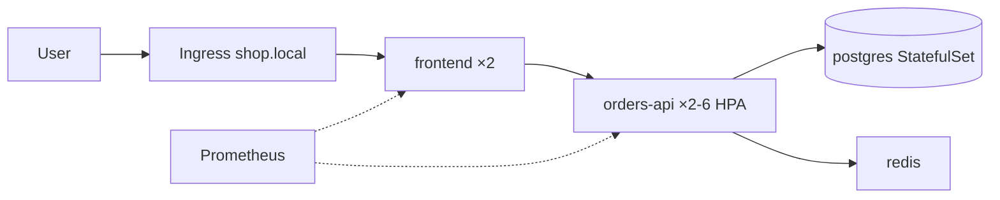

<!-- devopsshack:header -->
> ☸️ **Kubernetes Mastery: Zero to Production** · by **DevOps Shack** · [YouTube](https://www.youtube.com/@devopsshack) · [Hindi channel](https://www.youtube.com/@shackverse) · [devopsshack.com](https://devopsshack.com)
<!-- /devopsshack:header -->

# Lab 25 · End-to-End Microservices Platform

**Goal:** combine everything: a 3-service app with a database, hardened pods, network policies, autoscaling, PDBs, an ingress, and monitoring, deployed with Kustomize.
**Time:** 2–3 hours · **Level:** 🔴 Expert · **Module:** [33 · Production Readiness](../../02-modules/33-production-readiness.md)



## Deploy

Prerequisites from earlier labs: the kind cluster from Lab 01, Traefik from Lab 13, metrics-server from Lab 09.

```bash
kubectl apply -k app/
kubectl -n shop get all,pdb,hpa,networkpolicy
curl -s -H "Host: shop.local" localhost/ ; curl -s -H "Host: shop.local" localhost/api
```

## Your production-readiness tasks

Work through these and tick them off. Each maps to a module.

- [ ] Every pod passes `restricted` Pod Security (namespace is labelled; fix anything rejected)
- [ ] Default-deny NetworkPolicies are in place; prove frontend cannot reach postgres directly
- [ ] orders-api scales from 2 → 6 under load (`hey` or a busybox loop) and back down
- [ ] Drain a worker node: no request failures thanks to PDBs, spread and graceful shutdown
- [ ] Delete the postgres pod: data persists
- [ ] Add a ServiceMonitor and an alert for orders-api 5xx rate (needs Lab 21's stack)
- [ ] Back up the namespace with Velero and restore it to `shop-restore` (needs Lab 24)
- [ ] Write a one-page runbook for "orders-api is returning 503"

When you're done, attempt the capstone assignments [A109](../../06-assignments/A109-production-readiness-review.md) and [A110](../../06-assignments/A110-capstone-microservices-platform.md).

<!-- devopsshack:footer -->
---

<p align="center">
  Made with ❤️ by <b><a href="https://devopsshack.com">DevOps Shack</a></b> · Part of <b>Kubernetes Mastery: Zero to Production</b><br/>
  <a href="https://www.youtube.com/@devopsshack">YouTube · DevOps Shack</a> · <a href="https://www.youtube.com/@shackverse">YouTube · DevOps Shack Hindi</a> · <a href="https://devopsshack.com">devopsshack.com</a> · <a href="https://www.instagram.com/devopsshack">Instagram · @devopsshack</a><br/>
  <sub>© DevOps Shack. Original content created by DevOps Shack. Free to learn from and share with credit to DevOps Shack. See <a href="../../LICENSE">LICENSE</a>.</sub>
</p>
<!-- /devopsshack:footer -->
