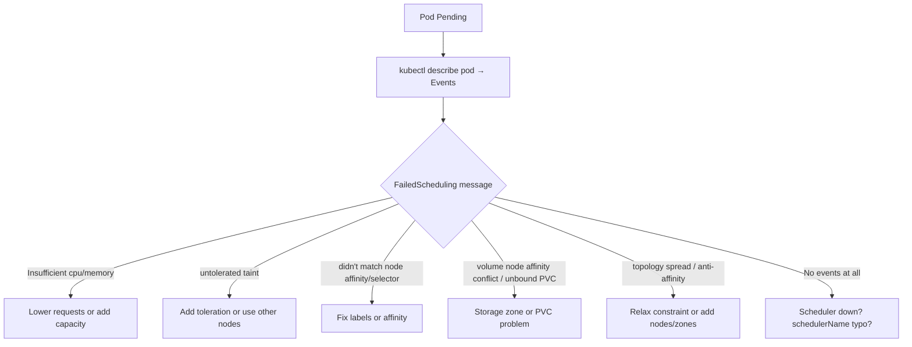

<!-- devopsshack:header -->
> ☸️ **Kubernetes Mastery: Zero to Production** · by **DevOps Shack** · [YouTube](https://www.youtube.com/@devopsshack) · [Hindi channel](https://www.youtube.com/@shackverse) · [devopsshack.com](https://devopsshack.com)
<!-- /devopsshack:header -->

# Playbook · Pod Stuck in Pending

## Symptom

`kubectl get pods` shows `Pending` for more than a few seconds. No node has been assigned (`NODE` column is `<none>`).

## Decision flow



## Likely causes

| Cause | How you recognise it |
|---|---|
| Not enough allocatable CPU/memory | `0/5 nodes are available: 5 Insufficient cpu` |
| Taints without tolerations | `node(s) had untolerated taint {dedicated: gpu}` |
| nodeSelector / affinity mismatch | `didn't match Pod's node affinity/selector` |
| PVC not bound or wrong zone | `pod has unbound immediate PersistentVolumeClaims`, `volume node affinity conflict` |
| Hard anti-affinity / spread constraints | `didn't match pod anti-affinity rules`, `didn't match pod topology spread constraints` |
| ResourceQuota (pod never created) | No pod at all; ReplicaSet events say `exceeded quota` |
| Custom scheduler not running | `spec.schedulerName` set, no events |

## Diagnose

```bash
kubectl describe pod <pod> | sed -n '/Events/,$p'
kubectl get pod <pod> -o jsonpath='{.spec.schedulerName} {.spec.nodeSelector} {.spec.tolerations}'; echo
kubectl describe nodes | grep -A8 "Allocated resources"
kubectl get nodes -o custom-columns=NAME:.metadata.name,TAINTS:.spec.taints[*].key
kubectl get nodes --show-labels | grep <expected-label>
kubectl get pvc -n <ns>
kubectl get events -n <ns> --field-selector reason=FailedScheduling
```

## Fix

- **Resources:** right-size requests (they're often copied from somewhere and far too high), or add nodes. Check the Cluster Autoscaler/Karpenter logs if nodes should have been added automatically.
- **Taints:** add the matching toleration, or remove the taint if it was left from maintenance (`kubectl taint node n key-`).
- **Affinity/selector:** fix the label on nodes or the selector in the pod spec.
- **Storage:** use `WaitForFirstConsumer`, fix the StorageClass name, or ensure nodes exist in the volume's zone.
- **Spread/anti-affinity:** switch hard rules to `ScheduleAnyway`/preferred, or add capacity in the missing zone.

## Prevent it next time

- Alert on pods Pending > 5 minutes.
- Base requests on measured usage (VPA recommendations).
- Keep spare headroom or fast node autoscaling for bursty workloads.

## Related

[Architecture 04 · Scheduler](../01-architecture/04-kube-scheduler.md) · [Module 12 · Scheduling](../02-modules/12-scheduling.md)

← [All playbooks](README.md)

<!-- devopsshack:footer -->
---

<p align="center">
  Made with ❤️ by <b><a href="https://devopsshack.com">DevOps Shack</a></b> · Part of <b>Kubernetes Mastery: Zero to Production</b><br/>
  <a href="https://www.youtube.com/@devopsshack">YouTube · DevOps Shack</a> · <a href="https://www.youtube.com/@shackverse">YouTube · DevOps Shack Hindi</a> · <a href="https://devopsshack.com">devopsshack.com</a> · <a href="https://www.instagram.com/devopsshack">Instagram · @devopsshack</a><br/>
  <sub>© DevOps Shack. Original content created by DevOps Shack. Free to learn from and share with credit to DevOps Shack. See <a href="../LICENSE">LICENSE</a>.</sub>
</p>
<!-- /devopsshack:footer -->
