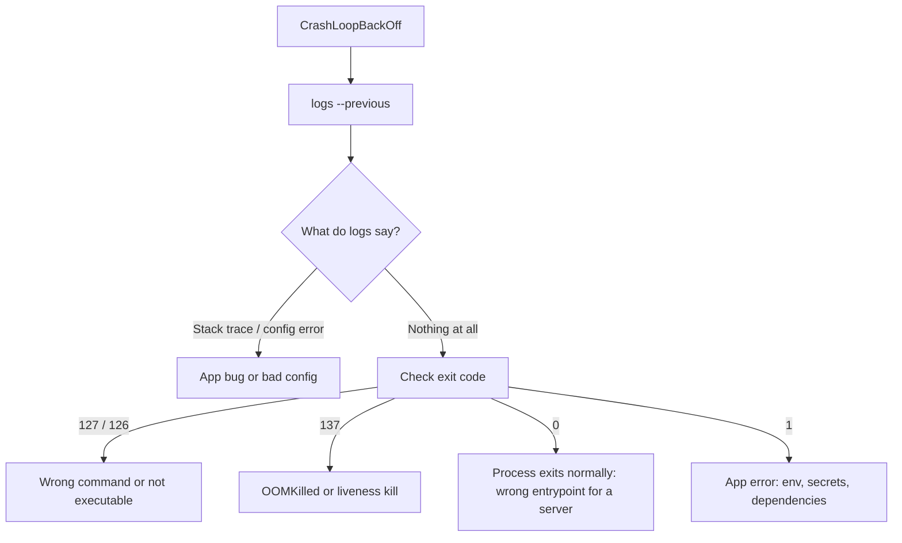

<!-- devopsshack:header -->
> ☸️ **Kubernetes Mastery: Zero to Production** · by **DevOps Shack** · [YouTube](https://www.youtube.com/@devopsshack) · [Hindi channel](https://www.youtube.com/@shackverse) · [devopsshack.com](https://devopsshack.com)
<!-- /devopsshack:header -->

# Playbook · CrashLoopBackOff

## Symptom

Pod status `CrashLoopBackOff`, restart count climbing. The container starts, exits, and the kubelet waits longer between each restart (10s, 20s, 40s... up to 5 minutes).

## Decision flow



## Likely causes

| Cause | How you recognise it |
|---|---|
| Missing/incorrect config or env var | Logs: `KeyError`, `missing required env`, `connection refused` to a dependency |
| Wrong command/args | Exit 127 `not found`, or 126 `permission denied` |
| OOMKilled | Last state `OOMKilled`, exit 137 |
| Liveness probe too aggressive | Events: `Liveness probe failed ... will be restarted` |
| Process exits 0 | Exit 0, reason `Completed`; a script that finishes instead of serving |
| Read-only filesystem / permissions | `EACCES`, `Read-only file system` after hardening |
| Architecture mismatch | `exec format error` (amd64 image on arm64 nodes) |

## Diagnose

```bash
kubectl logs <pod> -c <container> --previous
kubectl describe pod <pod> | grep -A10 "Last State"
kubectl get pod <pod> -o jsonpath='{.status.containerStatuses[*].lastState.terminated}'; echo
kubectl get pod <pod> -o yaml | grep -A5 -E "command|args"
# Keep the container alive to poke around:
kubectl debug <pod> -it --copy-to=dbg --container=<container> -- sh
# or override the command temporarily in a copy:
kubectl debug <pod> --copy-to=dbg --set-image=*=busybox:1.36 -- sleep 3600
```

## Fix

Fix the root cause the logs or exit code point to: supply the missing config, correct the command, raise the memory limit (after checking for leaks), relax or correct the liveness probe, add writable `emptyDir` mounts for paths the app writes to, or build a multi-arch image.

## Prevent it next time

- Fail fast with clear startup error messages in your app.
- Validate config in CI (schema checks) and use startup probes for slow starters.
- Alert on restart rate, not just on Pending/Failed.

## Related

[Pod lifecycle](../01-architecture/13-pod-lifecycle.md) · [OOMKilled](04-oomkilled.md)

← [All playbooks](README.md)

<!-- devopsshack:footer -->
---

<p align="center">
  Made with ❤️ by <b><a href="https://devopsshack.com">DevOps Shack</a></b> · Part of <b>Kubernetes Mastery: Zero to Production</b><br/>
  <a href="https://www.youtube.com/@devopsshack">YouTube · DevOps Shack</a> · <a href="https://www.youtube.com/@shackverse">YouTube · DevOps Shack Hindi</a> · <a href="https://devopsshack.com">devopsshack.com</a> · <a href="https://www.instagram.com/devopsshack">Instagram · @devopsshack</a><br/>
  <sub>© DevOps Shack. Original content created by DevOps Shack. Free to learn from and share with credit to DevOps Shack. See <a href="../LICENSE">LICENSE</a>.</sub>
</p>
<!-- /devopsshack:footer -->
