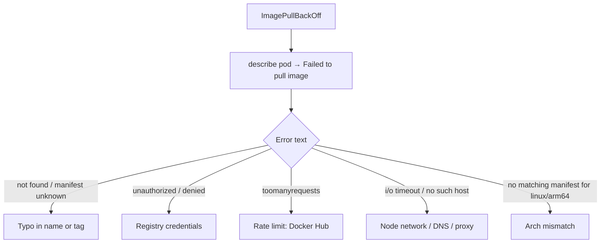

<!-- devopsshack:header -->
> ☸️ **Kubernetes Mastery: Zero to Production** · by **DevOps Shack** · [YouTube](https://www.youtube.com/@devopsshack) · [Hindi channel](https://www.youtube.com/@shackverse) · [devopsshack.com](https://devopsshack.com)
<!-- /devopsshack:header -->

# Playbook · ErrImagePull / ImagePullBackOff

## Symptom

Pod stuck with `ErrImagePull` then `ImagePullBackOff`. Containers never start.

## Decision flow



## Likely causes

| Cause | How you recognise it |
|---|---|
| Typo in image or tag | `manifest unknown`, `not found` |
| Private registry, no/incorrect imagePullSecret | `401 Unauthorized`, `pull access denied` |
| Cloud IAM for registry missing | ECR/ACR/GAR `denied` on nodes without registry permissions |
| Docker Hub rate limits | `toomanyrequests: You have reached your pull rate limit` |
| Network egress blocked | `dial tcp: i/o timeout`, private cluster without NAT/VPC endpoint |
| Wrong architecture | `no matching manifest for linux/arm64` |

## Diagnose

```bash
kubectl describe pod <pod> | grep -A3 -i "failed to pull"
kubectl get pod <pod> -o jsonpath='{.spec.containers[*].image} {.spec.imagePullSecrets}'; echo
kubectl get secret <pull-secret> -o jsonpath='{.data.\.dockerconfigjson}' | base64 -d | jq '.auths | keys'
kubectl get sa <sa> -o yaml | grep -A2 imagePullSecrets
# From a node:
kubectl debug node/<node> -it --image=ubuntu -- chroot /host crictl pull <image>
```

## Fix

- Correct the image reference (check the registry UI for the exact tag).
- Create the pull secret in **the pod's namespace** and reference it in the pod or ServiceAccount: `kubectl create secret docker-registry regcred --docker-server=... --docker-username=... --docker-password=...`.
- Grant node IAM roles registry read access (EKS: `AmazonEC2ContainerRegistryReadOnly`).
- Use a pull-through cache / mirror for Docker Hub.
- Build multi-arch images (`docker buildx build --platform linux/amd64,linux/arm64`).

## Prevent it next time

- Pin images by tag + digest, promote the same digest through environments.
- Mirror third-party images into your own registry.
- Admission policy restricting images to approved registries.

← [All playbooks](README.md)

<!-- devopsshack:footer -->
---

<p align="center">
  Made with ❤️ by <b><a href="https://devopsshack.com">DevOps Shack</a></b> · Part of <b>Kubernetes Mastery: Zero to Production</b><br/>
  <a href="https://www.youtube.com/@devopsshack">YouTube · DevOps Shack</a> · <a href="https://www.youtube.com/@shackverse">YouTube · DevOps Shack Hindi</a> · <a href="https://devopsshack.com">devopsshack.com</a> · <a href="https://www.instagram.com/devopsshack">Instagram · @devopsshack</a><br/>
  <sub>© DevOps Shack. Original content created by DevOps Shack. Free to learn from and share with credit to DevOps Shack. See <a href="../LICENSE">LICENSE</a>.</sub>
</p>
<!-- /devopsshack:footer -->
