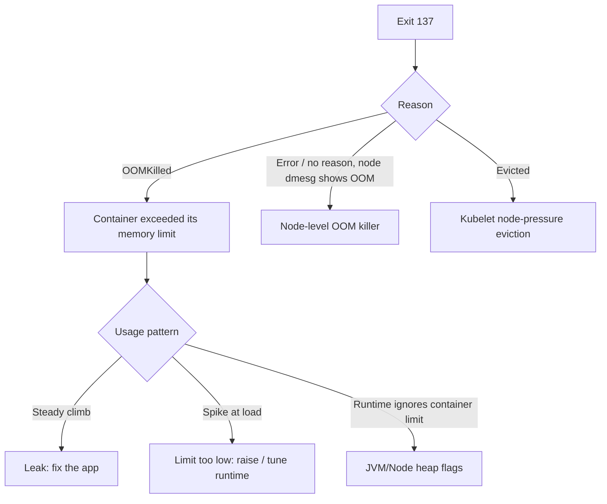

<!-- devopsshack:header -->
> ☸️ **Kubernetes Mastery: Zero to Production** · by **DevOps Shack** · [YouTube](https://www.youtube.com/@devopsshack) · [Hindi channel](https://www.youtube.com/@shackverse) · [devopsshack.com](https://devopsshack.com)
<!-- /devopsshack:header -->

# Playbook · OOMKilled (Exit Code 137)

## Symptom

Container restarts with `Last State: Terminated, Reason: OOMKilled, Exit Code: 137`. Sometimes the whole pod is `Evicted` instead.

## Decision flow



## Likely causes

| Cause | How you recognise it |
|---|---|
| Limit too low for real usage | Memory graph flat near the limit, kills under load |
| Memory leak | Usage grows steadily until killed, then repeats |
| Runtime not container-aware | JVM/Node default heap larger than the container limit |
| tmpfs/emptyDir medium Memory counts toward limit | Large files written to memory-backed volumes |
| Node overcommitted | Node OOM: dmesg shows kills of random containers; memory requests far below usage |

## Diagnose

```bash
kubectl describe pod <pod> | grep -A6 "Last State"
kubectl top pod <pod> --containers
kubectl get pod <pod> -o jsonpath='{.spec.containers[*].resources}'; echo
# PromQL: working set vs limit over time
# container_memory_working_set_bytes{pod="<pod>"} / on(pod) kube_pod_container_resource_limits{resource="memory",pod="<pod>"}
kubectl debug node/<node> -it --image=ubuntu -- chroot /host dmesg -T | grep -i -E "killed process|oom"
```

## Fix

- Measure peak working set under realistic load and set the limit with headroom (often 1.2–1.5× peak).
- Make runtimes respect the limit: `-XX:MaxRAMPercentage=75`, `NODE_OPTIONS=--max-old-space-size=...`, `GOMEMLIMIT`.
- Fix leaks (heap dumps: `kubectl cp` them out of the pod).
- Set memory requests close to real usage so nodes aren't overcommitted.

## Prevent it next time

- Alert on working set > 90% of limit.
- Load-test memory before release.
- Use VPA recommendations in `Off` mode as a sanity check.

## Related

[Module 10 · Resource Management](../02-modules/10-resource-management.md)

← [All playbooks](README.md)

<!-- devopsshack:footer -->
---

<p align="center">
  Made with ❤️ by <b><a href="https://devopsshack.com">DevOps Shack</a></b> · Part of <b>Kubernetes Mastery: Zero to Production</b><br/>
  <a href="https://www.youtube.com/@devopsshack">YouTube · DevOps Shack</a> · <a href="https://www.youtube.com/@shackverse">YouTube · DevOps Shack Hindi</a> · <a href="https://devopsshack.com">devopsshack.com</a> · <a href="https://www.instagram.com/devopsshack">Instagram · @devopsshack</a><br/>
  <sub>© DevOps Shack. Original content created by DevOps Shack. Free to learn from and share with credit to DevOps Shack. See <a href="../LICENSE">LICENSE</a>.</sub>
</p>
<!-- /devopsshack:footer -->
