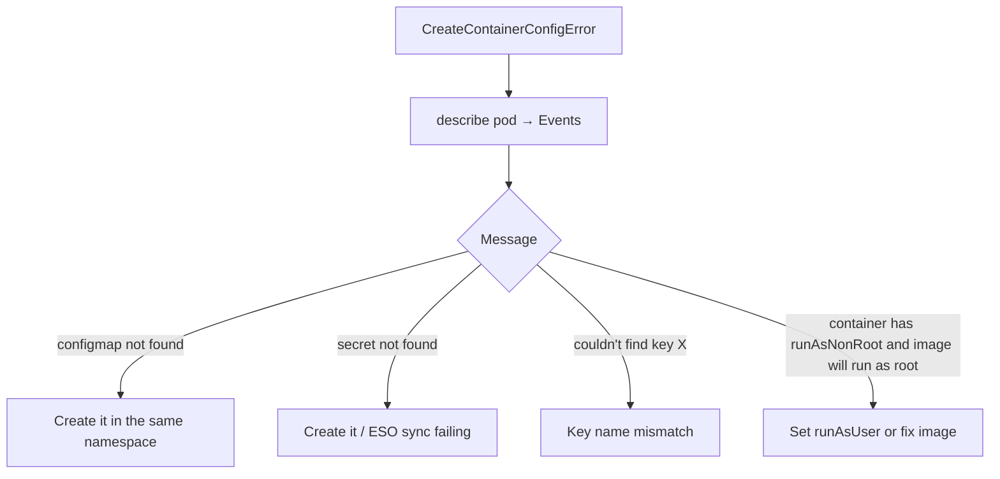

<!-- devopsshack:header -->
> ☸️ **Kubernetes Mastery: Zero to Production** · by **DevOps Shack** · [YouTube](https://www.youtube.com/@devopsshack) · [Hindi channel](https://www.youtube.com/@shackverse) · [devopsshack.com](https://devopsshack.com)
<!-- /devopsshack:header -->

# Playbook · CreateContainerConfigError

## Symptom

Pod status `CreateContainerConfigError`. The image pulled fine but the container can't be created.

## Decision flow



## Likely causes

| Cause | How you recognise it |
|---|---|
| Referenced ConfigMap/Secret missing | `configmap "app-config" not found` |
| Key missing in an existing object | `couldn't find key DATABASE_URL in ConfigMap` |
| Object in another namespace | Exists, but not in the pod's namespace |
| External Secrets not synced yet | ExternalSecret status shows an error |
| runAsNonRoot with a root image | `container has runAsNonRoot and image will run as root` |

## Diagnose

```bash
kubectl describe pod <pod> | tail -10
kubectl get configmap,secret -n <ns>
kubectl get configmap <name> -n <ns> -o jsonpath='{.data}' | jq 'keys'
kubectl get externalsecret -n <ns>
```

## Fix

Create or fix the referenced object/key in the pod's namespace, fix the ExternalSecret, or set `runAsUser` to a non-zero UID (or use an image built to run as non-root). Mark optional references with `optional: true` when the app can run without them.

## Prevent it next time

- Deploy config and workloads together (same Helm release / Kustomize overlay / Argo CD sync wave ordering).
- Use `configMapGenerator` or checksums so config and code move together.

← [All playbooks](README.md)

<!-- devopsshack:footer -->
---

<p align="center">
  Made with ❤️ by <b><a href="https://devopsshack.com">DevOps Shack</a></b> · Part of <b>Kubernetes Mastery: Zero to Production</b><br/>
  <a href="https://www.youtube.com/@devopsshack">YouTube · DevOps Shack</a> · <a href="https://www.youtube.com/@shackverse">YouTube · DevOps Shack Hindi</a> · <a href="https://devopsshack.com">devopsshack.com</a> · <a href="https://www.instagram.com/devopsshack">Instagram · @devopsshack</a><br/>
  <sub>© DevOps Shack. Original content created by DevOps Shack. Free to learn from and share with credit to DevOps Shack. See <a href="../LICENSE">LICENSE</a>.</sub>
</p>
<!-- /devopsshack:footer -->
