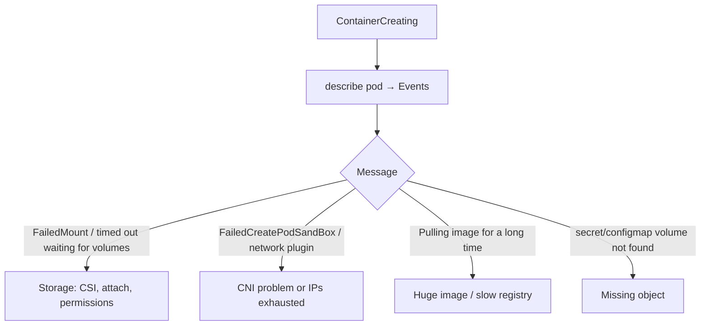

<!-- devopsshack:header -->
> ☸️ **Kubernetes Mastery: Zero to Production** · by **DevOps Shack** · [YouTube](https://www.youtube.com/@devopsshack) · [Hindi channel](https://www.youtube.com/@shackverse) · [devopsshack.com](https://devopsshack.com)
<!-- /devopsshack:header -->

# Playbook · Pod Stuck in ContainerCreating

## Symptom

Pod is scheduled (has a node) but stays in `ContainerCreating` for minutes.

## Decision flow



## Likely causes

| Cause | How you recognise it |
|---|---|
| Volume attach/mount failing | `FailedAttachVolume`, `FailedMount`, `Multi-Attach error` |
| CNI not ready or out of IPs | `failed to setup network for sandbox`, `failed to assign an IP address` |
| Very large image | `Pulling image` for minutes |
| Missing Secret/ConfigMap volume | `MountVolume.SetUp failed ... not found` |
| Slow fsGroup chown on big volumes | Mount succeeds but pod start takes minutes |

## Diagnose

```bash
kubectl describe pod <pod> | sed -n '/Events/,$p'
kubectl get volumeattachments | grep <pv>
kubectl -n kube-system get pods -o wide | grep -E "csi|cni|calico|cilium|aws-node"
kubectl -n kube-system logs -l app=ebs-csi-node -c ebs-plugin --tail=50     # example
kubectl -n kube-system logs ds/aws-node --tail=50                            # VPC CNI example
```

## Fix

- **CSI:** make sure the CSI node DaemonSet runs on that node, IAM permissions exist, and stale VolumeAttachments are cleaned up after node failures.
- **CNI:** restart failed CNI pods; on VPC CNI enable prefix delegation or add subnet space; check the node's max pods.
- **Images:** slim images; pre-pull critical images; use image streaming/lazy pull where available.
- **fsGroup:** set `fsGroupChangePolicy: OnRootMismatch`.

## Prevent it next time

- Monitor CNI/CSI DaemonSets like production services.
- Track subnet IP availability.

## Related

[Multi-Attach error](15-multi-attach-error.md) · [Architecture 09 · CNI](../01-architecture/09-pod-networking-cni.md)

← [All playbooks](README.md)

<!-- devopsshack:footer -->
---

<p align="center">
  Made with ❤️ by <b><a href="https://devopsshack.com">DevOps Shack</a></b> · Part of <b>Kubernetes Mastery: Zero to Production</b><br/>
  <a href="https://www.youtube.com/@devopsshack">YouTube · DevOps Shack</a> · <a href="https://www.youtube.com/@shackverse">YouTube · DevOps Shack Hindi</a> · <a href="https://devopsshack.com">devopsshack.com</a> · <a href="https://www.instagram.com/devopsshack">Instagram · @devopsshack</a><br/>
  <sub>© DevOps Shack. Original content created by DevOps Shack. Free to learn from and share with credit to DevOps Shack. See <a href="../LICENSE">LICENSE</a>.</sub>
</p>
<!-- /devopsshack:footer -->
