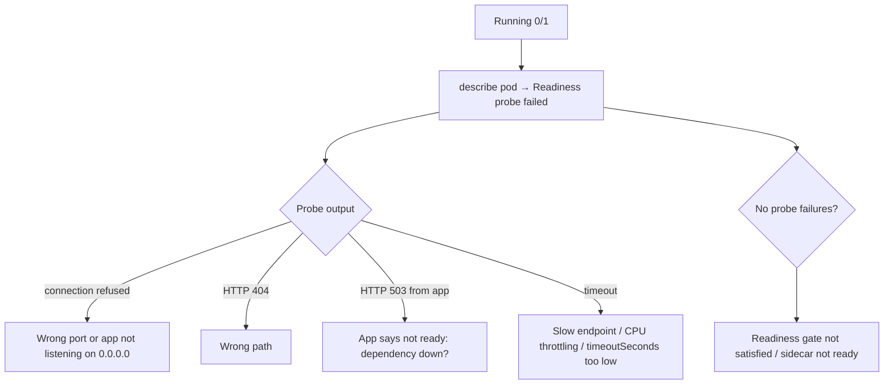

<!-- devopsshack:header -->
> ☸️ **Kubernetes Mastery: Zero to Production** · by **DevOps Shack** · [YouTube](https://www.youtube.com/@devopsshack) · [Hindi channel](https://www.youtube.com/@shackverse) · [devopsshack.com](https://devopsshack.com)
<!-- /devopsshack:header -->

# Playbook · Running but Not Ready (0/1)

## Symptom

Pod is `Running` but `READY 0/1`. It receives no Service traffic; rollouts stall.

## Decision flow



## Likely causes

| Cause | How you recognise it |
|---|---|
| Probe port/path wrong | `connection refused`, `404` |
| App bound to 127.0.0.1 | Works via exec curl localhost, fails from probe IP |
| Dependency unavailable | App readiness returns 503 when DB is down (by design) |
| Timeout too short / throttled CPU | `context deadline exceeded` |
| Readiness gate pending | Condition from LB controller not True |

## Diagnose

```bash
kubectl describe pod <pod> | grep -i -A2 readiness
kubectl get pod <pod> -o jsonpath='{.status.conditions}' | jq
kubectl exec <pod> -- sh -c 'netstat -tlnp 2>/dev/null || ss -tlnp'
kubectl exec <pod> -- wget -qO- -T 2 localhost:<port><path>
kubectl logs <pod> --tail=50
```

## Fix

Fix the probe to match the app (port name, path, `timeoutSeconds`), make the app listen on `0.0.0.0`, or fix the dependency. If readiness fails because a shared dependency is down, that's correct behaviour; fix the dependency.

## Prevent it next time

- Test probes in CI (start the container, hit the endpoints).
- Use named ports so probes and Services move together.

← [All playbooks](README.md)

<!-- devopsshack:footer -->
---

<p align="center">
  Made with ❤️ by <b><a href="https://devopsshack.com">DevOps Shack</a></b> · Part of <b>Kubernetes Mastery: Zero to Production</b><br/>
  <a href="https://www.youtube.com/@devopsshack">YouTube · DevOps Shack</a> · <a href="https://www.youtube.com/@shackverse">YouTube · DevOps Shack Hindi</a> · <a href="https://devopsshack.com">devopsshack.com</a> · <a href="https://www.instagram.com/devopsshack">Instagram · @devopsshack</a><br/>
  <sub>© DevOps Shack. Original content created by DevOps Shack. Free to learn from and share with credit to DevOps Shack. See <a href="../LICENSE">LICENSE</a>.</sub>
</p>
<!-- /devopsshack:footer -->
