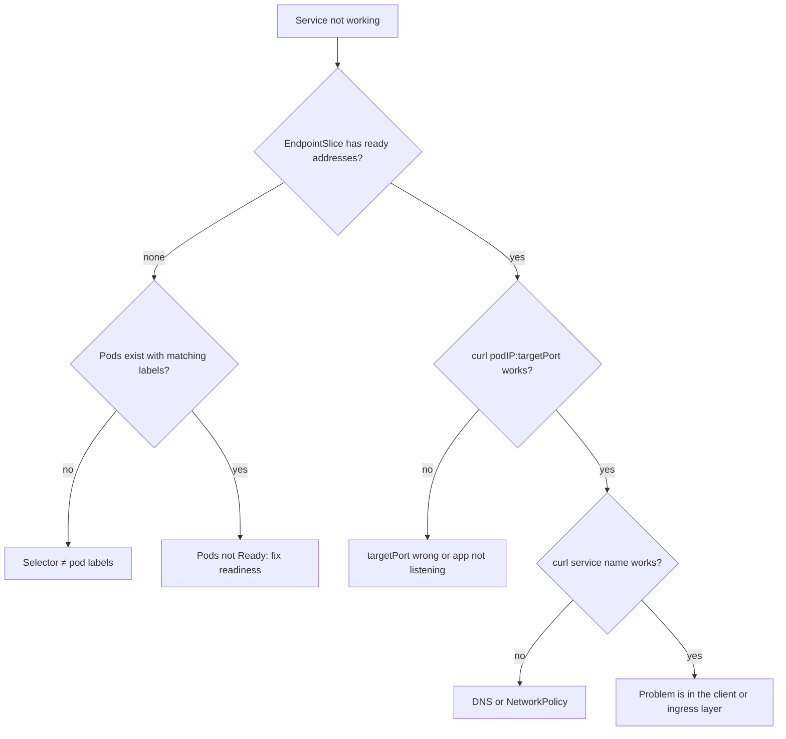

<!-- devopsshack:header -->
> ☸️ **Kubernetes Mastery: Zero to Production** · by **DevOps Shack** · [YouTube](https://www.youtube.com/@devopsshack) · [Hindi channel](https://www.youtube.com/@shackverse) · [devopsshack.com](https://devopsshack.com)
<!-- /devopsshack:header -->

# Playbook · Service Has No Endpoints / Connection Refused

## Symptom

Clients get `connection refused`, `no healthy upstream`, `503`, or timeouts calling a Service. `kubectl get endpointslices` shows no ready addresses.

## Decision flow



## Likely causes

| Cause | How you recognise it |
|---|---|
| Selector doesn't match labels | No endpoints; `kubectl get pods -l <selector>` empty |
| Pods not ready | Endpoints listed as not ready |
| targetPort mismatch | Endpoints exist; connection refused to pod IP on that port |
| App listening on localhost only | Refused from other pods, fine via exec |
| NetworkPolicy blocks | Timeouts rather than refused |
| Wrong namespace in client | `svc` resolves only in its namespace |

## Diagnose

```bash
kubectl get svc <svc> -n <ns> -o jsonpath='{.spec.selector} {.spec.ports}'; echo
kubectl get pods -n <ns> -l <key>=<value> -o wide
kubectl get endpointslices -n <ns> -l kubernetes.io/service-name=<svc> -o yaml | grep -E "addresses|ready|port"
kubectl run t --rm -it -n <ns> --image=nicolaka/netshoot -- bash -c 'curl -sv <podIP>:<targetPort>; curl -sv <svc>:<port>'
```

## Fix

Align selector and labels, fix readiness, set `targetPort` to the container's named port, make the app bind `0.0.0.0`, or add the NetworkPolicy allow rule.

## Prevent it next time

- Use named ports.
- Add a synthetic check per Service.

## Related

[Module 05 · Services](../02-modules/05-services.md) · [Architecture 08](../01-architecture/08-kube-proxy-and-services.md)

← [All playbooks](README.md)

<!-- devopsshack:footer -->
---

<p align="center">
  Made with ❤️ by <b><a href="https://devopsshack.com">DevOps Shack</a></b> · Part of <b>Kubernetes Mastery: Zero to Production</b><br/>
  <a href="https://www.youtube.com/@devopsshack">YouTube · DevOps Shack</a> · <a href="https://www.youtube.com/@shackverse">YouTube · DevOps Shack Hindi</a> · <a href="https://devopsshack.com">devopsshack.com</a> · <a href="https://www.instagram.com/devopsshack">Instagram · @devopsshack</a><br/>
  <sub>© DevOps Shack. Original content created by DevOps Shack. Free to learn from and share with credit to DevOps Shack. See <a href="../LICENSE">LICENSE</a>.</sub>
</p>
<!-- /devopsshack:footer -->
