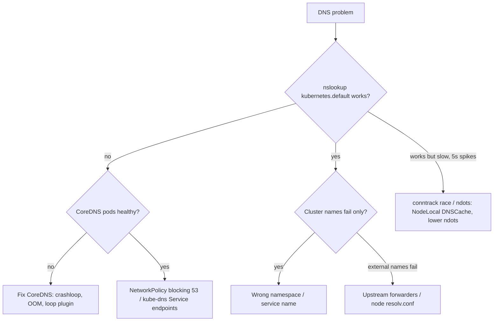

<!-- devopsshack:header -->
> ☸️ **Kubernetes Mastery: Zero to Production** · by **DevOps Shack** · [YouTube](https://www.youtube.com/@devopsshack) · [Hindi channel](https://www.youtube.com/@shackverse) · [devopsshack.com](https://devopsshack.com)
<!-- /devopsshack:header -->

# Playbook · DNS Failures & Slow DNS

## Symptom

`could not resolve host`, `NXDOMAIN`, `i/o timeout` on port 53, or intermittent 5-second delays on outbound calls.

## Decision flow



## Likely causes

| Cause | How you recognise it |
|---|---|
| CoreDNS down or overloaded | CoreDNS pods restarting; SERVFAIL rate up |
| Egress NetworkPolicy without DNS allow | Timeouts to 10.96.0.10:53 from policy-selected pods |
| Wrong name / namespace | NXDOMAIN for a name that exists in another namespace |
| Upstream DNS unreachable | Cluster names resolve, internet names fail |
| ndots:5 amplification | Many NXDOMAIN queries per lookup; high latency |
| UDP conntrack race | Intermittent ~5 s delays |

## Diagnose

```bash
kubectl run dns --rm -it --image=nicolaka/netshoot -- bash
  cat /etc/resolv.conf
  nslookup kubernetes.default
  dig +search <svc> ; dig <svc>.<ns>.svc.cluster.local ; dig google.com
kubectl -n kube-system get pods -l k8s-app=kube-dns -o wide
kubectl -n kube-system logs -l k8s-app=kube-dns --tail=100
kubectl -n kube-system get endpointslices -l kubernetes.io/service-name=kube-dns
kubectl -n kube-system get configmap coredns -o yaml
```

## Fix

- Scale/resource CoreDNS; add a PDB and anti-affinity.
- Allow UDP+TCP 53 to `k8s-app: kube-dns` in egress policies.
- Fix forwarders in the Corefile; check node `/etc/resolv.conf`.
- Deploy NodeLocal DNSCache; lower `ndots` or use FQDNs with a trailing dot.

## Prevent it next time

- Monitor CoreDNS latency and SERVFAIL/NXDOMAIN rates.
- Include DNS in every egress policy template.

## Related

[Architecture 10 · DNS](../01-architecture/10-dns-coredns.md)

← [All playbooks](README.md)

<!-- devopsshack:footer -->
---

<p align="center">
  Made with ❤️ by <b><a href="https://devopsshack.com">DevOps Shack</a></b> · Part of <b>Kubernetes Mastery: Zero to Production</b><br/>
  <a href="https://www.youtube.com/@devopsshack">YouTube · DevOps Shack</a> · <a href="https://www.youtube.com/@shackverse">YouTube · DevOps Shack Hindi</a> · <a href="https://devopsshack.com">devopsshack.com</a> · <a href="https://www.instagram.com/devopsshack">Instagram · @devopsshack</a><br/>
  <sub>© DevOps Shack. Original content created by DevOps Shack. Free to learn from and share with credit to DevOps Shack. See <a href="../LICENSE">LICENSE</a>.</sub>
</p>
<!-- /devopsshack:footer -->
