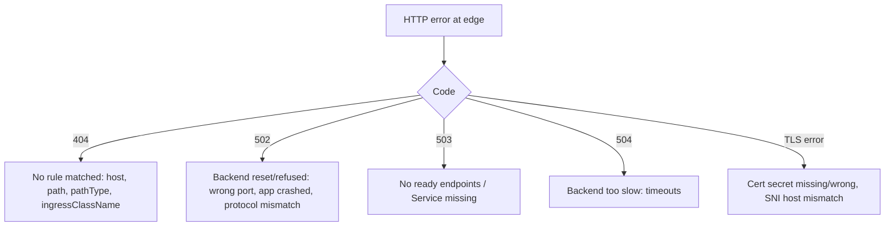

<!-- devopsshack:header -->
> ☸️ **Kubernetes Mastery: Zero to Production** · by **DevOps Shack** · [YouTube](https://www.youtube.com/@devopsshack) · [Hindi channel](https://www.youtube.com/@shackverse) · [devopsshack.com](https://devopsshack.com)
<!-- /devopsshack:header -->

# Playbook · Ingress / Gateway Returns 404, 502, 503 or 504

## Symptom

External requests fail with HTTP errors from the ingress controller or gateway rather than from your app.

## Decision flow



## Likely causes

| Cause | How you recognise it |
|---|---|
| Host/path doesn't match | 404 from controller default backend |
| Missing or wrong ingressClassName | Ingress ignored; no ADDRESS |
| Service port wrong | 502/503; controller logs show upstream connect errors |
| No ready pods | 503 `no healthy upstream` |
| HTTP vs HTTPS/gRPC backend mismatch | 502 with protocol errors |
| Timeouts too low | 504 on slow endpoints |
| Gateway route not accepted | HTTPRoute status `Accepted=False` or `ResolvedRefs=False` |

## Diagnose

```bash
kubectl get ingress -A; kubectl describe ingress <name> -n <ns>
kubectl get ingressclass
kubectl get gateway,httproute -A; kubectl describe httproute <name> -n <ns>
kubectl get endpointslices -n <ns> -l kubernetes.io/service-name=<svc>
kubectl -n <controller-ns> logs deploy/<controller> --tail=100 | grep -i -E "error|upstream"
curl -v -H "Host: app.example.com" http://<lb-address>/path
```

## Fix

Fix the rule (host/path/pathType/class), the backend Service name/port, readiness, the backend protocol annotation/appProtocol, or the timeouts. For Gateway API, read the route's status conditions: they tell you exactly what's wrong.

## Prevent it next time

- Synthetic checks from outside the cluster.
- Dashboards on controller 4xx/5xx by host and route.

## Related

[Architecture 16](../01-architecture/16-ingress-gateway-traffic.md) · [Module 14](../02-modules/14-ingress-gateway-api.md)

← [All playbooks](README.md)

<!-- devopsshack:footer -->
---

<p align="center">
  Made with ❤️ by <b><a href="https://devopsshack.com">DevOps Shack</a></b> · Part of <b>Kubernetes Mastery: Zero to Production</b><br/>
  <a href="https://www.youtube.com/@devopsshack">YouTube · DevOps Shack</a> · <a href="https://www.youtube.com/@shackverse">YouTube · DevOps Shack Hindi</a> · <a href="https://devopsshack.com">devopsshack.com</a> · <a href="https://www.instagram.com/devopsshack">Instagram · @devopsshack</a><br/>
  <sub>© DevOps Shack. Original content created by DevOps Shack. Free to learn from and share with credit to DevOps Shack. See <a href="../LICENSE">LICENSE</a>.</sub>
</p>
<!-- /devopsshack:footer -->
