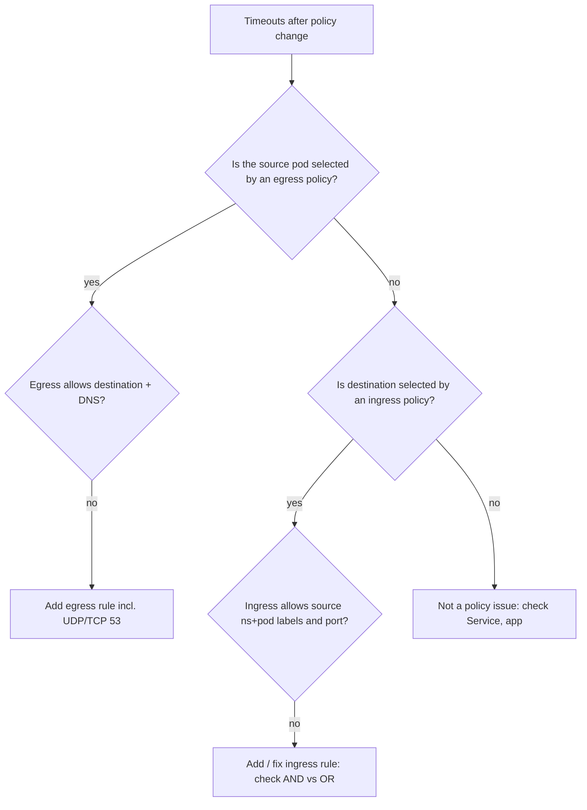

<!-- devopsshack:header -->
> ☸️ **Kubernetes Mastery: Zero to Production** · by **DevOps Shack** · [YouTube](https://www.youtube.com/@devopsshack) · [Hindi channel](https://www.youtube.com/@shackverse) · [devopsshack.com](https://devopsshack.com)
<!-- /devopsshack:header -->

# Playbook · NetworkPolicy Blocking Traffic

## Symptom

Connections time out (not refused) after NetworkPolicies were added or changed. Often DNS breaks too.

## Decision flow



## Likely causes

| Cause | How you recognise it |
|---|---|
| Default deny without DNS allow | Every name lookup times out |
| Labels in policy don't match | Policy looks right but selects nothing |
| namespaceSelector without namespace labels | Using a custom label that the namespace doesn't have; use `kubernetes.io/metadata.name` |
| AND vs OR confusion | Too much or too little allowed |
| Port is the Service port, not container port | Policies match the **pod** port |
| Egress to API server or metadata blocked | Operators/controllers failing after lockdown |

## Diagnose

```bash
kubectl get networkpolicy -n <ns> -o wide
kubectl describe networkpolicy <name> -n <ns>
kubectl get pods -n <ns> --show-labels; kubectl get ns --show-labels
kubectl run t -n <src-ns> --rm -it --image=nicolaka/netshoot -l <src-labels> -- curl -m 3 -sv <dst>
# Cilium:
hubble observe --verdict DROPPED -n <ns>
# Calico:
kubectl -n calico-system logs ds/calico-node --tail=50
```

## Fix

Add the narrowest rule that permits the required flow: correct selectors, pod ports, DNS egress, and API-server egress (to the kubernetes Service endpoints / control plane CIDR) for controllers that need it.

## Prevent it next time

- Policy templates per namespace, generated automatically.
- Test policies with a connectivity matrix in CI (e.g. Cyclonus, netassert).
- Use policy visualisation (Hubble UI, Calico flow logs).

## Related

[Module 15](../02-modules/15-network-policies.md)

← [All playbooks](README.md)

<!-- devopsshack:footer -->
---

<p align="center">
  Made with ❤️ by <b><a href="https://devopsshack.com">DevOps Shack</a></b> · Part of <b>Kubernetes Mastery: Zero to Production</b><br/>
  <a href="https://www.youtube.com/@devopsshack">YouTube · DevOps Shack</a> · <a href="https://www.youtube.com/@shackverse">YouTube · DevOps Shack Hindi</a> · <a href="https://devopsshack.com">devopsshack.com</a> · <a href="https://www.instagram.com/devopsshack">Instagram · @devopsshack</a><br/>
  <sub>© DevOps Shack. Original content created by DevOps Shack. Free to learn from and share with credit to DevOps Shack. See <a href="../LICENSE">LICENSE</a>.</sub>
</p>
<!-- /devopsshack:footer -->
