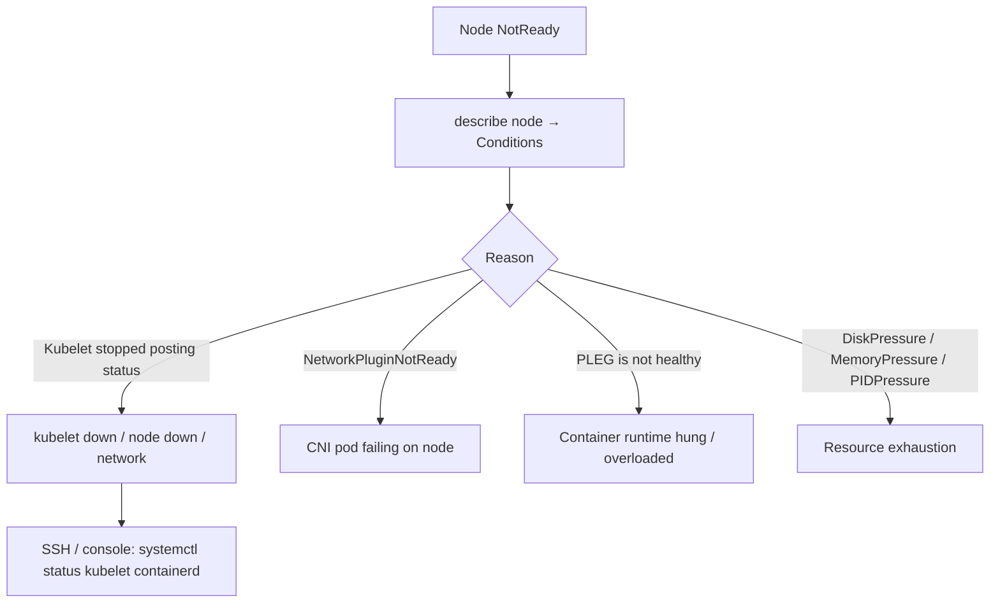

<!-- devopsshack:header -->
> ☸️ **Kubernetes Mastery: Zero to Production** · by **DevOps Shack** · [YouTube](https://www.youtube.com/@devopsshack) · [Hindi channel](https://www.youtube.com/@shackverse) · [devopsshack.com](https://devopsshack.com)
<!-- /devopsshack:header -->

# Playbook · Node NotReady

## Symptom

`kubectl get nodes` shows `NotReady`. Pods on it may show `Unknown`/`Terminating`; after ~5 minutes they're evicted and rescheduled.

## Decision flow



## Likely causes

| Cause | How you recognise it |
|---|---|
| kubelet crashed or misconfigured | `journalctl -u kubelet` errors, expired client cert |
| Container runtime unhealthy | `PLEG is not healthy`, containerd unresponsive |
| CNI not ready | `NetworkPluginNotReady`, CNI pod CrashLoop |
| Node out of resources | Pressure conditions true; OOM in dmesg |
| Network partition | Node fine locally but can't reach API server |
| Instance terminated / stopped | Cloud console shows instance gone |

## Diagnose

```bash
kubectl describe node <node> | sed -n '/Conditions/,/Addresses/p'
kubectl get pods -A -o wide --field-selector spec.nodeName=<node>
kubectl get lease -n kube-node-lease <node> -o yaml | grep renewTime
# On the node (SSH, SSM, or kubectl debug if it still works):
systemctl status kubelet containerd
journalctl -u kubelet --since "30 min ago" | tail -100
crictl info >/dev/null && echo runtime-ok
df -h; free -m; dmesg -T | tail -50
```

## Fix

Restart or fix the kubelet/runtime, renew certificates, repair the CNI, free disk (images, logs), or replace the node. In cloud environments, replacing an unhealthy node is usually faster and safer than repairing it: cordon, drain (if reachable), terminate, let the node group recreate it.

## Prevent it next time

- Node auto-repair (managed node groups, Karpenter, node problem detector + remediation).
- Reserve resources for system daemons (`kube-reserved`, `system-reserved`).
- Alert on NotReady > 2 minutes.

← [All playbooks](README.md)

<!-- devopsshack:footer -->
---

<p align="center">
  Made with ❤️ by <b><a href="https://devopsshack.com">DevOps Shack</a></b> · Part of <b>Kubernetes Mastery: Zero to Production</b><br/>
  <a href="https://www.youtube.com/@devopsshack">YouTube · DevOps Shack</a> · <a href="https://www.youtube.com/@shackverse">YouTube · DevOps Shack Hindi</a> · <a href="https://devopsshack.com">devopsshack.com</a> · <a href="https://www.instagram.com/devopsshack">Instagram · @devopsshack</a><br/>
  <sub>© DevOps Shack. Original content created by DevOps Shack. Free to learn from and share with credit to DevOps Shack. See <a href="../LICENSE">LICENSE</a>.</sub>
</p>
<!-- /devopsshack:footer -->
