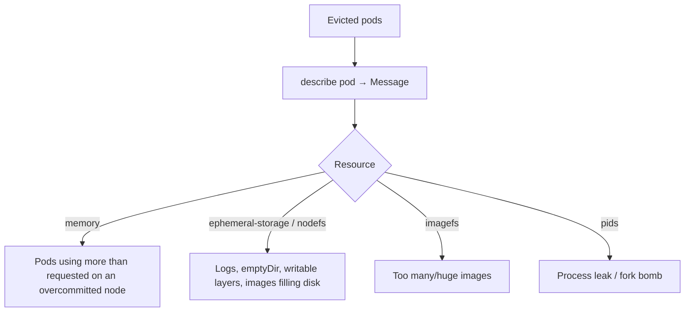

<!-- devopsshack:header -->
> ☸️ **Kubernetes Mastery: Zero to Production** · by **DevOps Shack** · [YouTube](https://www.youtube.com/@devopsshack) · [Hindi channel](https://www.youtube.com/@shackverse) · [devopsshack.com](https://devopsshack.com)
<!-- /devopsshack:header -->

# Playbook · Evictions & Node Pressure

## Symptom

Pods show status `Evicted` (often many at once). Node conditions report `MemoryPressure`, `DiskPressure` or `PIDPressure`.

## Decision flow



## Likely causes

| Cause | How you recognise it |
|---|---|
| Memory overcommit | Usage far above requests across pods; BestEffort evicted first |
| Disk full from logs or emptyDir | `The node was low on resource: ephemeral-storage` |
| Image bloat | imagefs pressure; image GC thrashing |
| PID exhaustion | `PIDPressure`, `fork: retry: Resource temporarily unavailable` |

## Diagnose

```bash
kubectl get pods -A --field-selector status.phase=Failed | grep Evicted
kubectl describe pod <evicted-pod> | grep -i message
kubectl describe node <node> | grep -E "Pressure|ephemeral|Allocated" -A3
kubectl top pods -A --sort-by=memory | head
# On the node:
du -sh /var/log/pods/* | sort -h | tail; crictl images | sort -k4 -h | tail
```

## Fix

- Set memory requests near real usage (stop overcommitting); give important pods Guaranteed QoS.
- Add `ephemeral-storage` requests/limits and `emptyDir.sizeLimit`; fix chatty logging; ensure log rotation.
- Larger root volumes; image GC thresholds; slimmer images.
- Set `podPidsLimit`.
- Clean up evicted pod objects: `kubectl delete pods -A --field-selector status.phase=Failed`.

## Prevent it next time

- Alert on node pressure conditions and disk > 80%.
- Enforce requests via LimitRange.

← [All playbooks](README.md)

<!-- devopsshack:footer -->
---

<p align="center">
  Made with ❤️ by <b><a href="https://devopsshack.com">DevOps Shack</a></b> · Part of <b>Kubernetes Mastery: Zero to Production</b><br/>
  <a href="https://www.youtube.com/@devopsshack">YouTube · DevOps Shack</a> · <a href="https://www.youtube.com/@shackverse">YouTube · DevOps Shack Hindi</a> · <a href="https://devopsshack.com">devopsshack.com</a> · <a href="https://www.instagram.com/devopsshack">Instagram · @devopsshack</a><br/>
  <sub>© DevOps Shack. Original content created by DevOps Shack. Free to learn from and share with credit to DevOps Shack. See <a href="../LICENSE">LICENSE</a>.</sub>
</p>
<!-- /devopsshack:footer -->
