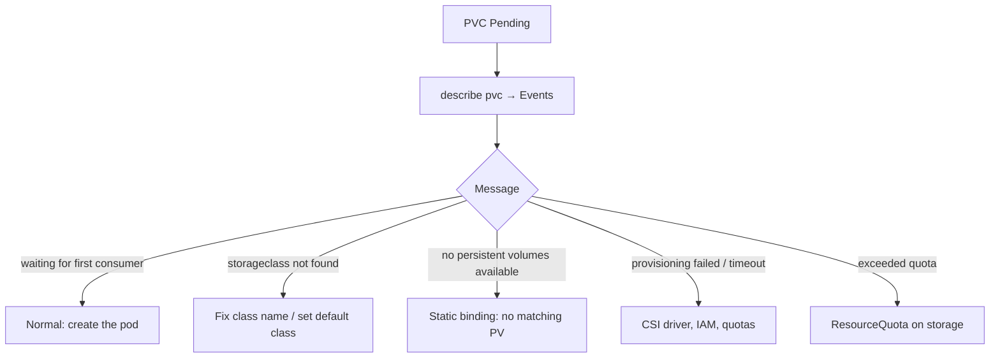

<!-- devopsshack:header -->
> ☸️ **Kubernetes Mastery: Zero to Production** · by **DevOps Shack** · [YouTube](https://www.youtube.com/@devopsshack) · [Hindi channel](https://www.youtube.com/@shackverse) · [devopsshack.com](https://devopsshack.com)
<!-- /devopsshack:header -->

# Playbook · PVC Stuck in Pending

## Symptom

`kubectl get pvc` shows `Pending`. Pods using it are Pending or stuck in ContainerCreating.

## Decision flow



## Likely causes

| Cause | How you recognise it |
|---|---|
| WaitForFirstConsumer | Normal until a pod uses it |
| StorageClass missing / no default | `storageclass.storage.k8s.io "x" not found` |
| No matching static PV | Size, access mode, class or selector mismatch |
| CSI controller failing | `failed to provision volume`, CSI controller logs |
| Cloud quota / permissions | `UnauthorizedOperation`, volume limit exceeded |
| Access mode unsupported | RWX requested from a block-only driver |

## Diagnose

```bash
kubectl describe pvc <pvc> -n <ns> | tail -10
kubectl get sc; kubectl get sc -o jsonpath='{range .items[*]}{.metadata.name}{" default="}{.metadata.annotations.storageclass\.kubernetes\.io/is-default-class}{"\n"}{end}'
kubectl get pv
kubectl -n kube-system get pods | grep csi
kubectl -n kube-system logs deploy/<csi-controller> -c csi-provisioner --tail=50
```

## Fix

Use an existing StorageClass (or mark one default), install/fix the CSI driver and its IAM, request a supported access mode, create a matching PV for static binding, or raise the quota.

## Prevent it next time

- One clearly documented default StorageClass per cluster.
- Admission policy that rejects unknown StorageClass names.

## Related

[Module 07 · Storage](../02-modules/07-storage.md)

← [All playbooks](README.md)

<!-- devopsshack:footer -->
---

<p align="center">
  Made with ❤️ by <b><a href="https://devopsshack.com">DevOps Shack</a></b> · Part of <b>Kubernetes Mastery: Zero to Production</b><br/>
  <a href="https://www.youtube.com/@devopsshack">YouTube · DevOps Shack</a> · <a href="https://www.youtube.com/@shackverse">YouTube · DevOps Shack Hindi</a> · <a href="https://devopsshack.com">devopsshack.com</a> · <a href="https://www.instagram.com/devopsshack">Instagram · @devopsshack</a><br/>
  <sub>© DevOps Shack. Original content created by DevOps Shack. Free to learn from and share with credit to DevOps Shack. See <a href="../LICENSE">LICENSE</a>.</sub>
</p>
<!-- /devopsshack:footer -->
