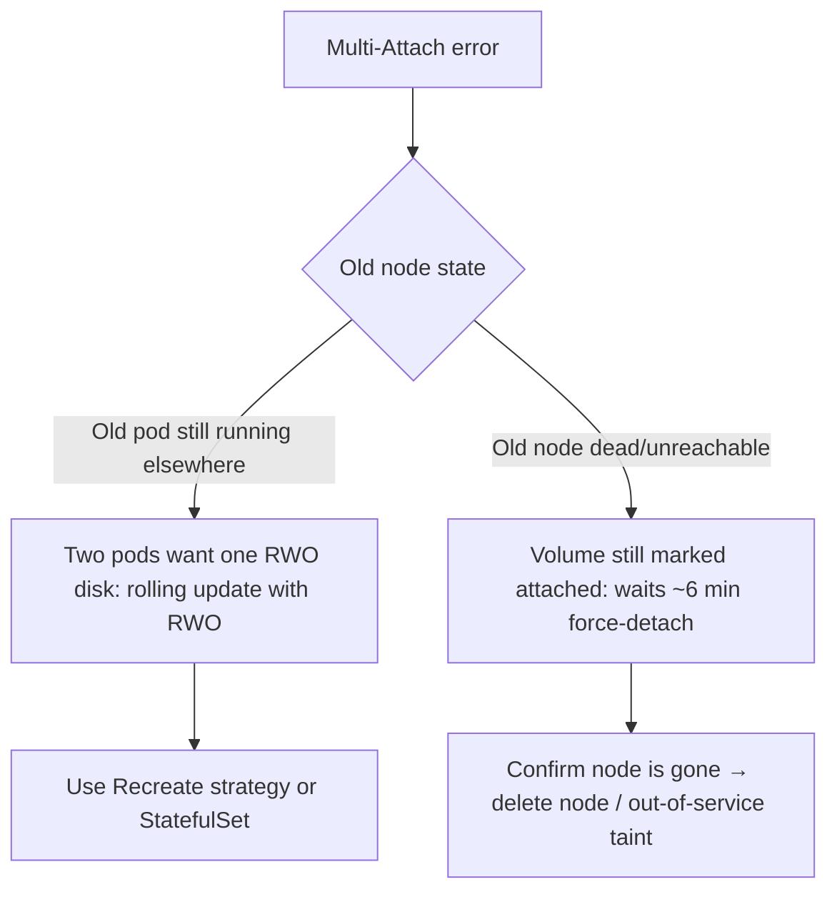

<!-- devopsshack:header -->
> ☸️ **Kubernetes Mastery: Zero to Production** · by **DevOps Shack** · [YouTube](https://www.youtube.com/@devopsshack) · [Hindi channel](https://www.youtube.com/@shackverse) · [devopsshack.com](https://devopsshack.com)
<!-- /devopsshack:header -->

# Playbook · Multi-Attach Error

## Symptom

`Multi-Attach error for volume "pvc-..." Volume is already exclusively attached to one node and can't be attached to another`. Pod stuck in ContainerCreating on a new node.

## Decision flow



## Likely causes

| Cause | How you recognise it |
|---|---|
| RollingUpdate Deployment with RWO PVC | New pod scheduled on another node while old pod holds the disk |
| Node crashed | VolumeAttachment still points at the dead node |
| Two Deployments share a PVC | Design error |

## Diagnose

```bash
kubectl describe pod <pod> | grep -A3 Multi-Attach
kubectl get volumeattachments -o custom-columns=NAME:.metadata.name,PV:.spec.source.persistentVolumeName,NODE:.spec.nodeName,ATTACHED:.status.attached
kubectl get pods -A -o wide | grep <claim-users>
kubectl get node <old-node>
```

## Fix

- For Deployments with RWO volumes: `strategy: Recreate`, or move to a StatefulSet.
- For a dead node: verify it's really down, then `kubectl taint node <node> node.kubernetes.io/out-of-service=nodeshutdown:NoExecute` (enables fast force-detach) or delete the Node object. Don't force-detach a disk that might still be written to.

## Prevent it next time

- Never share RWO PVCs between workloads.
- Use RWX storage when multiple writers are genuinely needed.

← [All playbooks](README.md)

<!-- devopsshack:footer -->
---

<p align="center">
  Made with ❤️ by <b><a href="https://devopsshack.com">DevOps Shack</a></b> · Part of <b>Kubernetes Mastery: Zero to Production</b><br/>
  <a href="https://www.youtube.com/@devopsshack">YouTube · DevOps Shack</a> · <a href="https://www.youtube.com/@shackverse">YouTube · DevOps Shack Hindi</a> · <a href="https://devopsshack.com">devopsshack.com</a> · <a href="https://www.instagram.com/devopsshack">Instagram · @devopsshack</a><br/>
  <sub>© DevOps Shack. Original content created by DevOps Shack. Free to learn from and share with credit to DevOps Shack. See <a href="../LICENSE">LICENSE</a>.</sub>
</p>
<!-- /devopsshack:footer -->
