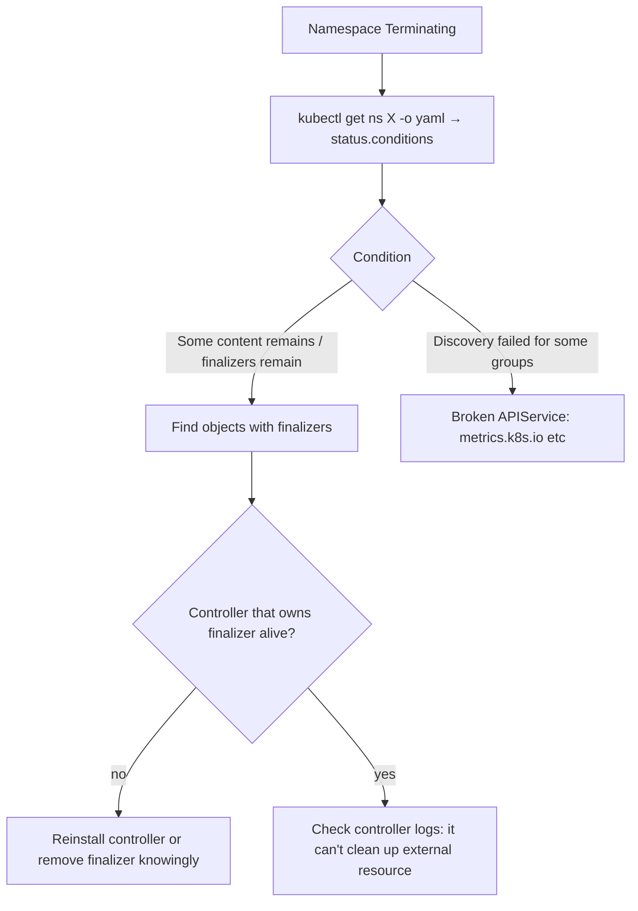

<!-- devopsshack:header -->
> ☸️ **Kubernetes Mastery: Zero to Production** · by **DevOps Shack** · [YouTube](https://www.youtube.com/@devopsshack) · [Hindi channel](https://www.youtube.com/@shackverse) · [devopsshack.com](https://devopsshack.com)
<!-- /devopsshack:header -->

# Playbook · Namespace Stuck in Terminating

## Symptom

`kubectl delete ns X` never finishes; namespace phase stays `Terminating`.

## Decision flow



## Likely causes

| Cause | How you recognise it |
|---|---|
| Objects with finalizers whose controller is gone | CRs left after uninstalling an operator |
| Unavailable aggregated API | `DiscoveryFailed`, `metrics.k8s.io/v1beta1: the server is currently unable to handle the request` |
| Controller can't delete external resource | Finalizer waiting on a cloud LB/volume deletion that fails (permissions) |

## Diagnose

```bash
kubectl get ns <ns> -o jsonpath='{.status.conditions}' | jq
kubectl api-resources --verbs=list --namespaced -o name | xargs -n1 kubectl get -n <ns> --ignore-not-found --show-kind -o name
kubectl get apiservices | grep -v True
kubectl get <kind> <name> -n <ns> -o jsonpath='{.metadata.finalizers}'
```

## Fix

1. Fix broken APIServices (restore metrics-server, or delete the stale APIService).
2. For leftover objects: bring back their controller so it can clean up properly, or fix its permissions.
3. Last resort, once you understand what cleanup you're skipping (e.g. an orphaned cloud load balancer you'll delete manually): `kubectl patch <kind> <name> -n <ns> --type=merge -p '{"metadata":{"finalizers":null}}'`.

## Prevent it next time

- Uninstall order: delete custom resources first, then the operator, then CRDs.
- Alert on APIServices that aren't Available.

← [All playbooks](README.md)

<!-- devopsshack:footer -->
---

<p align="center">
  Made with ❤️ by <b><a href="https://devopsshack.com">DevOps Shack</a></b> · Part of <b>Kubernetes Mastery: Zero to Production</b><br/>
  <a href="https://www.youtube.com/@devopsshack">YouTube · DevOps Shack</a> · <a href="https://www.youtube.com/@shackverse">YouTube · DevOps Shack Hindi</a> · <a href="https://devopsshack.com">devopsshack.com</a> · <a href="https://www.instagram.com/devopsshack">Instagram · @devopsshack</a><br/>
  <sub>© DevOps Shack. Original content created by DevOps Shack. Free to learn from and share with credit to DevOps Shack. See <a href="../LICENSE">LICENSE</a>.</sub>
</p>
<!-- /devopsshack:footer -->
