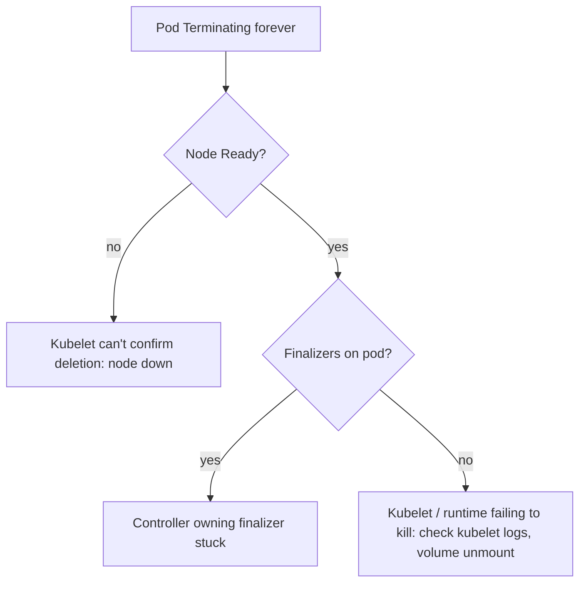

<!-- devopsshack:header -->
> ☸️ **Kubernetes Mastery: Zero to Production** · by **DevOps Shack** · [YouTube](https://www.youtube.com/@devopsshack) · [Hindi channel](https://www.youtube.com/@shackverse) · [devopsshack.com](https://devopsshack.com)
<!-- /devopsshack:header -->

# Playbook · Pod Stuck in Terminating

## Symptom

Pod shows `Terminating` long after `terminationGracePeriodSeconds`.

## Decision flow



## Likely causes

| Cause | How you recognise it |
|---|---|
| Node unreachable | Node NotReady; kubelet can't report |
| Custom finalizer | `metadata.finalizers` not empty |
| Volume unmount hanging | Kubelet logs show unmount errors (NFS hang) |
| Runtime hung | crictl stop hangs; PLEG issues |

## Diagnose

```bash
kubectl get pod <pod> -o jsonpath='{.metadata.deletionTimestamp} {.metadata.finalizers} {.spec.nodeName}'; echo
kubectl get node <node>
# on node: journalctl -u kubelet | grep <pod-uid> | tail
```

## Fix

- Node gone: confirm it's dead, then `kubectl delete pod <pod> --grace-period=0 --force` (for StatefulSets, only when you're sure the old pod isn't running, or you risk two writers).
- Finalizer: fix its controller or remove the finalizer knowingly.
- Fix storage/runtime issues on the node or replace the node.

## Prevent it next time

- Avoid NFS hard-mount hangs; monitor node health.

← [All playbooks](README.md)

<!-- devopsshack:footer -->
---

<p align="center">
  Made with ❤️ by <b><a href="https://devopsshack.com">DevOps Shack</a></b> · Part of <b>Kubernetes Mastery: Zero to Production</b><br/>
  <a href="https://www.youtube.com/@devopsshack">YouTube · DevOps Shack</a> · <a href="https://www.youtube.com/@shackverse">YouTube · DevOps Shack Hindi</a> · <a href="https://devopsshack.com">devopsshack.com</a> · <a href="https://www.instagram.com/devopsshack">Instagram · @devopsshack</a><br/>
  <sub>© DevOps Shack. Original content created by DevOps Shack. Free to learn from and share with credit to DevOps Shack. See <a href="../LICENSE">LICENSE</a>.</sub>
</p>
<!-- /devopsshack:footer -->
