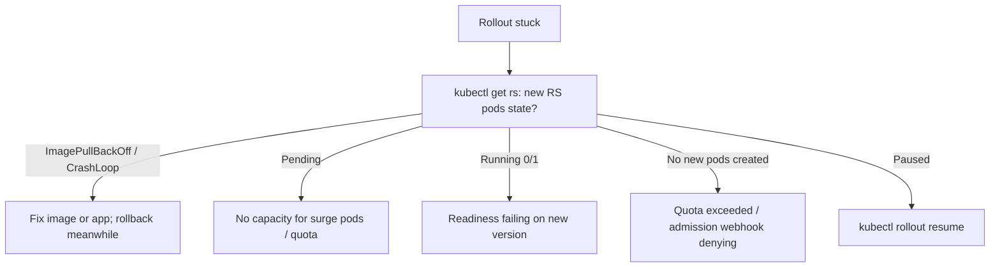

<!-- devopsshack:header -->
> ☸️ **Kubernetes Mastery: Zero to Production** · by **DevOps Shack** · [YouTube](https://www.youtube.com/@devopsshack) · [Hindi channel](https://www.youtube.com/@shackverse) · [devopsshack.com](https://devopsshack.com)
<!-- /devopsshack:header -->

# Playbook · Deployment Rollout Stuck

## Symptom

`kubectl rollout status` never completes or times out. Deployment condition `Progressing=False`, reason `ProgressDeadlineExceeded`.

## Decision flow



## Likely causes

| Cause | How you recognise it |
|---|---|
| New pods failing | ImagePullBackOff, CrashLoopBackOff on the new ReplicaSet |
| No room to surge | New pods Pending; maxUnavailable 0 with full nodes |
| Readiness never passes | New pods Running 0/1 |
| Quota or admission denial | ReplicaSet events: `exceeded quota`, `denied the request` |
| Paused rollout | `kubectl rollout status` says paused |

## Diagnose

```bash
kubectl rollout status deploy/<d> --timeout=10s
kubectl get deploy <d> -o jsonpath='{.status.conditions}' | jq
kubectl get rs -l <selector> -o wide
kubectl describe rs <new-rs> | tail -10
kubectl get pods -l <selector> -o wide
```

## Fix

Roll back first if users are affected (`kubectl rollout undo deploy/<d>`), then fix the cause on the new version: image, config, readiness, capacity, quota or policy. Resume a paused rollout with `kubectl rollout resume`.

## Prevent it next time

- CI/CD waits on `rollout status` with a timeout and auto-rollbacks.
- Progressive delivery with analysis for risky services.

## Related

[Module 04 · Deployments](../02-modules/04-deployments.md)

← [All playbooks](README.md)

<!-- devopsshack:footer -->
---

<p align="center">
  Made with ❤️ by <b><a href="https://devopsshack.com">DevOps Shack</a></b> · Part of <b>Kubernetes Mastery: Zero to Production</b><br/>
  <a href="https://www.youtube.com/@devopsshack">YouTube · DevOps Shack</a> · <a href="https://www.youtube.com/@shackverse">YouTube · DevOps Shack Hindi</a> · <a href="https://devopsshack.com">devopsshack.com</a> · <a href="https://www.instagram.com/devopsshack">Instagram · @devopsshack</a><br/>
  <sub>© DevOps Shack. Original content created by DevOps Shack. Free to learn from and share with credit to DevOps Shack. See <a href="../LICENSE">LICENSE</a>.</sub>
</p>
<!-- /devopsshack:footer -->
