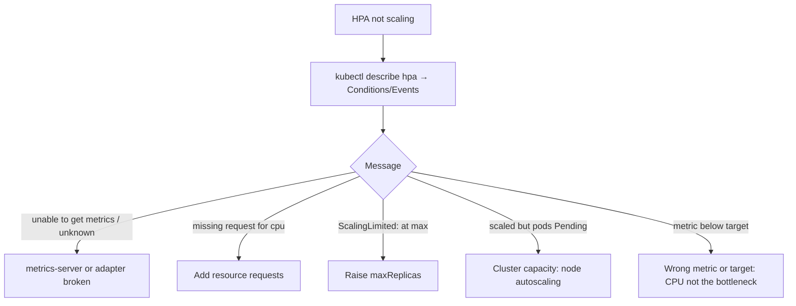

<!-- devopsshack:header -->
> ☸️ **Kubernetes Mastery: Zero to Production** · by **DevOps Shack** · [YouTube](https://www.youtube.com/@devopsshack) · [Hindi channel](https://www.youtube.com/@shackverse) · [devopsshack.com](https://devopsshack.com)
<!-- /devopsshack:header -->

# Playbook · HPA Not Scaling

## Symptom

Load is high but replicas don't increase, or the HPA shows `<unknown>/70%`.

## Decision flow



## Likely causes

| Cause | How you recognise it |
|---|---|
| metrics-server missing/failing | `unable to get metrics for resource cpu` |
| No CPU/memory requests | `missing request for cpu` |
| At maxReplicas | `ScalingLimited True TooManyReplicas` |
| Wrong metric | CPU low while latency high (I/O-bound, thread pool limits) |
| Deployment manifest resets replicas | GitOps sync keeps setting `replicas` |
| New pods Pending | HPA did scale; no nodes |

## Diagnose

```bash
kubectl describe hpa <hpa> -n <ns>
kubectl get --raw /apis/metrics.k8s.io/v1beta1/namespaces/<ns>/pods | jq '.items[].metadata.name'
kubectl -n kube-system logs deploy/metrics-server --tail=50
kubectl top pods -n <ns>
kubectl get apiservice v1beta1.metrics.k8s.io
```

## Fix

Fix metrics-server (common on self-managed: `--kubelet-insecure-tls` or proper kubelet certs), add requests, raise `maxReplicas`, scale on a better metric (RPS, queue depth, latency via Prometheus Adapter/KEDA), remove `replicas` from GitOps-managed manifests, and make sure node autoscaling works.

## Prevent it next time

- Dashboard: HPA desired vs current vs max, plus pending pods.

## Related

[Module 13 · Autoscaling](../02-modules/13-autoscaling.md)

← [All playbooks](README.md)

<!-- devopsshack:footer -->
---

<p align="center">
  Made with ❤️ by <b><a href="https://devopsshack.com">DevOps Shack</a></b> · Part of <b>Kubernetes Mastery: Zero to Production</b><br/>
  <a href="https://www.youtube.com/@devopsshack">YouTube · DevOps Shack</a> · <a href="https://www.youtube.com/@shackverse">YouTube · DevOps Shack Hindi</a> · <a href="https://devopsshack.com">devopsshack.com</a> · <a href="https://www.instagram.com/devopsshack">Instagram · @devopsshack</a><br/>
  <sub>© DevOps Shack. Original content created by DevOps Shack. Free to learn from and share with credit to DevOps Shack. See <a href="../LICENSE">LICENSE</a>.</sub>
</p>
<!-- /devopsshack:footer -->
