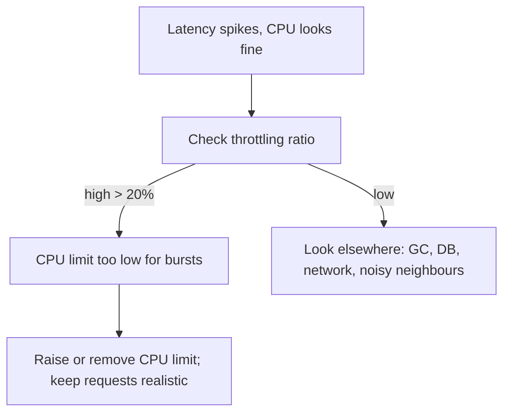

<!-- devopsshack:header -->
> ☸️ **Kubernetes Mastery: Zero to Production** · by **DevOps Shack** · [YouTube](https://www.youtube.com/@devopsshack) · [Hindi channel](https://www.youtube.com/@shackverse) · [devopsshack.com](https://devopsshack.com)
<!-- /devopsshack:header -->

# Playbook · CPU Throttling & Latency Spikes

## Symptom

p99 latency spikes while average CPU looks low. Requests time out under modest load.

## Decision flow



## Likely causes

| Cause | How you recognise it |
|---|---|
| Low CPU limit with bursty workload | `container_cpu_cfs_throttled_periods_total` high |
| Multi-threaded runtime vs limit | Many threads exhaust the CFS quota in a fraction of the period |
| GC pauses | JVM GC logs show long pauses |

## Diagnose

```bash
# PromQL: throttling ratio
# sum by (pod) (rate(container_cpu_cfs_throttled_periods_total{namespace="<ns>"}[5m]))
#   / sum by (pod) (rate(container_cpu_cfs_periods_total{namespace="<ns>"}[5m]))
kubectl exec <pod> -- cat /sys/fs/cgroup/cpu.stat     # nr_throttled, throttled_usec
kubectl get pod <pod> -o jsonpath='{.spec.containers[*].resources}'; echo
```

## Fix

Raise the CPU limit or remove it for latency-sensitive services (keeping accurate requests so scheduling and fairness still work). Tune thread pools / GOMAXPROCS / JVM `ActiveProcessorCount` to match the CPU you actually get.

## Prevent it next time

- Alert on throttling ratio > 25% for latency-critical services.
- Load-test with production-like limits.

## Related

[Module 10 · Resource Management](../02-modules/10-resource-management.md)

← [All playbooks](README.md)

<!-- devopsshack:footer -->
---

<p align="center">
  Made with ❤️ by <b><a href="https://devopsshack.com">DevOps Shack</a></b> · Part of <b>Kubernetes Mastery: Zero to Production</b><br/>
  <a href="https://www.youtube.com/@devopsshack">YouTube · DevOps Shack</a> · <a href="https://www.youtube.com/@shackverse">YouTube · DevOps Shack Hindi</a> · <a href="https://devopsshack.com">devopsshack.com</a> · <a href="https://www.instagram.com/devopsshack">Instagram · @devopsshack</a><br/>
  <sub>© DevOps Shack. Original content created by DevOps Shack. Free to learn from and share with credit to DevOps Shack. See <a href="../LICENSE">LICENSE</a>.</sub>
</p>
<!-- /devopsshack:footer -->
