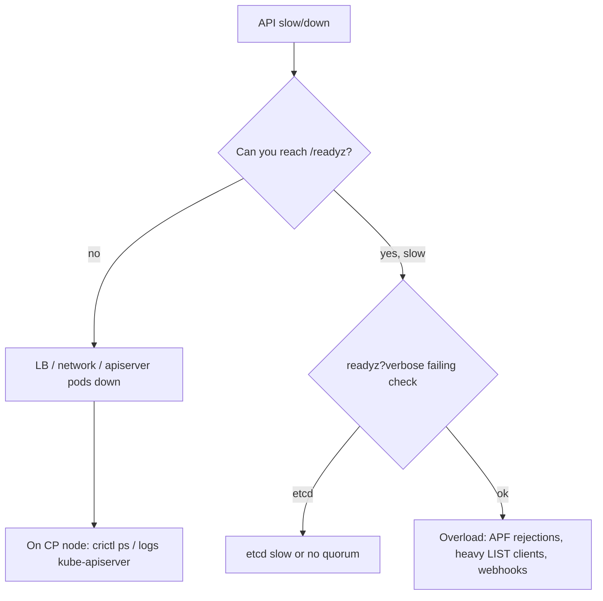

<!-- devopsshack:header -->
> ☸️ **Kubernetes Mastery: Zero to Production** · by **DevOps Shack** · [YouTube](https://www.youtube.com/@devopsshack) · [Hindi channel](https://www.youtube.com/@shackverse) · [devopsshack.com](https://devopsshack.com)
<!-- /devopsshack:header -->

# Playbook · API Server Slow or Unavailable

## Symptom

`kubectl` hangs or returns `connection refused`, `TLS handshake timeout`, `etcdserver: request timed out`, or `429 Too Many Requests`.

## Decision flow



## Likely causes

| Cause | How you recognise it |
|---|---|
| etcd latency / no quorum | `etcdserver: request timed out`, readyz etcd check failing |
| Client overload | APF rejected requests rising; a controller doing unbounded LISTs |
| Slow admission webhooks | Requests slow only for some resource types; webhook latency metrics |
| Certificates expired | `x509: certificate has expired` |
| Load balancer unhealthy | Works from CP node via localhost, not via LB |

## Diagnose

```bash
kubectl get --raw='/readyz?verbose'
kubectl get --raw='/metrics' | grep -E "apiserver_flowcontrol_rejected_requests_total|apiserver_current_inflight_requests" | head
kubectl get validatingwebhookconfigurations,mutatingwebhookconfigurations
# On control plane node:
crictl ps | grep -E 'apiserver|etcd'; crictl logs --tail 100 $(crictl ps --name kube-apiserver -q)
kubeadm certs check-expiration
```

## Fix

Fix etcd (disk latency, quorum), find and throttle the noisy client (audit logs show user-agent), fix or temporarily relax slow webhooks, renew certificates, repair the load balancer health checks.

## Prevent it next time

- Monitor API server latency, APF rejections and etcd fsync latency.
- Review controllers and operators for watch/LIST efficiency.

## Related

[Architecture 02](../01-architecture/02-kube-apiserver.md) · [etcd problems](22-etcd-problems.md)

← [All playbooks](README.md)

<!-- devopsshack:footer -->
---

<p align="center">
  Made with ❤️ by <b><a href="https://devopsshack.com">DevOps Shack</a></b> · Part of <b>Kubernetes Mastery: Zero to Production</b><br/>
  <a href="https://www.youtube.com/@devopsshack">YouTube · DevOps Shack</a> · <a href="https://www.youtube.com/@shackverse">YouTube · DevOps Shack Hindi</a> · <a href="https://devopsshack.com">devopsshack.com</a> · <a href="https://www.instagram.com/devopsshack">Instagram · @devopsshack</a><br/>
  <sub>© DevOps Shack. Original content created by DevOps Shack. Free to learn from and share with credit to DevOps Shack. See <a href="../LICENSE">LICENSE</a>.</sub>
</p>
<!-- /devopsshack:footer -->
