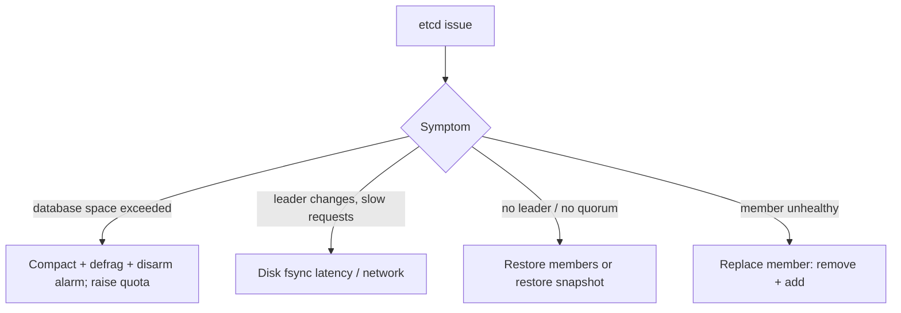

<!-- devopsshack:header -->
> ☸️ **Kubernetes Mastery: Zero to Production** · by **DevOps Shack** · [YouTube](https://www.youtube.com/@devopsshack) · [Hindi channel](https://www.youtube.com/@shackverse) · [devopsshack.com](https://devopsshack.com)
<!-- /devopsshack:header -->

# Playbook · etcd Problems: Latency, NOSPACE, Lost Quorum

## Symptom

API timeouts, `mvcc: database space exceeded`, frequent leader elections, or the cluster refuses all writes.

## Decision flow



## Likely causes

| Cause | How you recognise it |
|---|---|
| Backend quota reached | `NOSPACE` alarm; writes rejected |
| Slow disk | WAL fsync p99 > 10 ms; leader changes |
| Lost quorum | Majority of members down |
| Huge objects / too many events | DB grows fast; big ConfigMaps or CRDs |

## Diagnose

```bash
E="etcdctl --endpoints=https://127.0.0.1:2379 --cacert=/etc/kubernetes/pki/etcd/ca.crt --cert=/etc/kubernetes/pki/etcd/server.crt --key=/etc/kubernetes/pki/etcd/server.key"
$E endpoint status --cluster -w table
$E endpoint health --cluster
$E alarm list
$E member list -w table
```

## Fix

NOSPACE recovery:

```bash
rev=$($E endpoint status --write-out=json | jq -r '.[0].Status.header.revision')
$E compact $rev
$E defrag --cluster
$E alarm disarm
```

Move etcd to fast local SSDs; for lost quorum, restore from the latest snapshot (see [Lab 23](../04-labs/lab-23-etcd-backup-restore/README.md)).

## Prevent it next time

- Snapshot schedule + restore drills.
- Alert on DB size, fsync latency, leader changes.

## Related

[Architecture 03 · etcd](../01-architecture/03-etcd.md)

← [All playbooks](README.md)

<!-- devopsshack:footer -->
---

<p align="center">
  Made with ❤️ by <b><a href="https://devopsshack.com">DevOps Shack</a></b> · Part of <b>Kubernetes Mastery: Zero to Production</b><br/>
  <a href="https://www.youtube.com/@devopsshack">YouTube · DevOps Shack</a> · <a href="https://www.youtube.com/@shackverse">YouTube · DevOps Shack Hindi</a> · <a href="https://devopsshack.com">devopsshack.com</a> · <a href="https://www.instagram.com/devopsshack">Instagram · @devopsshack</a><br/>
  <sub>© DevOps Shack. Original content created by DevOps Shack. Free to learn from and share with credit to DevOps Shack. See <a href="../LICENSE">LICENSE</a>.</sub>
</p>
<!-- /devopsshack:footer -->
