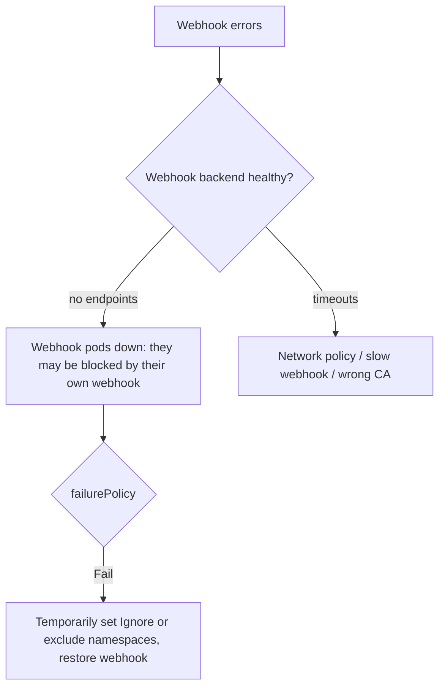

<!-- devopsshack:header -->
> ☸️ **Kubernetes Mastery: Zero to Production** · by **DevOps Shack** · [YouTube](https://www.youtube.com/@devopsshack) · [Hindi channel](https://www.youtube.com/@shackverse) · [devopsshack.com](https://devopsshack.com)
<!-- /devopsshack:header -->

# Playbook · Admission Webhook Blocking the Cluster

## Symptom

Creates/updates fail with `failed calling webhook ... context deadline exceeded` or `no endpoints available for service`. Sometimes nothing at all can be deployed, including fixes.

## Decision flow



## Likely causes

| Cause | How you recognise it |
|---|---|
| Webhook Deployment scaled to 0 / crashing | `no endpoints available for service` |
| Webhook blocks its own namespace | Can't recreate its own pods |
| Expired/rotated serving cert | `x509: certificate signed by unknown authority` |
| NetworkPolicy blocks API server → webhook | Timeouts |

## Diagnose

```bash
kubectl get validatingwebhookconfigurations,mutatingwebhookconfigurations
kubectl get validatingwebhookconfiguration <name> -o yaml | grep -E "failurePolicy|timeoutSeconds|namespaceSelector" -A3
kubectl -n <webhook-ns> get pods,endpointslices
```

## Fix

Restore the webhook backend. If it's deadlocked, temporarily patch `failurePolicy: Ignore` (or add a `namespaceSelector` exclusion for its own namespace), recover, then revert. Renew certificates (cert-manager CA injection).

## Prevent it next time

- Exclude `kube-system` and the webhook's namespace; low `timeoutSeconds`; HA + PDB.
- Prefer in-process ValidatingAdmissionPolicy for simple rules.

## Related

[Architecture 14](../01-architecture/14-authn-authz-admission.md)

← [All playbooks](README.md)

<!-- devopsshack:footer -->
---

<p align="center">
  Made with ❤️ by <b><a href="https://devopsshack.com">DevOps Shack</a></b> · Part of <b>Kubernetes Mastery: Zero to Production</b><br/>
  <a href="https://www.youtube.com/@devopsshack">YouTube · DevOps Shack</a> · <a href="https://www.youtube.com/@shackverse">YouTube · DevOps Shack Hindi</a> · <a href="https://devopsshack.com">devopsshack.com</a> · <a href="https://www.instagram.com/devopsshack">Instagram · @devopsshack</a><br/>
  <sub>© DevOps Shack. Original content created by DevOps Shack. Free to learn from and share with credit to DevOps Shack. See <a href="../LICENSE">LICENSE</a>.</sub>
</p>
<!-- /devopsshack:footer -->
