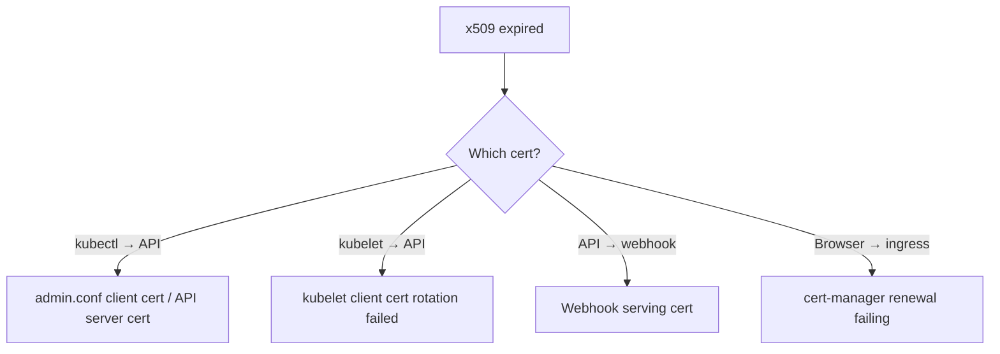

<!-- devopsshack:header -->
> ☸️ **Kubernetes Mastery: Zero to Production** · by **DevOps Shack** · [YouTube](https://www.youtube.com/@devopsshack) · [Hindi channel](https://www.youtube.com/@shackverse) · [devopsshack.com](https://devopsshack.com)
<!-- /devopsshack:header -->

# Playbook · Expired Certificates

## Symptom

`x509: certificate has expired or is not yet valid` from kubectl, kubelets, webhooks or ingress. Nodes may go NotReady.

## Decision flow



## Likely causes

| Cause | How you recognise it |
|---|---|
| kubeadm certs older than 1 year | `kubeadm certs check-expiration` shows expired |
| Kubelet rotation disabled/failing | Node NotReady with x509 errors in kubelet logs |
| cert-manager challenge failing | Certificate `Ready=False`, Order/Challenge errors |

## Diagnose

```bash
kubeadm certs check-expiration
openssl x509 -noout -enddate -in /etc/kubernetes/pki/apiserver.crt
openssl x509 -noout -enddate -in /var/lib/kubelet/pki/kubelet-client-current.pem
kubectl get certificates,certificaterequests,orders,challenges -A
echo | openssl s_client -connect app.example.com:443 -servername app.example.com 2>/dev/null | openssl x509 -noout -dates
```

## Fix

- kubeadm: `kubeadm certs renew all`, restart control plane static pods (move manifests out and back), regenerate `admin.conf` for users.
- Kubelet: ensure `rotateCertificates: true`, approve pending CSRs (`kubectl get csr`).
- cert-manager: fix DNS/HTTP challenge (DNS records, ingress class, rate limits).

## Prevent it next time

- Upgrade at least yearly (kubeadm renews certs on upgrade).
- Monitor expiry for every cert (cert-manager metrics, blackbox exporter).

← [All playbooks](README.md)

<!-- devopsshack:footer -->
---

<p align="center">
  Made with ❤️ by <b><a href="https://devopsshack.com">DevOps Shack</a></b> · Part of <b>Kubernetes Mastery: Zero to Production</b><br/>
  <a href="https://www.youtube.com/@devopsshack">YouTube · DevOps Shack</a> · <a href="https://www.youtube.com/@shackverse">YouTube · DevOps Shack Hindi</a> · <a href="https://devopsshack.com">devopsshack.com</a> · <a href="https://www.instagram.com/devopsshack">Instagram · @devopsshack</a><br/>
  <sub>© DevOps Shack. Original content created by DevOps Shack. Free to learn from and share with credit to DevOps Shack. See <a href="../LICENSE">LICENSE</a>.</sub>
</p>
<!-- /devopsshack:footer -->
