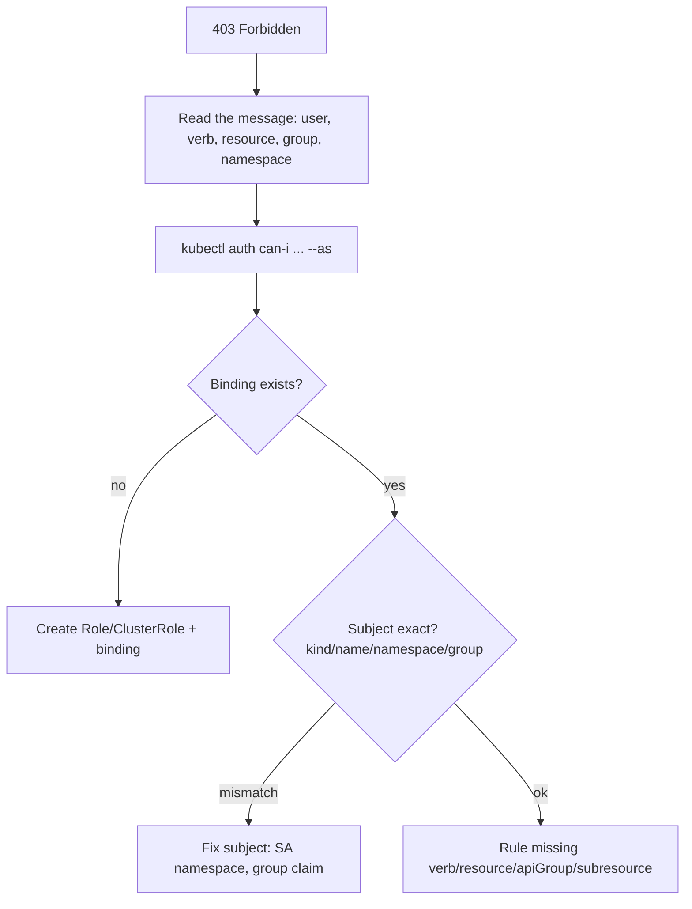

<!-- devopsshack:header -->
> ☸️ **Kubernetes Mastery: Zero to Production** · by **DevOps Shack** · [YouTube](https://www.youtube.com/@devopsshack) · [Hindi channel](https://www.youtube.com/@shackverse) · [devopsshack.com](https://devopsshack.com)
<!-- /devopsshack:header -->

# Playbook · RBAC Forbidden (403)

## Symptom

`Error from server (Forbidden): pods is forbidden: User "x" cannot list resource "pods" in API group "" in the namespace "y"`.

## Decision flow



## Likely causes

| Cause | How you recognise it |
|---|---|
| No binding | Nothing references the subject |
| Wrong subject | ServiceAccount namespace wrong; IdP group name differs from binding |
| Wrong apiGroup | Deployments are in `apps`, not core `""` |
| Subresource missing | `pods/log`, `pods/exec`, `deployments/scale` |
| Role vs ClusterRole scope | Role can't grant cluster-scoped resources like nodes |

## Diagnose

```bash
kubectl auth whoami
kubectl auth can-i <verb> <resource> -n <ns> --as=<user> --as-group=<group>
kubectl auth can-i --list -n <ns> --as=system:serviceaccount:<ns>:<sa>
kubectl get rolebindings,clusterrolebindings -A -o wide | grep -i <subject>
```

## Fix

Grant the minimal missing rule via a Role (namespaced) or ClusterRole (cluster-scoped or reused), bound to the correct subject. Re-test with `can-i`.

## Prevent it next time

- Manage RBAC in Git; review with `rbac-tool` / `who-can`.

## Related

[Module 16 · RBAC](../02-modules/16-rbac-service-accounts.md)

← [All playbooks](README.md)

<!-- devopsshack:footer -->
---

<p align="center">
  Made with ❤️ by <b><a href="https://devopsshack.com">DevOps Shack</a></b> · Part of <b>Kubernetes Mastery: Zero to Production</b><br/>
  <a href="https://www.youtube.com/@devopsshack">YouTube · DevOps Shack</a> · <a href="https://www.youtube.com/@shackverse">YouTube · DevOps Shack Hindi</a> · <a href="https://devopsshack.com">devopsshack.com</a> · <a href="https://www.instagram.com/devopsshack">Instagram · @devopsshack</a><br/>
  <sub>© DevOps Shack. Original content created by DevOps Shack. Free to learn from and share with credit to DevOps Shack. See <a href="../LICENSE">LICENSE</a>.</sub>
</p>
<!-- /devopsshack:footer -->
