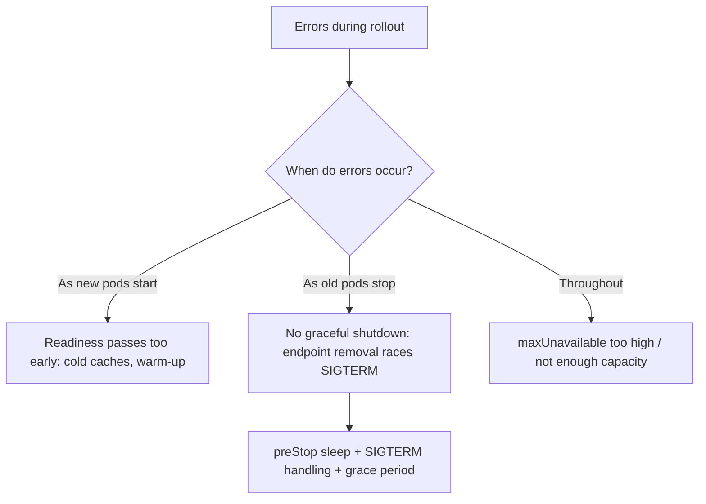

<!-- devopsshack:header -->
> ☸️ **Kubernetes Mastery: Zero to Production** · by **DevOps Shack** · [YouTube](https://www.youtube.com/@devopsshack) · [Hindi channel](https://www.youtube.com/@shackverse) · [devopsshack.com](https://devopsshack.com)
<!-- /devopsshack:header -->

# Playbook · 5xx Errors During Every Deploy

## Symptom

A short burst of 502/503/connection resets every time a Deployment rolls out or scales down.

## Decision flow



## Likely causes

| Cause | How you recognise it |
|---|---|
| App exits immediately on SIGTERM | Errors exactly when old pods terminate |
| No preStop delay | LB/kube-proxy still sends traffic for a few seconds |
| Readiness too optimistic | Errors right after new pods become Ready |
| Keep-alive connections to dying pods | Resets on long-lived connections |
| LB target deregistration slower than pod shutdown | Cloud LB health check intervals |

## Diagnose

```bash
kubectl get deploy <d> -o jsonpath='{.spec.strategy} {.spec.template.spec.terminationGracePeriodSeconds}'; echo
kubectl get deploy <d> -o yaml | grep -A4 -E "preStop|readinessProbe"
# During a rollout:
kubectl get endpointslices -l kubernetes.io/service-name=<svc> -w
```

## Fix

Add `preStop` sleep (5–15 s), handle SIGTERM gracefully (drain, then exit), set `terminationGracePeriodSeconds` above preStop + drain, make readiness reflect warm state, use `maxUnavailable: 0`, and enable connection draining / readiness gates on cloud load balancers.

## Prevent it next time

- Run a load test during a rollout in CI/staging and fail on any errors.

## Related

[Pod lifecycle](../01-architecture/13-pod-lifecycle.md) · [Lab 10](../04-labs/lab-10-probes-graceful-shutdown/README.md)

← [All playbooks](README.md)

<!-- devopsshack:footer -->
---

<p align="center">
  Made with ❤️ by <b><a href="https://devopsshack.com">DevOps Shack</a></b> · Part of <b>Kubernetes Mastery: Zero to Production</b><br/>
  <a href="https://www.youtube.com/@devopsshack">YouTube · DevOps Shack</a> · <a href="https://www.youtube.com/@shackverse">YouTube · DevOps Shack Hindi</a> · <a href="https://devopsshack.com">devopsshack.com</a> · <a href="https://www.instagram.com/devopsshack">Instagram · @devopsshack</a><br/>
  <sub>© DevOps Shack. Original content created by DevOps Shack. Free to learn from and share with credit to DevOps Shack. See <a href="../LICENSE">LICENSE</a>.</sub>
</p>
<!-- /devopsshack:footer -->
