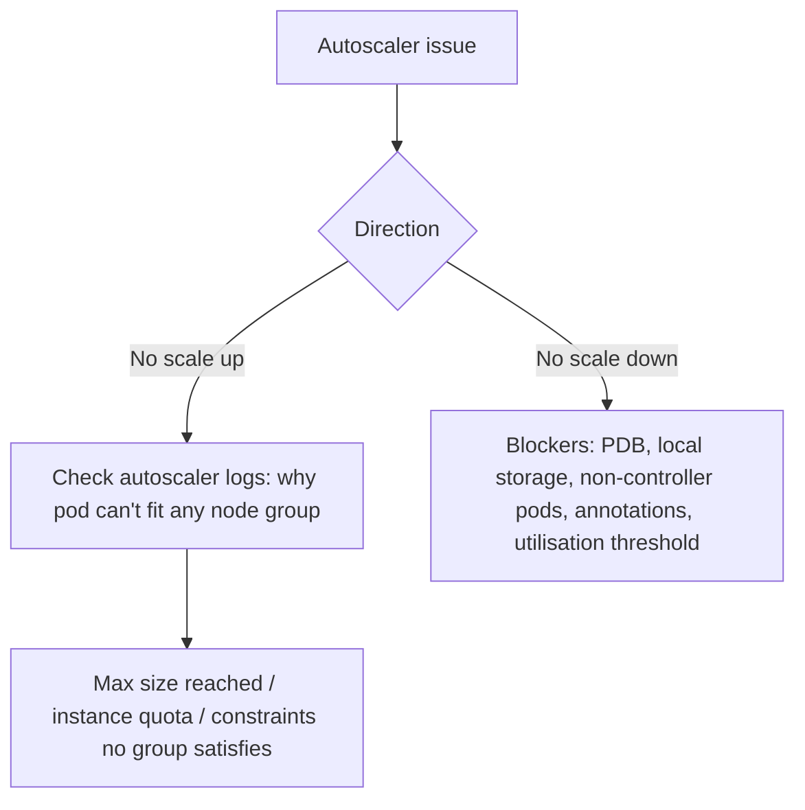

<!-- devopsshack:header -->
> ☸️ **Kubernetes Mastery: Zero to Production** · by **DevOps Shack** · [YouTube](https://www.youtube.com/@devopsshack) · [Hindi channel](https://www.youtube.com/@shackverse) · [devopsshack.com](https://devopsshack.com)
<!-- /devopsshack:header -->

# Playbook · Node Autoscaler Not Adding or Removing Nodes

## Symptom

Pods sit Pending but no nodes appear; or nodes stay mostly idle and never scale down.

## Decision flow



## Likely causes

| Cause | How you recognise it |
|---|---|
| Node group at max / cloud quota | Logs: `max node group size reached`, `InsufficientInstanceCapacity` |
| Pod constraints no group can satisfy | Selector/affinity for a label no template has |
| Scale-down blocked by PDB | `not enough pod disruption budget` |
| Pods with local storage / no controller | Logs list blocking pods |
| do-not-evict annotations | `safe-to-evict: false` / `karpenter.sh/do-not-disrupt` |

## Diagnose

```bash
kubectl -n kube-system logs deploy/cluster-autoscaler --tail=200 | grep -i -E "scale|unschedulable|blocked"
kubectl -n kube-system get configmap cluster-autoscaler-status -o yaml
kubectl -n karpenter logs deploy/karpenter --tail=200     # Karpenter
kubectl get nodepools,nodeclaims                           # Karpenter
```

## Fix

Raise group/NodePool limits or cloud quotas, add instance types, align pod constraints with available node labels, fix overly strict PDBs, and remove unnecessary do-not-evict annotations.

## Prevent it next time

- Alert on Pending pods and on autoscaler errors.

## Related

[Module 13](../02-modules/13-autoscaling.md)

← [All playbooks](README.md)

<!-- devopsshack:footer -->
---

<p align="center">
  Made with ❤️ by <b><a href="https://devopsshack.com">DevOps Shack</a></b> · Part of <b>Kubernetes Mastery: Zero to Production</b><br/>
  <a href="https://www.youtube.com/@devopsshack">YouTube · DevOps Shack</a> · <a href="https://www.youtube.com/@shackverse">YouTube · DevOps Shack Hindi</a> · <a href="https://devopsshack.com">devopsshack.com</a> · <a href="https://www.instagram.com/devopsshack">Instagram · @devopsshack</a><br/>
  <sub>© DevOps Shack. Original content created by DevOps Shack. Free to learn from and share with credit to DevOps Shack. See <a href="../LICENSE">LICENSE</a>.</sub>
</p>
<!-- /devopsshack:footer -->
