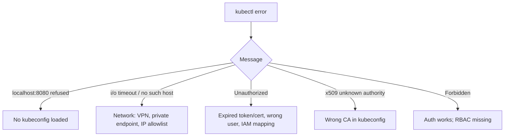

<!-- devopsshack:header -->
> ☸️ **Kubernetes Mastery: Zero to Production** · by **DevOps Shack** · [YouTube](https://www.youtube.com/@devopsshack) · [Hindi channel](https://www.youtube.com/@shackverse) · [devopsshack.com](https://devopsshack.com)
<!-- /devopsshack:header -->

# Playbook · kubectl Can't Connect to the Cluster

## Symptom

`The connection to the server localhost:8080 was refused`, `Unable to connect to the server: dial tcp ... i/o timeout`, `You must be logged in to the server (Unauthorized)`.

## Decision flow



## Likely causes

| Cause | How you recognise it |
|---|---|
| No kubeconfig | `localhost:8080` (the default when nothing is configured) |
| Wrong context | Talking to another cluster |
| Private endpoint / allowlist | Timeouts from outside VPN |
| Expired credentials | `Unauthorized`; exec plugin errors |
| Cloud IAM not mapped | EKS: IAM principal lacks an access entry |

## Diagnose

```bash
kubectl config current-context; kubectl config view --minify
echo $KUBECONFIG
kubectl cluster-info -v=6 2>&1 | tail -5
curl -k https://<api-endpoint>/healthz
aws eks update-kubeconfig --name <cluster> --region <region>     # EKS example
az aks get-credentials -g <rg> -n <cluster>                      # AKS example
gcloud container clusters get-credentials <cluster> --region <r> # GKE example
```

## Fix

Load the right kubeconfig/context, connect the VPN or bastion, refresh credentials, fix CA data, or map the identity to cluster access.

## Prevent it next time

- Prompt showing the current context; short-lived SSO credentials.

← [All playbooks](README.md)

<!-- devopsshack:footer -->
---

<p align="center">
  Made with ❤️ by <b><a href="https://devopsshack.com">DevOps Shack</a></b> · Part of <b>Kubernetes Mastery: Zero to Production</b><br/>
  <a href="https://www.youtube.com/@devopsshack">YouTube · DevOps Shack</a> · <a href="https://www.youtube.com/@shackverse">YouTube · DevOps Shack Hindi</a> · <a href="https://devopsshack.com">devopsshack.com</a> · <a href="https://www.instagram.com/devopsshack">Instagram · @devopsshack</a><br/>
  <sub>© DevOps Shack. Original content created by DevOps Shack. Free to learn from and share with credit to DevOps Shack. See <a href="../LICENSE">LICENSE</a>.</sub>
</p>
<!-- /devopsshack:footer -->
