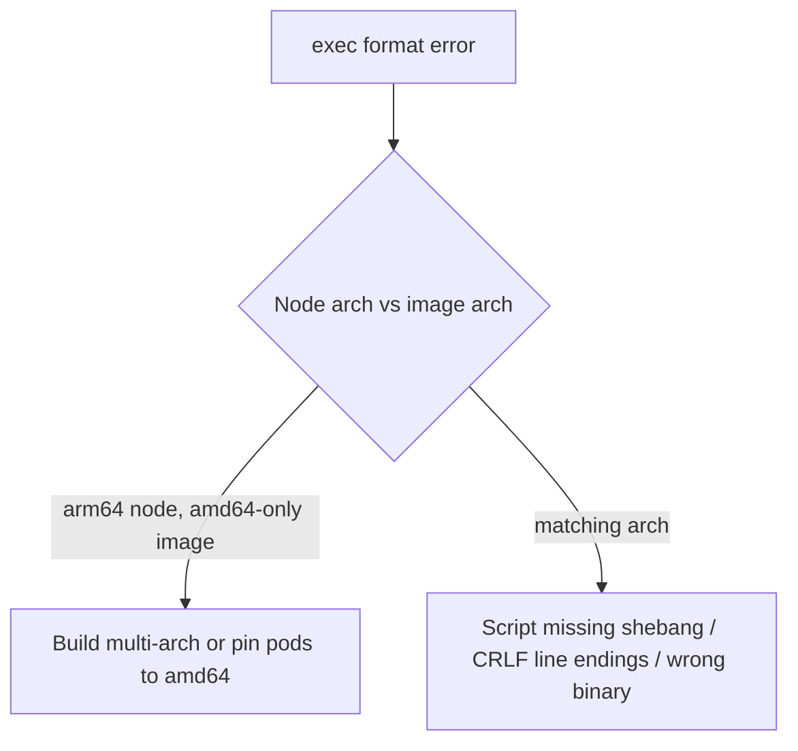

<!-- devopsshack:header -->
> ☸️ **Kubernetes Mastery: Zero to Production** · by **DevOps Shack** · [YouTube](https://www.youtube.com/@devopsshack) · [Hindi channel](https://www.youtube.com/@shackverse) · [devopsshack.com](https://devopsshack.com)
<!-- /devopsshack:header -->

# Playbook · exec format error (Architecture Mismatch)

## Symptom

Container fails instantly with `exec /app: exec format error` or `standard_init_linux.go: exec user process caused: exec format error`.

## Decision flow



## Likely causes

| Cause | How you recognise it |
|---|---|
| Single-arch image on mixed cluster | Works on some nodes, fails on Graviton/Ampere nodes |
| Script without shebang | Entrypoint is a shell script lacking `#!/bin/sh` |
| Windows line endings | `/bin/sh^M: bad interpreter` |

## Diagnose

```bash
kubectl get pod <pod> -o jsonpath='{.spec.nodeName}' | xargs kubectl get node -o jsonpath='{.metadata.labels.kubernetes\.io/arch}'; echo
docker buildx imagetools inspect <image> | grep -i platform
```

## Fix

Build and push multi-arch images (`docker buildx build --platform linux/amd64,linux/arm64 --push`), or constrain pods with `nodeSelector: kubernetes.io/arch: amd64` until you do. Fix shebangs and line endings.

## Prevent it next time

- Multi-arch builds by default in CI; admission check for platform availability.

← [All playbooks](README.md)

<!-- devopsshack:footer -->
---

<p align="center">
  Made with ❤️ by <b><a href="https://devopsshack.com">DevOps Shack</a></b> · Part of <b>Kubernetes Mastery: Zero to Production</b><br/>
  <a href="https://www.youtube.com/@devopsshack">YouTube · DevOps Shack</a> · <a href="https://www.youtube.com/@shackverse">YouTube · DevOps Shack Hindi</a> · <a href="https://devopsshack.com">devopsshack.com</a> · <a href="https://www.instagram.com/devopsshack">Instagram · @devopsshack</a><br/>
  <sub>© DevOps Shack. Original content created by DevOps Shack. Free to learn from and share with credit to DevOps Shack. See <a href="../LICENSE">LICENSE</a>.</sub>
</p>
<!-- /devopsshack:footer -->
