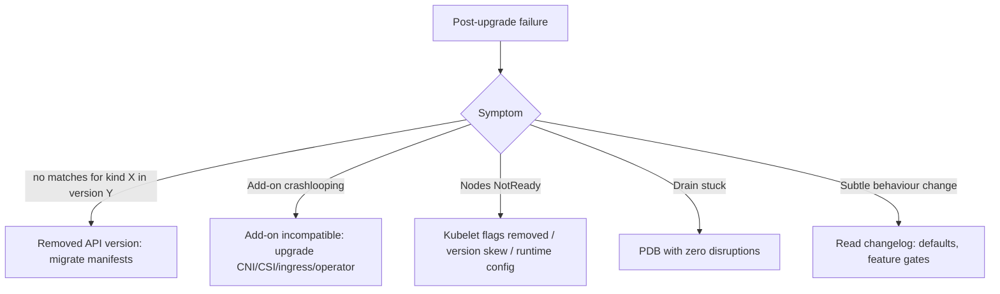

<!-- devopsshack:header -->
> ☸️ **Kubernetes Mastery: Zero to Production** · by **DevOps Shack** · [YouTube](https://www.youtube.com/@devopsshack) · [Hindi channel](https://www.youtube.com/@shackverse) · [devopsshack.com](https://devopsshack.com)
<!-- /devopsshack:header -->

# Playbook · Cluster Upgrade Gone Wrong

## Symptom

After a Kubernetes upgrade: workloads fail to deploy (`no matches for kind`), add-ons crash, nodes NotReady, or behaviour changed.

## Decision flow



## Likely causes

| Cause | How you recognise it |
|---|---|
| Removed APIs still in manifests or Helm releases | `no matches for kind "Ingress" in version "extensions/v1beta1"` |
| Incompatible add-ons | CNI/CSI/ingress/mesh pods failing after upgrade |
| Deprecated kubelet flags | Kubelet won't start with unknown flags |
| PDB blocking node roll | Drain hangs on eviction |
| Helm release stores removed API versions | Upgrade fails until release manifests are mapped (helm-mapkubeapis) |

## Diagnose

```bash
kubectl get --raw /metrics | grep apiserver_requested_deprecated_apis
pluto detect-helm -A ; pluto detect-files -d manifests/
kubectl get pods -A | grep -v -E "Running|Completed"
kubectl get pdb -A
journalctl -u kubelet | grep -i -E "unknown flag|deprecated" | tail
```

## Fix

Migrate manifests and Helm releases to current API versions, upgrade add-ons to versions supporting the new Kubernetes minor, fix kubelet configuration, adjust PDBs. Control plane downgrades are generally not supported, so the real rollback plan for managed clusters is often "fix forward" or fail over to a standby cluster.

## Prevent it next time

- Pre-upgrade checklist (Module 27), staging cluster first, blue-green node pools, deprecated-API scanning in CI.

## Related

[Module 27 · Cluster Operations](../02-modules/27-cluster-operations-upgrades.md)

← [All playbooks](README.md)

<!-- devopsshack:footer -->
---

<p align="center">
  Made with ❤️ by <b><a href="https://devopsshack.com">DevOps Shack</a></b> · Part of <b>Kubernetes Mastery: Zero to Production</b><br/>
  <a href="https://www.youtube.com/@devopsshack">YouTube · DevOps Shack</a> · <a href="https://www.youtube.com/@shackverse">YouTube · DevOps Shack Hindi</a> · <a href="https://devopsshack.com">devopsshack.com</a> · <a href="https://www.instagram.com/devopsshack">Instagram · @devopsshack</a><br/>
  <sub>© DevOps Shack. Original content created by DevOps Shack. Free to learn from and share with credit to DevOps Shack. See <a href="../LICENSE">LICENSE</a>.</sub>
</p>
<!-- /devopsshack:footer -->
