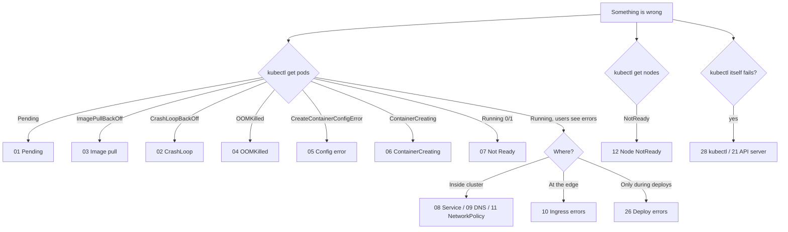

<!-- devopsshack:header -->
> ☸️ **Kubernetes Mastery: Zero to Production** · by **DevOps Shack** · [YouTube](https://www.youtube.com/@devopsshack) · [Hindi channel](https://www.youtube.com/@shackverse) · [devopsshack.com](https://devopsshack.com)
<!-- /devopsshack:header -->

# 05 · Troubleshooting Playbooks

30 step-by-step playbooks for the failures you'll actually meet in production and in interviews. Each one gives you the symptom, a decision flow, likely causes, exact diagnosis commands, the fix, and how to prevent it.

## Start here: which playbook?

## Pod won't start

| # | Playbook |
|---|---|
| 01 | [Pod Stuck in Pending](01-pod-pending.md) |
| 02 | [CrashLoopBackOff](02-crashloopbackoff.md) |
| 03 | [ErrImagePull / ImagePullBackOff](03-imagepullbackoff.md) |
| 04 | [OOMKilled (Exit Code 137)](04-oomkilled.md) |
| 05 | [CreateContainerConfigError](05-createcontainerconfigerror.md) |
| 06 | [Pod Stuck in ContainerCreating](06-containercreating-stuck.md) |

## Pod runs but traffic fails

| # | Playbook |
|---|---|
| 07 | [Running but Not Ready (0/1)](07-running-not-ready.md) |
| 08 | [Service Has No Endpoints / Connection Refused](08-service-no-endpoints.md) |
| 09 | [DNS Failures & Slow DNS](09-dns-failures.md) |
| 10 | [Ingress / Gateway Returns 404, 502, 503 or 504](10-ingress-errors.md) |
| 11 | [NetworkPolicy Blocking Traffic](11-networkpolicy-blocking.md) |
| 26 | [5xx Errors During Every Deploy](26-errors-during-deploys.md) |

## Nodes, storage & capacity

| # | Playbook |
|---|---|
| 12 | [Node NotReady](12-node-notready.md) |
| 13 | [Evictions & Node Pressure](13-node-pressure-evictions.md) |
| 14 | [PVC Stuck in Pending](14-pvc-pending.md) |
| 15 | [Multi-Attach Error](15-multi-attach-error.md) |
| 20 | [CPU Throttling & Latency Spikes](20-cpu-throttling-latency.md) |
| 27 | [Node Autoscaler Not Adding or Removing Nodes](27-node-autoscaler-not-scaling.md) |
| 29 | [exec format error (Architecture Mismatch)](29-exec-format-error.md) |

## Stuck objects & rollouts

| # | Playbook |
|---|---|
| 16 | [Namespace Stuck in Terminating](16-namespace-stuck-terminating.md) |
| 17 | [Pod Stuck in Terminating](17-pod-stuck-terminating.md) |
| 18 | [Deployment Rollout Stuck](18-rollout-stuck.md) |
| 19 | [HPA Not Scaling](19-hpa-not-scaling.md) |

## Control plane & cluster

| # | Playbook |
|---|---|
| 21 | [API Server Slow or Unavailable](21-apiserver-slow-down.md) |
| 22 | [etcd Problems: Latency, NOSPACE, Lost Quorum](22-etcd-problems.md) |
| 23 | [Admission Webhook Blocking the Cluster](23-webhook-blocking.md) |
| 24 | [Expired Certificates](24-certificates-expired.md) |
| 25 | [RBAC Forbidden (403)](25-rbac-forbidden.md) |
| 28 | [kubectl Can't Connect to the Cluster](28-kubectl-cannot-connect.md) |
| 30 | [Cluster Upgrade Gone Wrong](30-upgrade-gone-wrong.md) |

## The method behind every playbook

1. **Observe** before acting: `get`, `describe`, events, logs. Write down what you see.
2. **Locate the layer** using the [life of a kubectl apply](../01-architecture/12-life-of-kubectl-apply.md): API → controllers → scheduler → kubelet → container → readiness → Service/DNS/policy → edge.
3. **Form one hypothesis**, test it with one command.
4. **Mitigate first** when users are affected (roll back, scale up, fail over), then fix the root cause.
5. **Prevent:** add the alert, test or policy that would have caught it.

Practise on purpose-built breakages in [Lab 22 · Troubleshooting Gauntlet](../04-labs/lab-22-troubleshooting-gauntlet/README.md), then test yourself with the [Troubleshooting Q&A](../07-interview-questions/04-troubleshooting/README.md).

<!-- devopsshack:footer -->
---

  Made with ❤️ by <b><a href="https://devopsshack.com">DevOps Shack</a></b> · Part of <b>Kubernetes Mastery: Zero to Production</b> 
  <a href="https://www.youtube.com/@devopsshack">YouTube · DevOps Shack</a> · <a href="https://www.youtube.com/@shackverse">YouTube · DevOps Shack Hindi</a> · <a href="https://devopsshack.com">devopsshack.com</a> · <a href="https://www.instagram.com/devopsshack">Instagram · @devopsshack</a> 
  © DevOps Shack. Original content created by DevOps Shack. Free to learn from and share with credit to DevOps Shack. See <a href="../LICENSE">LICENSE</a>.

<!-- /devopsshack:footer -->
