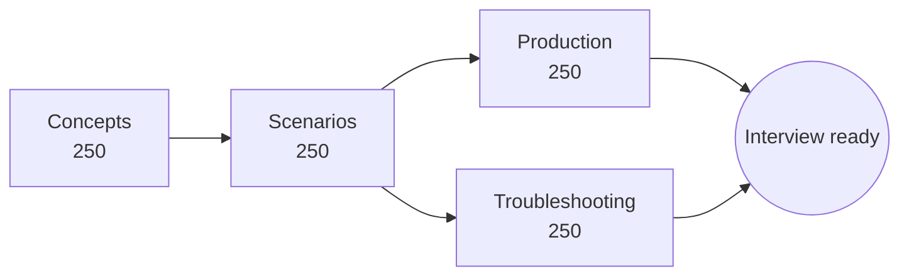

<!-- devopsshack:header -->
> ☸️ **Kubernetes Mastery: Zero to Production** · by **DevOps Shack** · [YouTube](https://www.youtube.com/@devopsshack) · [Hindi channel](https://www.youtube.com/@shackverse) · [devopsshack.com](https://devopsshack.com)
<!-- /devopsshack:header -->

# 07 · Interview Questions: 1,000 Q&A

**1000 questions with answers**, split into four banks so you can practise the way real interviews are structured.

| Bank | Questions | What it tests |
|---|---|---|
| [Concept-Based](01-concepts/README.md) | 250 | Core knowledge interviewers check first: what each component is, how it works, and why it was designed that way. |
| [Scenario-Based](02-scenario-based/README.md) | 250 | "You're on the team and this happens. What do you do?" Practical judgement questions. |
| [Production-Based](03-production-based/README.md) | 250 | How you run Kubernetes for real: reliability, operations, security at scale, cost and platform engineering. Senior and staff-level territory. |
| [Troubleshooting](04-troubleshooting/README.md) | 250 | Symptom → cause → fix. The questions that separate people who have operated clusters from people who have only read about them. |

## How to practise

1. **Say it out loud.** Interviews are spoken. Answer before you open the answer.
2. **Answer in layers:** one-line definition → how it works → a production example → a trade-off.
3. **Draw while you talk.** For architecture questions, sketch the diagram from [Architecture](../01-architecture/README.md).
4. **Turn scenarios into stories.** For scenario and production questions, use situation → action → result, ideally from your own [assignments](../06-assignments/README.md).
5. **Revisit what you missed** after 1, 3 and 7 days.

## Suggested order by experience

| Your experience | Start with | Then |
|---|---|---|
| 0–1 years | Concepts | Scenario sections 1–3 |
| 1–3 years | Scenario | Troubleshooting, then Production 1–2 |
| 3+ years | Production | Troubleshooting 4–5, Scenario 5 |

<!-- devopsshack:footer -->
---

  Made with ❤️ by <b><a href="https://devopsshack.com">DevOps Shack</a></b> · Part of <b>Kubernetes Mastery: Zero to Production</b> 
  <a href="https://www.youtube.com/@devopsshack">YouTube · DevOps Shack</a> · <a href="https://www.youtube.com/@shackverse">YouTube · DevOps Shack Hindi</a> · <a href="https://devopsshack.com">devopsshack.com</a> · <a href="https://www.instagram.com/devopsshack">Instagram · @devopsshack</a> 
  © DevOps Shack. Original content created by DevOps Shack. Free to learn from and share with credit to DevOps Shack. See <a href="../LICENSE">LICENSE</a>.

<!-- /devopsshack:footer -->
