<!-- devopsshack:header -->
> ☸️ **Kubernetes Mastery: Zero to Production** · by **DevOps Shack** · [YouTube](https://www.youtube.com/@devopsshack) · [Hindi channel](https://www.youtube.com/@shackverse) · [devopsshack.com](https://devopsshack.com)
<!-- /devopsshack:header -->

# Diagrams · Architecture Diagrams

## Architecture 01 · The Big Picture

Source: [Architecture 01 · The Big Picture](../01-architecture/01-big-picture.md)

### 1. Why Kubernetes exists

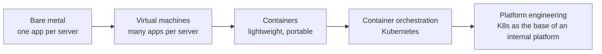

### 2. Imperative vs declarative

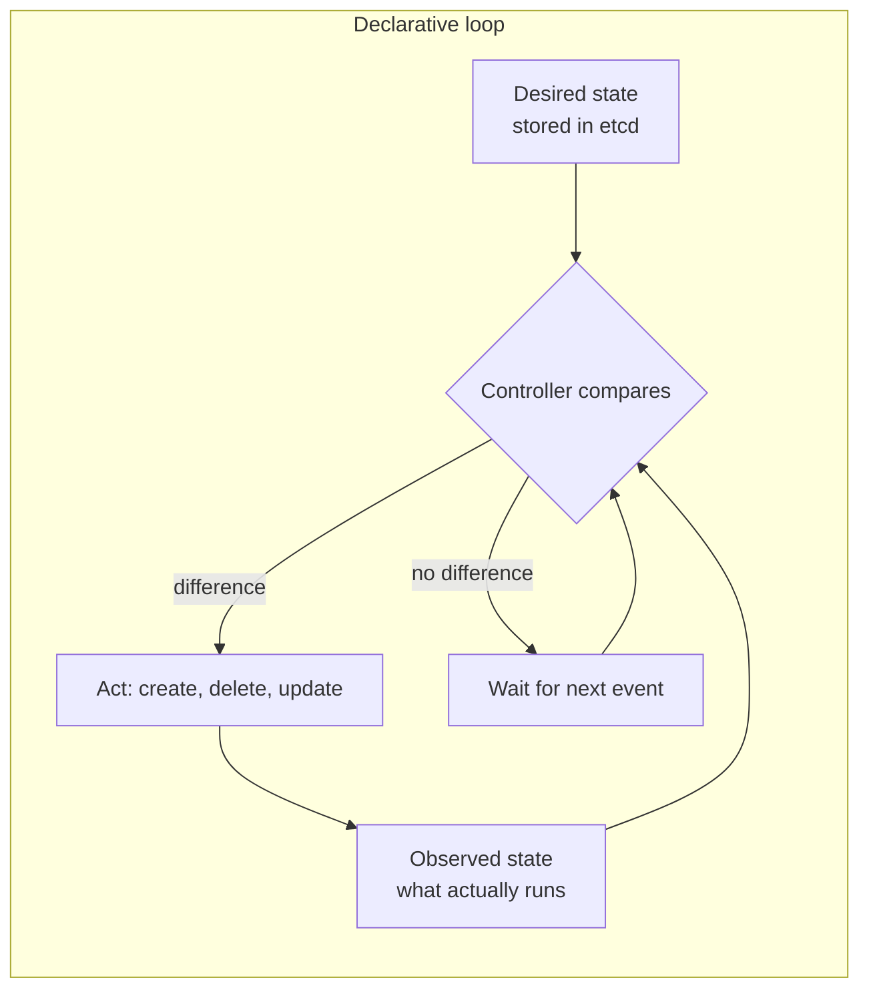

### 3. The object family tree

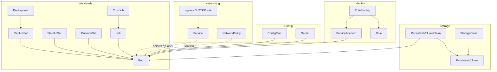

### 4. Control plane vs data plane

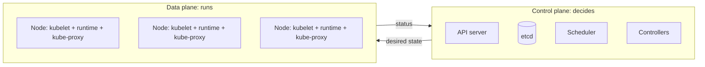

### 5. Labels, selectors and annotations

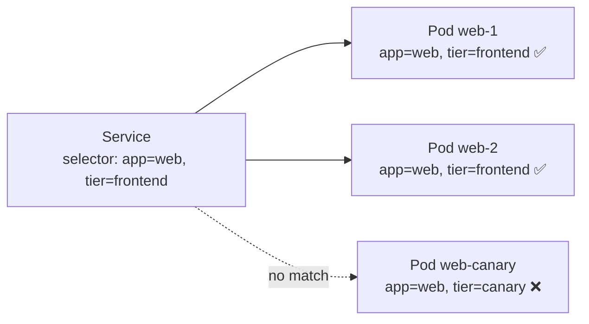

## Architecture 02 · kube-apiserver

Source: [Architecture 02 · kube-apiserver](../01-architecture/02-kube-apiserver.md)

### 6. The request pipeline

```mermaid
flowchart LR
    R[HTTPS request] --> TLS[TLS termination]
    TLS --> AUTHN[Authentication<br/>who are you?]
    AUTHN --> AUDIT[Audit logging]
    AUDIT --> APF[API Priority & Fairness<br/>rate limiting]
    APF --> AUTHZ[Authorization<br/>are you allowed?]
    AUTHZ --> MUT[Mutating admission<br/>defaults, sidecar injection]
    MUT --> SCHEMA[Schema validation]
    SCHEMA --> VAL[Validating admission<br/>policy checks]
    VAL --> ETCD[(Persist to etcd)]
    ETCD --> RESP[Response + watch event]
```

### 7. API groups, versions and maturity

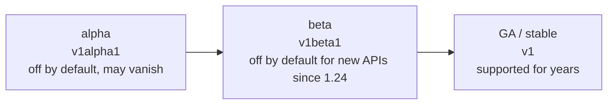

### 8. Optimistic concurrency and resourceVersion

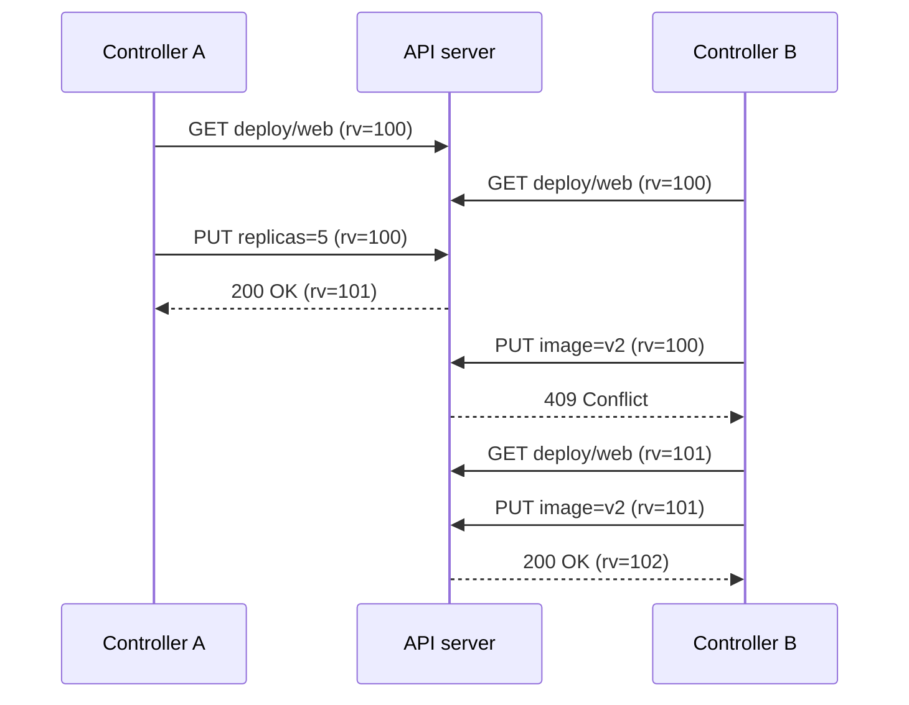

### 9. Watches: the nervous system

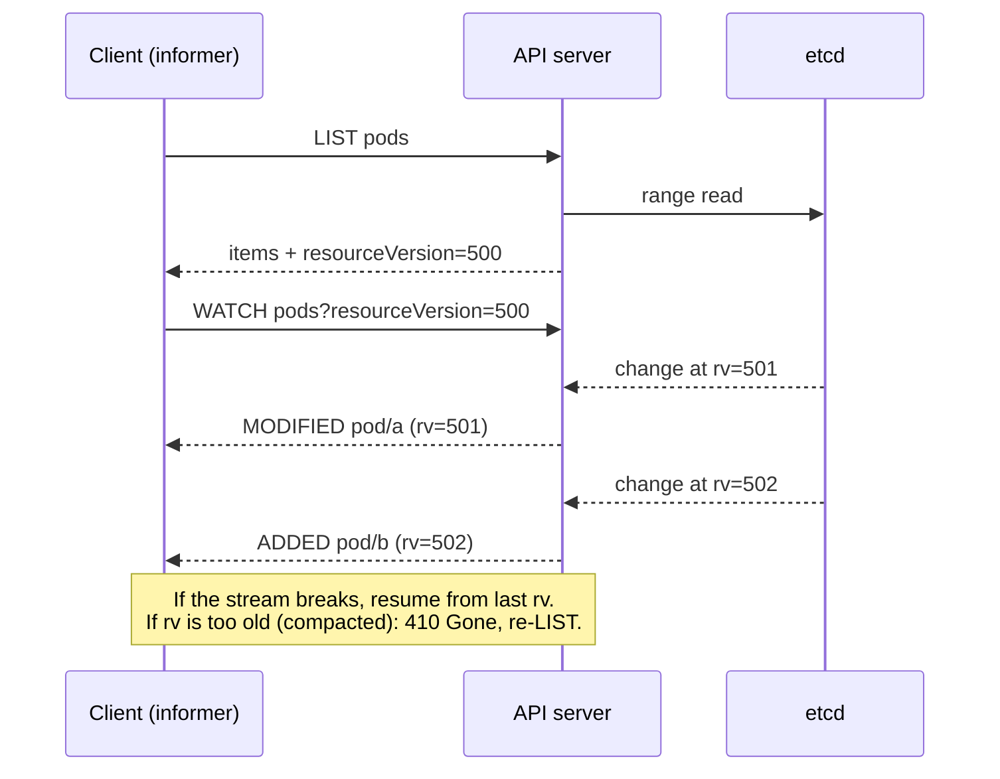

### 10. API aggregation

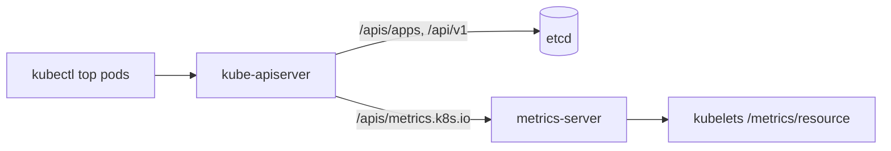

## Architecture 03 · etcd

Source: [Architecture 03 · etcd](../01-architecture/03-etcd.md)

### 11. Raft in one diagram

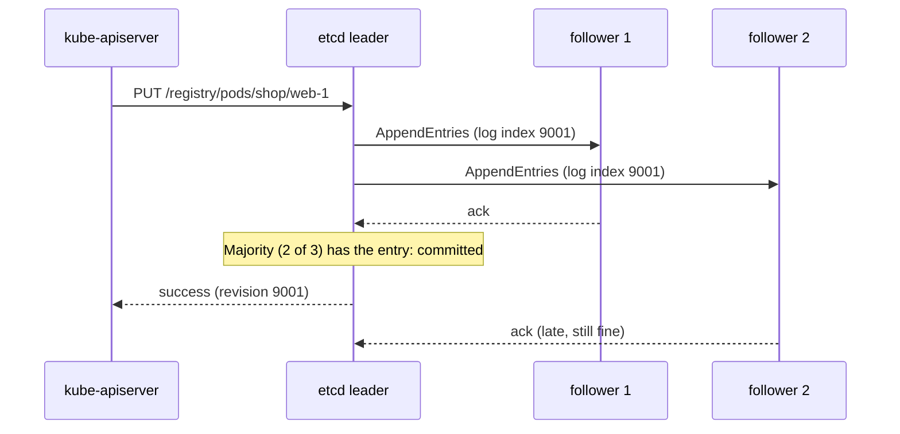

### 12. Quorum math

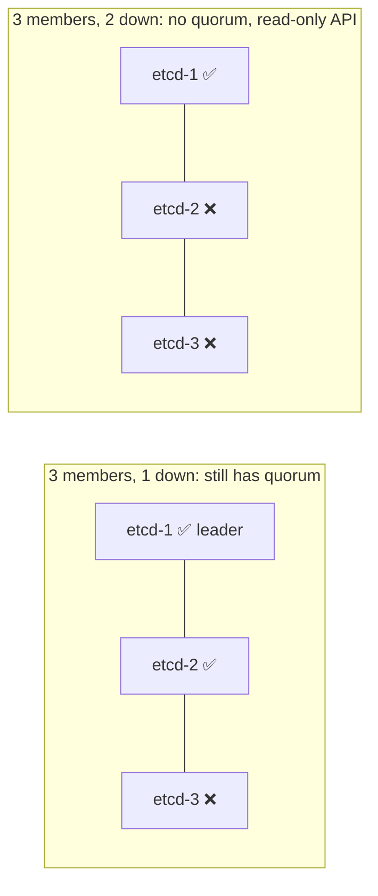

### 13. Revisions, history and compaction

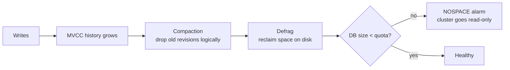

### 14. Backup and restore

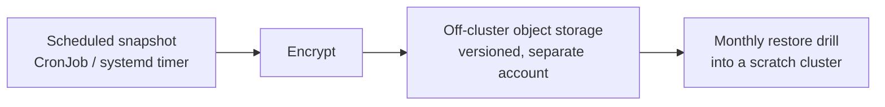

## Architecture 04 · kube-scheduler

Source: [Architecture 04 · kube-scheduler](../01-architecture/04-kube-scheduler.md)

### 15. The scheduling cycle

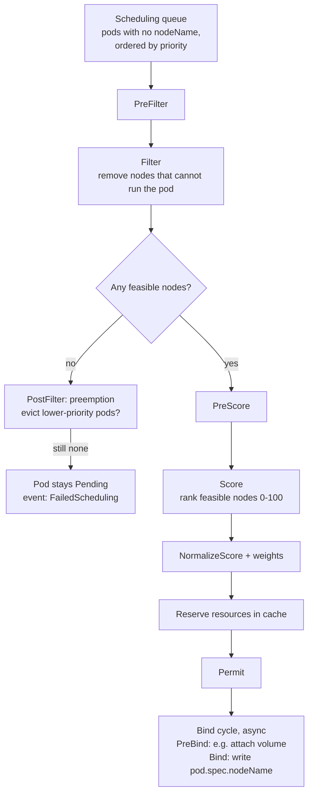

### 16. Placement controls at a glance

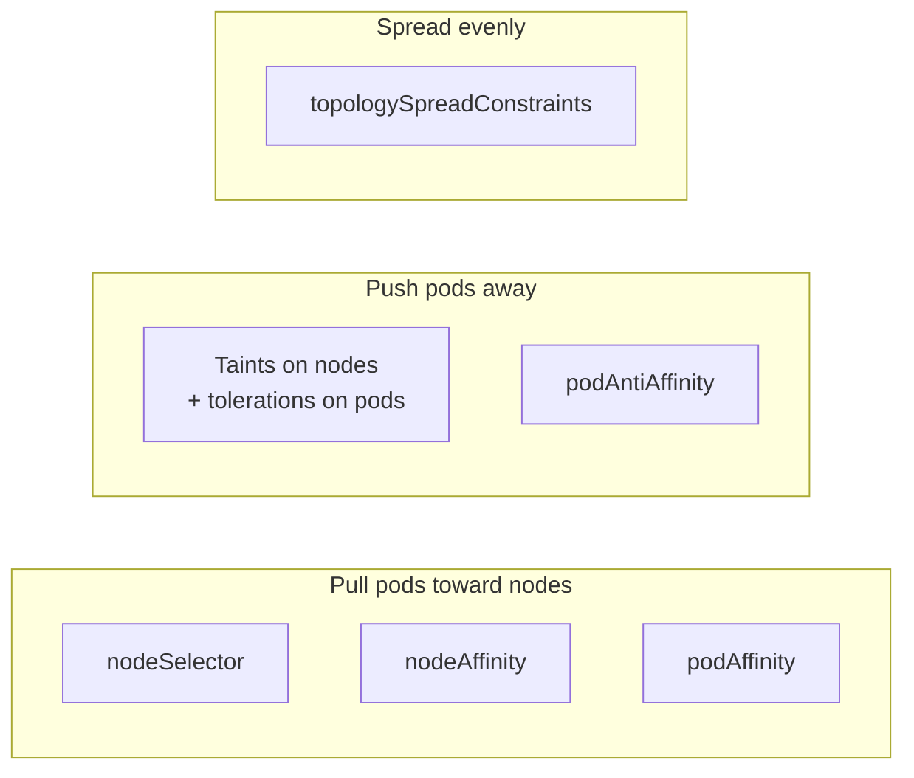

### 17. Priority and preemption

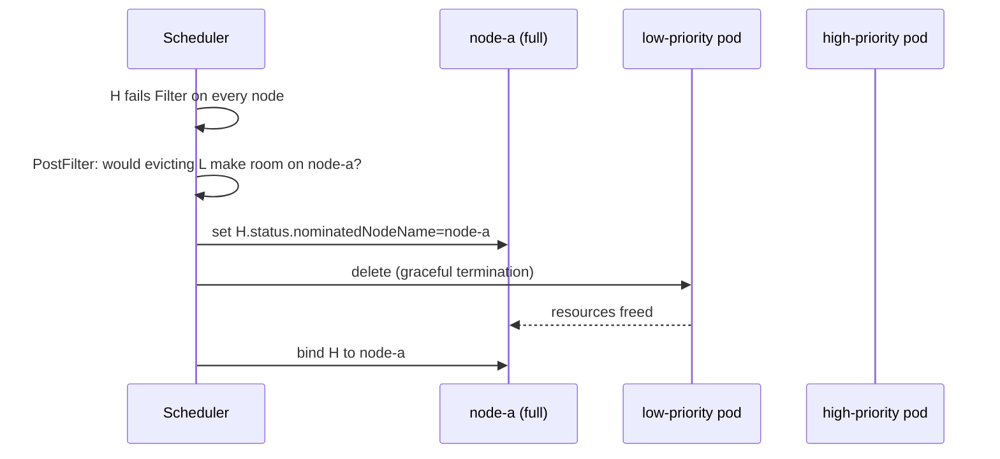

## Architecture 05 · Controllers & Reconciliation

Source: [Architecture 05 · Controllers & Reconciliation](../01-architecture/05-controllers-and-reconciliation.md)

### 18. The control loop

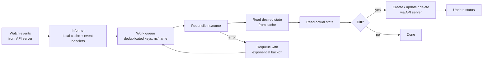

### 19. A Deployment, traced through three controllers

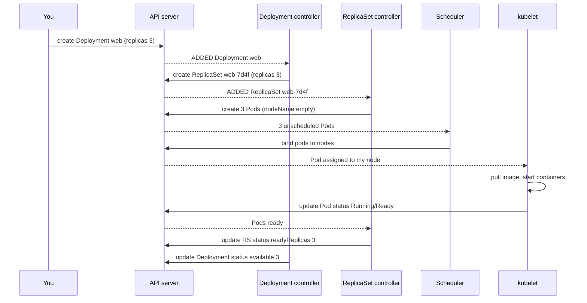

### 20. Rolling updates as reconciliation

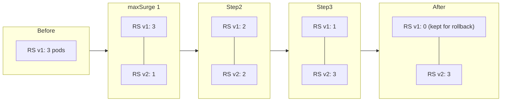

### 21. Owner references and garbage collection

```mermaid
flowchart TB
    D[Deployment web] -- ownerReference --> RS[ReplicaSet web-7d4f]
    RS -- ownerReference --> P1[Pod web-7d4f-a]
    RS -- ownerReference --> P2[Pod web-7d4f-b]
```

### 22. Finalizers: "don't delete me yet"

```mermaid
sequenceDiagram
    participant U as You
    participant API as API server
    participant C as Controller (e.g. PV protection)
    U->>API: delete PVC data
    API->>API: set deletionTimestamp, keep object
    API-->>C: MODIFIED PVC (being deleted)
    C->>C: is a pod still using it? wait
    C->>API: remove finalizer kubernetes.io/pvc-protection
    API->>API: no finalizers left: delete for real
```

## Architecture 06 · cloud-controller-manager

Source: [Architecture 06 · cloud-controller-manager](../01-architecture/06-cloud-controller-manager.md)

### 23. Architecture 06 · cloud-controller-manager

```mermaid
flowchart LR
    API[kube-apiserver] <--> CCM[cloud-controller-manager]
    CCM --> NC[Node controller]
    CCM --> RC[Route controller]
    CCM --> SC[Service controller]
    NC --> CLOUD[(Cloud APIs)]
    RC --> CLOUD
    SC --> CLOUD
```

### 24. How a LoadBalancer Service becomes a real load balancer

```mermaid
sequenceDiagram
    participant U as You
    participant API as API server
    participant CCM as Service controller (CCM)
    participant C as Cloud API
    U->>API: create Service type LoadBalancer
    API-->>CCM: ADDED Service
    CCM->>C: create LB, listeners, health checks,<br/>target = all nodes on NodePort
    C-->>CCM: LB hostname / IP
    CCM->>API: update status.loadBalancer.ingress
    Note over U,API: kubectl get svc now shows EXTERNAL-IP
    API-->>CCM: Node added / removed
    CCM->>C: update LB target list
```

## Architecture 07 · Worker Node: kubelet & Container Runtime

Source: [Architecture 07 · Worker Node: kubelet & Container Runtime](../01-architecture/07-worker-node-kubelet-runtime.md)

### 25. Architecture 07 · Worker Node: kubelet & Container Runtime

```mermaid
flowchart TB
    API[kube-apiserver] <-- watch pods for this node,<br/>report status, heartbeat lease --> KL
    subgraph Node["Worker node"]
        KL[kubelet]
        KL -- CRI gRPC --> CTD[containerd]
        CTD -- OCI --> RUNC[runc]
        RUNC --> C1[container]
        RUNC --> C2[container]
        KL -- CNI --> CNI[CNI plugin<br/>Calico / Cilium / VPC CNI]
        KL -- CSI --> CSI[CSI node plugin]
        KL --> CAD[cAdvisor<br/>resource stats]
        KP[kube-proxy] --> NF[iptables / IPVS / nftables]
        K[Linux kernel:<br/>namespaces, cgroups v2, netfilter]
    end
```

### 26. The kubelet's job

```mermaid
flowchart LR
    A[Pod assigned to this node] --> B[Admit<br/>enough resources? node conditions OK?]
    B --> C[Create pod sandbox<br/>pause container + network namespace]
    C --> D[CNI: attach pod network, assign IP]
    D --> E[Mount volumes<br/>ConfigMaps, Secrets, PVCs via CSI]
    E --> F[Pull images]
    F --> G[Run init containers, in order]
    G --> H[Start app + sidecar containers]
    H --> I[Run probes: startup, liveness, readiness]
    I --> J[Report status to API server]
    J --> I
```

### 27. CRI, containerd and runc

```mermaid
flowchart LR
    KL[kubelet] -- "CRI (gRPC):<br/>RunPodSandbox, CreateContainer,<br/>PullImage" --> CTD[containerd<br/>or CRI-O]
    CTD -- "OCI runtime spec<br/>(config.json)" --> R[runc / crun / gVisor / Kata]
    R --> K[Kernel: clone namespaces,<br/>set cgroups, pivot_root, exec]
```

### 28. Requests, limits and QoS

```mermaid
flowchart TB
    subgraph G["Guaranteed: requests = limits for every container (CPU and memory)"]
        g1[Evicted last]
    end
    subgraph B["Burstable: at least one request or limit set"]
        b1[Evicted by how far over request]
    end
    subgraph BE["BestEffort: no requests, no limits"]
        be1[Evicted first]
    end
    BE --> B --> G
```

### 29. Node-pressure eviction

```mermaid
flowchart LR
    M[Memory / disk / PID<br/>below threshold] --> C[Node condition<br/>MemoryPressure / DiskPressure / PIDPressure]
    C --> T[Taint node:<br/>no new pods scheduled]
    T --> R[Rank pods:<br/>BestEffort, then Burstable over request,<br/>then by priority]
    R --> E[Evict: pod Failed,<br/>reason Evicted]
    E --> RS[Controller recreates pod elsewhere]
```

## Architecture 08 · kube-proxy & Service Networking

Source: [Architecture 08 · kube-proxy & Service Networking](../01-architecture/08-kube-proxy-and-services.md)

### 30. Service types

```mermaid
flowchart TB
    subgraph LB["LoadBalancer: cloud LB → NodePort → pods"]
        subgraph NP["NodePort: nodeIP:30000-32767 → ClusterIP"]
            subgraph CIP["ClusterIP: virtual IP inside the cluster"]
                P[Pods selected by label]
            end
        end
    end
```

### 31. How a ClusterIP actually works

```mermaid
sequenceDiagram
    participant A as Pod A (10.244.1.5)
    participant K as Node kernel (netfilter rules)
    participant B as Pod B (10.244.2.9)
    A->>K: connect 10.96.0.50:80 (Service web)
    K->>K: match KUBE-SERVICES rule for 10.96.0.50:80
    K->>K: pick an endpoint at random (KUBE-SEP-*)
    K->>K: DNAT to 10.244.2.9:8080
    K->>B: packet to 10.244.2.9:8080
    B-->>A: reply (conntrack reverses the NAT)
```

### 32. EndpointSlices

```mermaid
flowchart LR
    SVC["Service web<br/>selector app=web"] --> ESC[EndpointSlice controller]
    PODS[Pods with app=web] --> ESC
    ESC --> ES["EndpointSlice web-abc<br/>10.244.1.7 ready<br/>10.244.2.9 ready<br/>10.244.3.4 terminating"]
    ES --> KP[kube-proxy on every node]
    ES --> IC[Ingress controllers, meshes]
```

### 33. NodePort and LoadBalancer traffic paths

```mermaid
flowchart LR
    C[Client] --> LB[Cloud LB]
    LB --> N1["Node 1 :31080"]
    LB --> N2["Node 2 :31080"]
    N1 -- "DNAT, may hop to another node" --> P2[Pod on Node 2]
    N2 --> P2
```

## Architecture 09 · Pod Networking & CNI

Source: [Architecture 09 · Pod Networking & CNI](../01-architecture/09-pod-networking-cni.md)

### 34. Four kinds of traffic

```mermaid
flowchart TB
    A["1 · Container to container<br/>same pod: localhost"] 
    B["2 · Pod to pod<br/>same node or across nodes: pod IPs, no NAT"]
    C["3 · Pod to Service<br/>ClusterIP → DNAT to a pod IP (kube-proxy)"]
    D["4 · External to Service<br/>LoadBalancer / Ingress / Gateway"]
    A --> B --> C --> D
```

### 35. Inside a node

```mermaid
flowchart TB
    subgraph PodA["Pod A netns"]
        EA["eth0 10.244.1.5"]
    end
    subgraph PodB["Pod B netns"]
        EB["eth0 10.244.1.6"]
    end
    subgraph Host["Node root netns"]
        VA[vethA] 
        VB[vethB]
        BR["bridge cni0 / or per-pod routes"]
        ETH["eth0 node IP 192.168.1.10"]
    end
    EA --- VA
    EB --- VB
    VA --- BR
    VB --- BR
    BR --- ETH
```

### 36. Across nodes: overlay vs native routing

```mermaid
flowchart LR
    subgraph Overlay["Overlay (VXLAN / Geneve / IPIP)"]
        PA1[Pod 10.244.1.5] --> N1[Node 1<br/>encapsulate inside<br/>node-to-node packet]
        N1 -- "UDP 4789: outer 192.168.1.10 → 192.168.1.11" --> N2[Node 2<br/>decapsulate]
        N2 --> PB1[Pod 10.244.2.9]
    end
    subgraph Native["Native routing (BGP / cloud routes / VPC IPs)"]
        PA2[Pod 10.0.1.25] --> R[Network knows pod routes]
        R --> PB2[Pod 10.0.2.40]
    end
```

### 37. NetworkPolicy in one picture

```mermaid
flowchart LR
    FE["frontend pods<br/>app=frontend"] -- "allowed: TCP 8080" --> API["api pods<br/>app=api"]
    X["other pods"] -. denied .-> API
    API -- "allowed: TCP 5432" --> DB["db pods<br/>app=db"]
    API -- "allowed: UDP/TCP 53" --> DNS[CoreDNS]
```

## Architecture 10 · Cluster DNS & CoreDNS

Source: [Architecture 10 · Cluster DNS & CoreDNS](../01-architecture/10-dns-coredns.md)

### 38. The resolution path

```mermaid
sequenceDiagram
    participant App as App in pod (namespace shop)
    participant R as /etc/resolv.conf
    participant DNS as CoreDNS (Service 10.96.0.10)
    participant API as API server (watched)
    participant UP as Upstream DNS
    App->>R: resolve "payments"
    R-->>App: nameserver 10.96.0.10, search shop.svc.cluster.local ...
    App->>DNS: payments.shop.svc.cluster.local?
    DNS->>DNS: kubernetes plugin: Service found in cache
    DNS-->>App: A 10.96.14.20
    App->>DNS: api.github.com.shop.svc.cluster.local? (ndots search)
    DNS-->>App: NXDOMAIN
    App->>DNS: api.github.com?
    DNS->>UP: forward
    UP-->>DNS: A 140.82.x.x
    DNS-->>App: A 140.82.x.x
```

### 39. NodeLocal DNSCache

```mermaid
flowchart LR
    P[Pod] --> L["node-local-dns<br/>169.254.20.10 on every node<br/>(DaemonSet)"]
    L -- cache miss, cluster names --> C[CoreDNS pods]
    L -- cache miss, external --> U[Upstream]
```

## Architecture 11 · Storage & CSI

Source: [Architecture 11 · Storage & CSI](../01-architecture/11-storage-csi.md)

### 40. Volume types at a glance

```mermaid
flowchart TB
    subgraph Ephemeral["Ephemeral: lives and dies with the pod"]
        ED[emptyDir]
        CM[configMap / secret / downwardAPI / projected]
        GE[generic ephemeral volume]
    end
    subgraph Persistent["Persistent: outlives the pod"]
        PVC[persistentVolumeClaim] --> PV[PersistentVolume] --> BK[(EBS / Azure Disk / PD / Ceph / NFS / EFS)]
    end
    subgraph Node["Node-bound"]
        HP[hostPath: avoid in apps]
        LV[local PV]
    end
```

### 41. The PV / PVC / StorageClass trio

```mermaid
sequenceDiagram
    participant U as You
    participant API as API server
    participant P as external-provisioner (CSI sidecar)
    participant D as CSI controller plugin
    participant C as Cloud storage API
    participant S as Scheduler
    participant A as external-attacher
    participant K as kubelet + CSI node plugin
    U->>API: create PVC (class gp3, WaitForFirstConsumer)
    U->>API: create Pod using the PVC
    S->>API: pick node in zone ap-south-1a
    API-->>P: PVC needs provisioning in ap-south-1a
    P->>D: CreateVolume
    D->>C: create disk
    P->>API: create PV, bind to PVC
    API-->>A: VolumeAttachment for node
    A->>D: ControllerPublishVolume (attach disk to VM)
    K->>K: NodeStageVolume (format, mount to global path)
    K->>K: NodePublishVolume (bind mount into pod)
    K->>K: start container with /data mounted
```

### 42. Lifecycle and reclaim policy

```mermaid
stateDiagram-v2
    [*] --> Available: PV created (static or dynamic)
    Available --> Bound: PVC binds
    Bound --> Released: PVC deleted
    Released --> [*]: reclaimPolicy Delete (disk destroyed)
    Released --> Released: reclaimPolicy Retain (disk kept, manual cleanup)
```

### 43. CSI architecture

```mermaid
flowchart LR
    subgraph Controller["CSI controller Deployment"]
        EP[external-provisioner]
        EA[external-attacher]
        ER[external-resizer]
        ES[external-snapshotter]
        CP[CSI driver: controller service]
        EP --> CP
        EA --> CP
        ER --> CP
        ES --> CP
    end
    subgraph NodeDS["CSI node DaemonSet (every node)"]
        NR[node-driver-registrar]
        NP[CSI driver: node service]
    end
    KL[kubelet] -- gRPC unix socket --> NP
    CP --> CLOUD[(Storage API)]
```

## Architecture 12 · Life of a `kubectl apply`

Source: [Architecture 12 · Life of a `kubectl apply`](../01-architecture/12-life-of-kubectl-apply.md)

### 44. The full trace

```mermaid
sequenceDiagram
    autonumber
    participant K as kubectl
    participant API as kube-apiserver
    participant E as etcd
    participant DC as Deployment ctrl
    participant RC as ReplicaSet ctrl
    participant S as Scheduler
    participant KL as kubelet (node-2)
    participant CR as containerd
    participant CNI as CNI plugin
    participant ESC as EndpointSlice ctrl
    participant KP as kube-proxy (all nodes)

    K->>K: read kubeconfig, parse YAML, compute patch
    K->>API: PATCH (server-side apply) Deployment + Service
    API->>API: authn → APF → authz → mutating → validate → validating
    API->>E: write Deployment, Service
    E-->>API: committed
    API-->>K: 200 OK (deployment.apps/web configured)
    API-->>DC: watch event: Deployment web
    DC->>API: create ReplicaSet web-6c9f
    API-->>RC: watch event: ReplicaSet
    RC->>API: create Pods x3 (no nodeName)
    API-->>S: watch event: unscheduled Pods
    S->>S: filter + score nodes
    S->>API: Binding pod-a → node-2
    API-->>KL: watch event: Pod assigned to node-2
    KL->>CR: RunPodSandbox
    CR->>CNI: ADD network for sandbox
    CNI-->>CR: IP 10.244.2.17
    KL->>KL: mount volumes, fetch Secrets/ConfigMaps
    KL->>CR: PullImage, CreateContainer, StartContainer
    KL->>KL: startup → readiness probe passes
    KL->>API: Pod status Running, Ready=True, podIP
    API-->>ESC: watch event: Pod ready
    ESC->>API: update EndpointSlice for Service web
    API-->>KP: watch event: EndpointSlice changed
    KP->>KP: program iptables / nftables / IPVS
    Note over K,KP: Traffic to the Service now reaches the new pod
```

### 45. Where it can go wrong, mapped to each step

```mermaid
flowchart LR
    S1["kubectl → API"] --> F1["401/403, wrong context,<br/>webhook denied, schema error"]
    S2["Controllers"] --> F2["ResourceQuota exceeded,<br/>LimitRange rejects pod,<br/>PSA blocks privileged pod"]
    S3["Scheduler"] --> F3["Pending: insufficient CPU/memory,<br/>taints, affinity, PVC zone"]
    S4["kubelet + runtime"] --> F4["ImagePullBackOff, CreateContainerConfigError,<br/>ContainerCreating (CNI/CSI)"]
    S5["Container"] --> F5["CrashLoopBackOff, OOMKilled,<br/>liveness restarts"]
    S6["Readiness"] --> F6["Running but not Ready,<br/>no endpoints, 503s"]
    S7["Service / DNS / policy"] --> F7["selector mismatch, wrong targetPort,<br/>NetworkPolicy, DNS"]
```

## Architecture 13 · Pod Lifecycle & Termination

Source: [Architecture 13 · Pod Lifecycle & Termination](../01-architecture/13-pod-lifecycle.md)

### 46. Pod phases

```mermaid
stateDiagram-v2
    [*] --> Pending: accepted by API server
    Pending --> Running: scheduled, sandbox up,<br/>at least one container started
    Running --> Succeeded: all containers exited 0<br/>(restartPolicy Never/OnFailure)
    Running --> Failed: a container exited non-zero<br/>and won't be restarted
    Pending --> Failed: e.g. eviction, admission failure
    Running --> Unknown: node lost contact
    Unknown --> Running: node returns
    Succeeded --> [*]
    Failed --> [*]
```

### 47. Container states

```mermaid
stateDiagram-v2
    [*] --> Waiting: ContainerCreating, PodInitializing,<br/>ImagePullBackOff, CrashLoopBackOff,<br/>CreateContainerConfigError
    Waiting --> Running
    Running --> Terminated: exit code + reason<br/>(Completed, Error, OOMKilled)
    Terminated --> Waiting: restartPolicy says restart<br/>(with exponential backoff up to 5 min)
```

### 48. Init containers and native sidecars

```mermaid
flowchart LR
    I1[init: wait-for-db] --> I2[init: run migrations]
    I2 --> SC["sidecar: log shipper<br/>(init container with restartPolicy: Always)"]
    SC --> APP[app container]
```

### 49. Graceful termination: the most misunderstood sequence

```mermaid
sequenceDiagram
    participant U as kubectl delete / rollout / scale-in
    participant API as API server
    participant KL as kubelet
    participant C as container
    participant ES as EndpointSlice ctrl
    participant KP as kube-proxy / ingress
    U->>API: delete pod
    API->>API: set deletionTimestamp, grace 30s
    par in parallel
        API-->>KL: pod terminating
        KL->>C: run preStop hook (e.g. sleep 10)
        KL->>C: SIGTERM after preStop
    and
        API-->>ES: pod terminating
        ES->>API: mark endpoint not ready / remove
        API-->>KP: update rules (takes a moment)
    end
    C->>C: stop accepting, finish in-flight requests, exit
    KL->>C: SIGKILL if still alive at 30s
    KL->>API: pod gone
```

## Architecture 14 · Authentication, Authorization & Admission

Source: [Architecture 14 · Authentication, Authorization & Admission](../01-architecture/14-authn-authz-admission.md)

### 50. Architecture 14 · Authentication, Authorization & Admission

```mermaid
flowchart LR
    REQ[Request] --> AN{Authentication}
    AN -- fail --> E401[401]
    AN -- user, groups --> AZ{Authorization<br/>RBAC, Node, Webhook}
    AZ -- deny --> E403[403]
    AZ -- allow --> MA[Mutating admission]
    MA --> VA{Validating admission<br/>PSA, VAP, webhooks}
    VA -- reject --> E400[Denied with message]
    VA -- accept --> ETCD[(etcd)]
```

### 51. Authentication: who are you?

```mermaid
sequenceDiagram
    participant U as Engineer
    participant K as kubectl + kubelogin
    participant IDP as Identity provider (OIDC)
    participant API as API server
    U->>K: kubectl get pods
    K->>IDP: browser login (SSO + MFA)
    IDP-->>K: ID token (sub, email, groups)
    K->>API: request with Bearer token
    API->>API: verify signature with IdP keys,<br/>map claims to user + groups
    API-->>K: response (RBAC decides)
```

### 52. Authorization: RBAC

```mermaid
flowchart LR
    subgraph Subjects
        U[User alice]
        G[Group platform-team]
        SA[ServiceAccount ci-deployer]
    end
    subgraph Bindings
        RB[RoleBinding<br/>namespace-scoped]
        CRB[ClusterRoleBinding<br/>cluster-wide]
    end
    subgraph Roles
        R[Role<br/>rules in one namespace]
        CR[ClusterRole<br/>reusable / cluster-scoped rules]
    end
    U --> RB
    SA --> RB
    G --> CRB
    RB --> R
    RB --> CR
    CRB --> CR
```

### 53. Admission control

```mermaid
flowchart TB
    subgraph Mutating["Mutating (can change the object)"]
        M1[ServiceAccount, DefaultStorageClass,<br/>DefaultTolerationSeconds]
        M2[MutatingAdmissionPolicy / webhooks:<br/>sidecar injection, label defaults]
    end
    subgraph Validating["Validating (accept or reject)"]
        V1[Built-in: NamespaceLifecycle, LimitRanger,<br/>ResourceQuota, NodeRestriction]
        V2[Pod Security Admission]
        V3[ValidatingAdmissionPolicy: CEL, in-process]
        V4[Webhooks: Kyverno, OPA Gatekeeper]
    end
    Mutating --> Validating
```

## Architecture 15 · High Availability Control Plane

Source: [Architecture 15 · High Availability Control Plane](../01-architecture/15-high-availability.md)

### 54. Stacked etcd topology

```mermaid
flowchart TB
    LB["Load balancer :6443<br/>(cloud NLB, HAProxy + keepalived, kube-vip)"]
    subgraph CP1["Control plane 1 (zone a)"]
        A1[apiserver] --- E1[(etcd)]
        S1[scheduler] 
        C1[controller-manager]
    end
    subgraph CP2["Control plane 2 (zone b)"]
        A2[apiserver] --- E2[(etcd)]
        S2[scheduler]
        C2[controller-manager]
    end
    subgraph CP3["Control plane 3 (zone c)"]
        A3[apiserver] --- E3[(etcd)]
        S3[scheduler]
        C3[controller-manager]
    end
    LB --> A1
    LB --> A2
    LB --> A3
    E1 <--> E2
    E2 <--> E3
    E1 <--> E3
    W[Workers / kubectl] --> LB
```

### 55. External etcd topology

```mermaid
flowchart TB
    LB[Load balancer :6443]
    subgraph CPs["Control plane nodes"]
        A1[apiserver 1]
        A2[apiserver 2]
        A3[apiserver 3]
    end
    subgraph ETCD["Dedicated etcd cluster"]
        E1[(etcd 1)]
        E2[(etcd 2)]
        E3[(etcd 3)]
    end
    LB --> A1
    LB --> A2
    LB --> A3
    A1 --> ETCD
    A2 --> ETCD
    A3 --> ETCD
```

### 56. Failure scenarios

```mermaid
flowchart LR
    F1["1 control plane node lost"] --> R1["API OK via other replicas,<br/>etcd keeps quorum (2/3),<br/>new leader elected for scheduler/KCM"]
    F2["2 of 3 etcd members lost"] --> R2["No quorum: API rejects writes,<br/>running pods unaffected,<br/>restore quorum or restore from snapshot"]
    F3["Load balancer lost"] --> R3["Clients and kubelets can't reach API,<br/>nodes eventually NotReady in status,<br/>workloads keep running"]
    F4["Whole zone lost"] --> R4["Survives if etcd members and<br/>worker capacity span 3 zones"]
```

## Architecture 16 · Ingress & Gateway API: North-South Traffic

Source: [Architecture 16 · Ingress & Gateway API: North-South Traffic](../01-architecture/16-ingress-gateway-traffic.md)

### 57. The full path from browser to pod

```mermaid
flowchart LR
    U[Browser] --> DNS[DNS: shop.example.com<br/>→ LB address]
    DNS --> LB[Cloud load balancer<br/>L4 or L7]
    LB --> IC[Ingress / Gateway controller pods<br/>NGINX, Envoy Gateway, Traefik,<br/>Istio, Cilium, ALB]
    IC -- "Host + path rules, TLS" --> S1[Service web]
    IC --> S2[Service api]
    S1 --> P1[web pods]
    S2 --> P2[api pods]
```

### 58. Gateway API

```mermaid
flowchart TB
    subgraph Infra["Infrastructure provider"]
        GC[GatewayClass<br/>which controller implements gateways]
    end
    subgraph Ops["Cluster operator / platform team"]
        GW[Gateway<br/>listeners: ports, hostnames, TLS,<br/>which namespaces may attach routes]
    end
    subgraph Dev["Application teams"]
        HR1[HTTPRoute shop]
        HR2[HTTPRoute payments]
        GR[GRPCRoute / TCPRoute / TLSRoute]
    end
    GC --> GW
    HR1 -- parentRefs --> GW
    HR2 -- parentRefs --> GW
    GR -- parentRefs --> GW
    HR1 --> SVC1[Service web / api]
    HR2 --> SVC2[Service payments]
```

### 59. TLS with cert-manager

```mermaid
sequenceDiagram
    participant I as Ingress / Gateway (annotated)
    participant CM as cert-manager
    participant LE as Let's Encrypt (ACME)
    participant S as Secret shop-tls
    I->>CM: needs cert for shop.example.com
    CM->>LE: order certificate
    LE-->>CM: HTTP-01 or DNS-01 challenge
    CM->>CM: solve challenge
    LE-->>CM: signed certificate
    CM->>S: store tls.crt / tls.key
    Note over CM,S: renews automatically ~30 days before expiry
```

## Architecture 17 · Extending Kubernetes

Source: [Architecture 17 · Extending Kubernetes](../01-architecture/17-extending-kubernetes.md)

### 60. Architecture 17 · Extending Kubernetes

```mermaid
flowchart TB
    subgraph API["Extend the API"]
        CRD[CustomResourceDefinitions]
        AGG[API aggregation]
    end
    subgraph Behaviour["Extend behaviour"]
        CTRL[Custom controllers / operators]
        ADM[Admission webhooks & CEL policies]
        SCHED[Scheduler plugins / custom schedulers]
    end
    subgraph Node["Extend the node"]
        CNI[CNI: networking]
        CSI[CSI: storage]
        CRI[CRI / RuntimeClass]
        DP[Device plugins & DRA: GPUs, FPGAs]
    end
    subgraph Client["Extend the client"]
        KP[kubectl plugins via krew]
    end
```

### 61. Operators: CRD + controller + operational knowledge

```mermaid
sequenceDiagram
    participant U as App team
    participant API as API server
    participant OP as Database operator
    participant K8s as Built-in objects
    participant EXT as External system (cloud DB / backups)
    U->>API: create Database orders (postgres, 50GB)
    API-->>OP: watch event
    OP->>API: create StatefulSet, Service, Secret, PVCs
    OP->>EXT: configure backups, monitoring
    OP->>API: status.phase = Ready
    Note over OP: Keeps reconciling: failover, upgrades,<br/>resizing, backups. The "operator" is the<br/>human SRE's runbook encoded as code.
```

## Architecture 18 · Managed Kubernetes: EKS, AKS, GKE

Source: [Architecture 18 · Managed Kubernetes: EKS, AKS, GKE](../01-architecture/18-managed-kubernetes.md)

### 62. The shared responsibility line

```mermaid
flowchart TB
    subgraph Provider["Provider owns"]
        A[API server, etcd, scheduler,<br/>controller managers]
        B[Control plane HA, patching, backups of etcd]
        C[Control plane scaling]
    end
    subgraph Shared["Shared / configurable"]
        D[Node OS images and upgrades<br/>managed node groups / node auto-provisioning]
        E[Cluster version upgrades: you trigger, they execute]
        F[Add-ons: CNI, CoreDNS, kube-proxy, CSI drivers]
    end
    subgraph You["You own"]
        G[Workloads, manifests, Helm charts]
        H[RBAC, network policies, pod security]
        I[Secrets management, image security]
        J[App backups, DR, observability]
        K[Cost, capacity, autoscaling config]
    end
```

### 63. EKS architecture

```mermaid
flowchart LR
    subgraph AWSAcct["AWS-managed VPC"]
        CP[EKS control plane<br/>API servers + etcd across 3 AZs]
    end
    subgraph YourVPC["Your VPC"]
        ENI[Cross-account ENIs<br/>for control plane → node traffic]
        subgraph Nodes["Data plane"]
            MNG[Managed node groups]
            KAR[Karpenter-provisioned nodes]
            FG[Fargate pods]
        end
        ALB[ALB / NLB<br/>via AWS Load Balancer Controller]
    end
    U[kubectl] -- "public / private endpoint<br/>IAM auth (access entries)" --> CP
    CP --> ENI --> Nodes
    ALB --> Nodes
```

<!-- devopsshack:footer -->
---

<p align="center">
  Made with ❤️ by <b><a href="https://devopsshack.com">DevOps Shack</a></b> · Part of <b>Kubernetes Mastery: Zero to Production</b><br/>
  <a href="https://www.youtube.com/@devopsshack">YouTube · DevOps Shack</a> · <a href="https://www.youtube.com/@shackverse">YouTube · DevOps Shack Hindi</a> · <a href="https://devopsshack.com">devopsshack.com</a> · <a href="https://www.instagram.com/devopsshack">Instagram · @devopsshack</a><br/>
  <sub>© DevOps Shack. Original content created by DevOps Shack. Free to learn from and share with credit to DevOps Shack. See <a href="../LICENSE">LICENSE</a>.</sub>
</p>
<!-- /devopsshack:footer -->
