<!-- devopsshack:header -->
> ☸️ **Kubernetes Mastery: Zero to Production** · by **DevOps Shack** · [YouTube](https://www.youtube.com/@devopsshack) · [Hindi channel](https://www.youtube.com/@shackverse) · [devopsshack.com](https://devopsshack.com)
<!-- /devopsshack:header -->

# Diagrams · Learning Module Diagrams

## Module 01 · Foundations & Your First Cluster

Source: [Module 01 · Foundations & Your First Cluster](../02-modules/01-foundations-and-setup.md)

### 1. kubeconfig and contexts

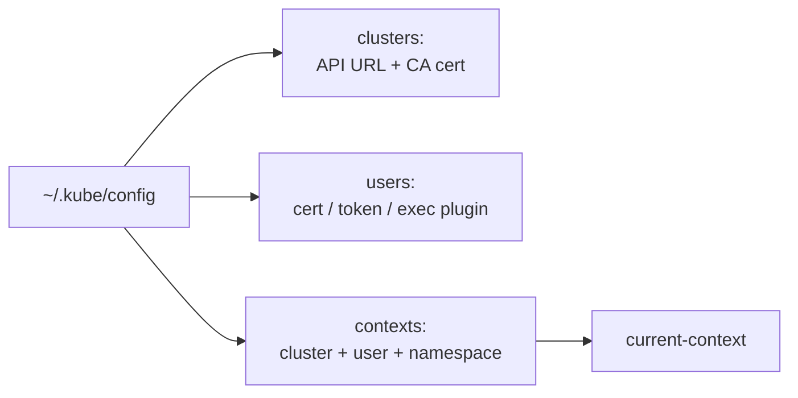

## Module 02 · Pods

Source: [Module 02 · Pods](../02-modules/02-pods.md)

### 2. Module 02 · Pods

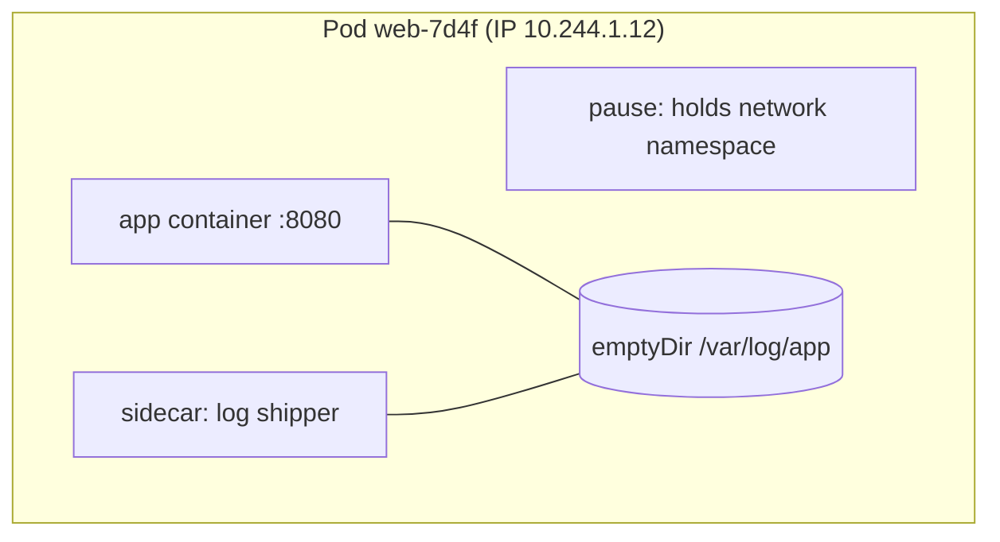

### 3. Multi-container patterns

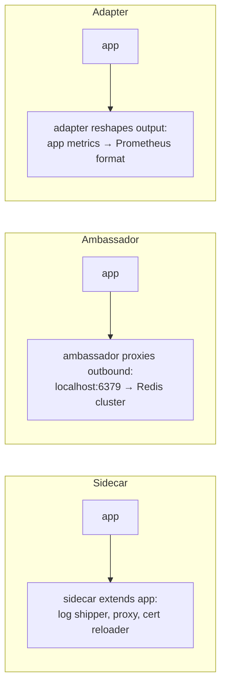

## Module 03 · Namespaces, Labels & Annotations

Source: [Module 03 · Namespaces, Labels & Annotations](../02-modules/03-namespaces-labels-annotations.md)

### 4. Namespaces

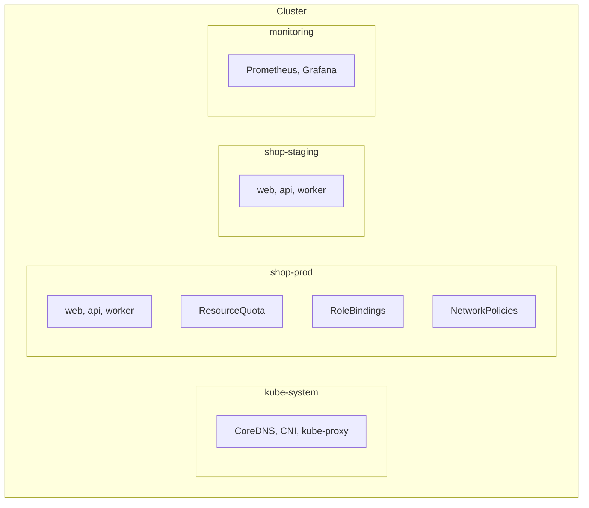

### 5. Labels

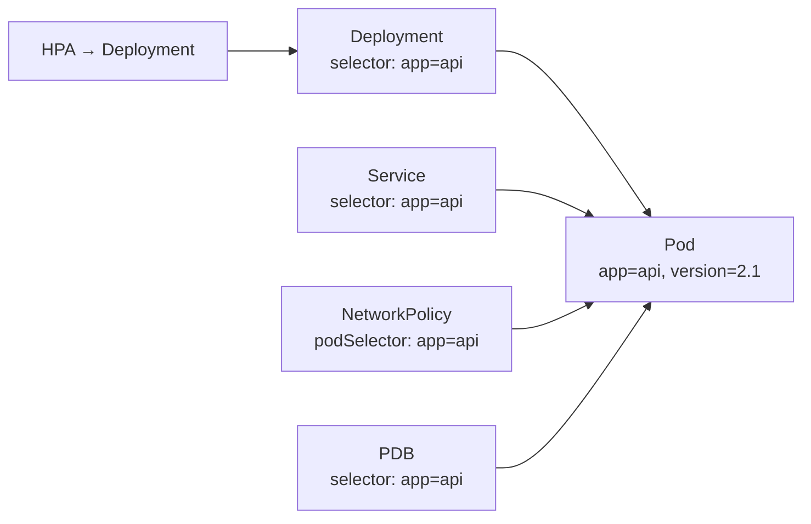

## Module 04 · Deployments & ReplicaSets

Source: [Module 04 · Deployments & ReplicaSets](../02-modules/04-deployments.md)

### 6. Module 04 · Deployments & ReplicaSets

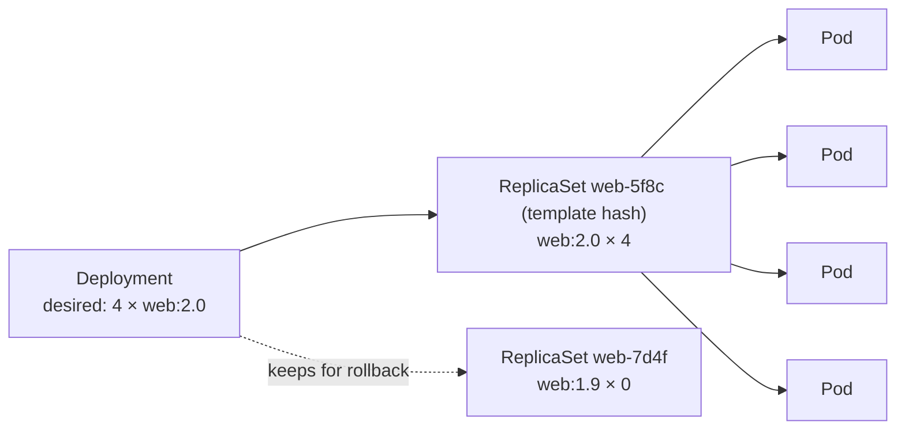

### 7. Rolling update mechanics

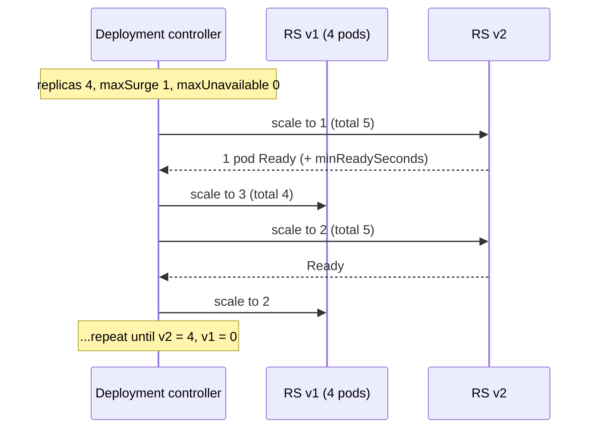

## Module 05 · Services

Source: [Module 05 · Services](../02-modules/05-services.md)

### 8. Module 05 · Services

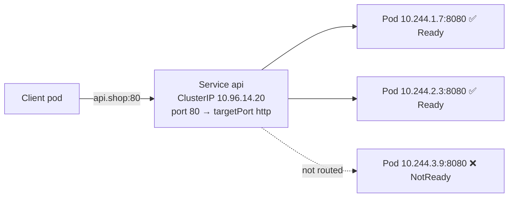

### 9. Choosing a type

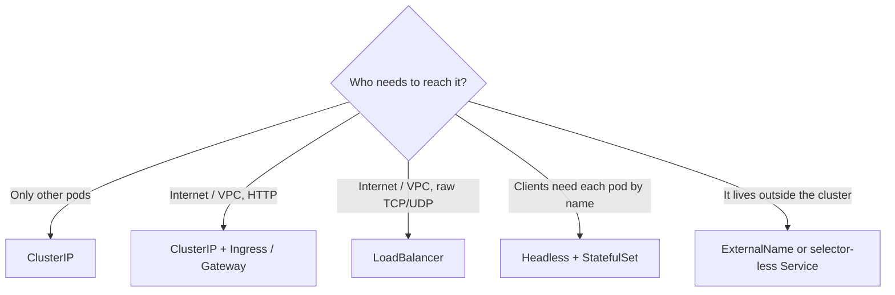

## Module 06 · ConfigMaps & Secrets

Source: [Module 06 · ConfigMaps & Secrets](../02-modules/06-configmaps-secrets.md)

### 10. Module 06 · ConfigMaps & Secrets

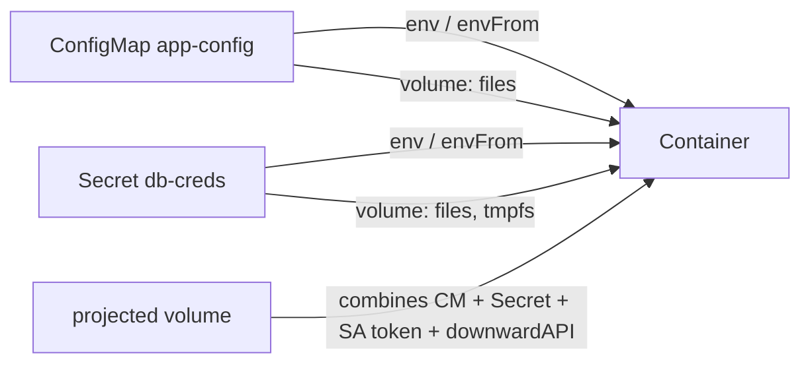

### 11. The truth about Secrets

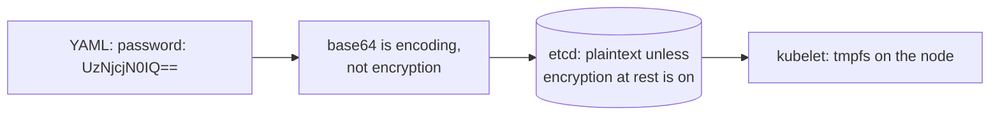

## Module 07 · Storage: Volumes, PVs & PVCs

Source: [Module 07 · Storage: Volumes, PVs & PVCs](../02-modules/07-storage.md)

### 12. Decision guide

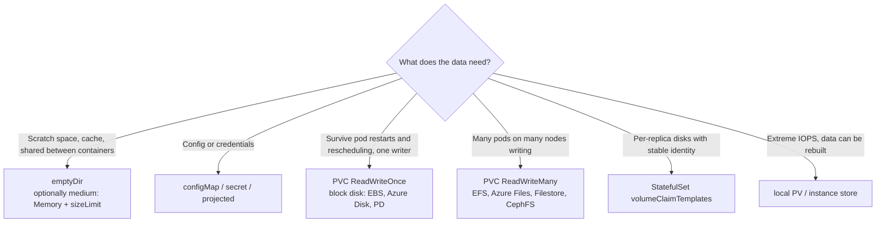

## Module 08 · StatefulSets

Source: [Module 08 · StatefulSets](../02-modules/08-statefulsets.md)

### 13. Module 08 · StatefulSets

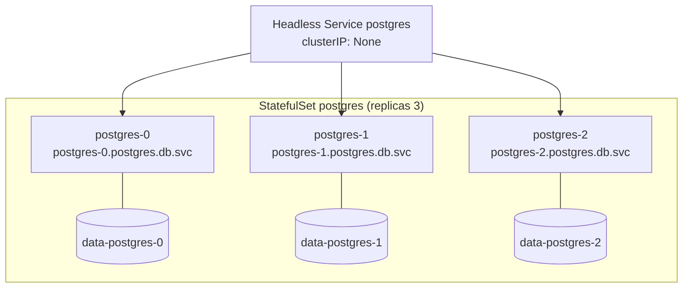

### 14. Updates and partitions

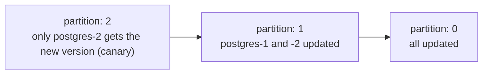

### 15. What a StatefulSet does NOT do

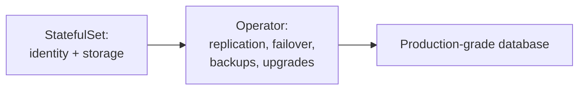

## Module 09 · DaemonSets, Jobs & CronJobs

Source: [Module 09 · DaemonSets, Jobs & CronJobs](../02-modules/09-daemonsets-jobs-cronjobs.md)

### 16. DaemonSets: one pod per node

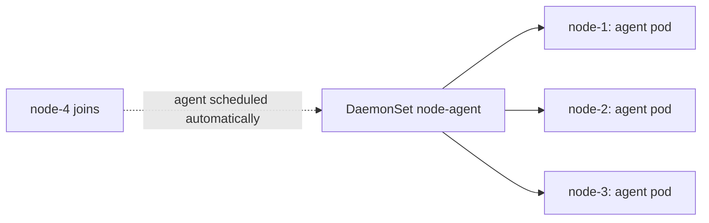

### 17. Jobs: run to completion

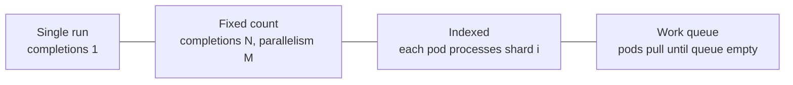

## Module 10 · Resource Management: Requests, Limits, Quotas

Source: [Module 10 · Resource Management: Requests, Limits, Quotas](../02-modules/10-resource-management.md)

### 18. Requests vs limits

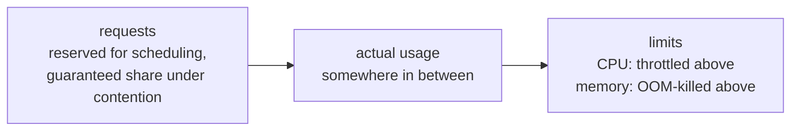

### 19. Practical sizing approach

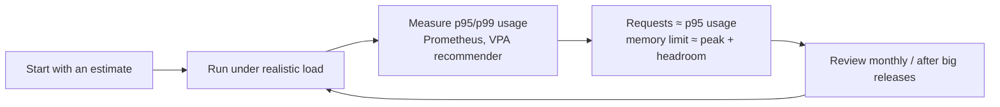

## Module 11 · Health Probes & Lifecycle Hooks

Source: [Module 11 · Health Probes & Lifecycle Hooks](../02-modules/11-health-probes-lifecycle.md)

### 20. The three probes

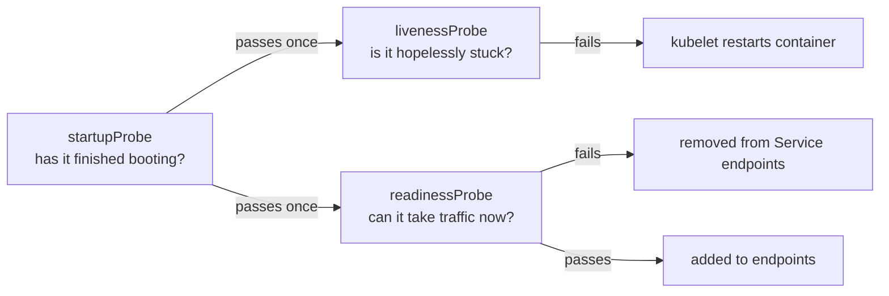

### 21. Designing good probes

```mermaid
sequenceDiagram
    participant DB as Database
    participant P as 50 API pods
    participant K as kubelets
    Note over DB: 30-second blip
    K->>P: liveness: /healthz checks DB → fails
    K->>P: restart all 50 pods
    Note over P: Cold start storm, caches empty,<br/>DB hammered on reconnect: outage extends
```

### 22. Graceful shutdown, the full recipe

```mermaid
sequenceDiagram
    participant K as kubelet
    participant A as App
    participant LB as Endpoints / LBs
    K->>A: preStop: sleep 10s
    K-->>LB: (in parallel) endpoint removed, rules updating
    K->>A: SIGTERM
    A->>A: stop accepting new connections
    A->>A: finish in-flight requests (≤ 20s)
    A->>A: close DB pools, flush logs
    A-->>K: exit 0
    Note over K: SIGKILL only if still alive after terminationGracePeriodSeconds
```

## Module 12 · Advanced Scheduling

Source: [Module 12 · Advanced Scheduling](../02-modules/12-scheduling.md)

### 23. Recipe 1: Dedicated node pool for one team or workload

```mermaid
flowchart LR
    T["Taint nodes<br/>dedicated=payments:NoSchedule<br/>(keeps everyone else out)"] --> N[(payments node pool)]
    A["Pods: toleration + nodeAffinity<br/>(allowed in AND pulled in)"] --> N
    O[Other pods] -. repelled .-> N
```

### 24. Recipe 2: Survive a zone outage

```mermaid
flowchart LR
    subgraph za[zone a]
        a1[api]
        a2[api]
    end
    subgraph zb[zone b]
        b1[api]
        b2[api]
    end
    subgraph zc[zone c]
        c1[api]
        c2[api]
    end
```

## Module 13 · Autoscaling

Source: [Module 13 · Autoscaling](../02-modules/13-autoscaling.md)

### 25. Module 13 · Autoscaling

```mermaid
flowchart TB
    subgraph Pods["More pods (horizontal)"]
        HPA[HorizontalPodAutoscaler<br/>CPU, memory, custom, external metrics]
        KEDA[KEDA<br/>event-driven, scale to zero]
    end
    subgraph Size["Bigger pods (vertical)"]
        VPA[VerticalPodAutoscaler<br/>right-size requests]
    end
    subgraph Nodes["More nodes (cluster)"]
        CA[Cluster Autoscaler<br/>node groups]
        KAR[Karpenter / NAP<br/>just-in-time nodes]
    end
    HPA -- creates pending pods --> CA
    HPA --> KAR
```

### 26. HPA

```mermaid
flowchart LR
    MS[metrics-server<br/>or Prometheus Adapter] --> HPA[HPA controller<br/>every 15s]
    HPA -- "desired = ceil(current × currentMetric / target)" --> D[Deployment replicas]
```

### 27. Node autoscaling

```mermaid
sequenceDiagram
    participant HPA
    participant S as Scheduler
    participant NA as Cluster Autoscaler / Karpenter
    participant Cloud
    HPA->>S: 10 new pods
    S-->>NA: 4 pods Pending (Insufficient cpu)
    NA->>Cloud: launch nodes that fit them
    Cloud-->>S: nodes Ready
    S->>S: bind pending pods
    Note over NA: Later: underused nodes are drained<br/>and removed (respecting PDBs)
```

## Module 14 · Ingress & Gateway API

Source: [Module 14 · Ingress & Gateway API](../02-modules/14-ingress-gateway-api.md)

### 28. Migrating from Ingress

```mermaid
flowchart LR
    A[Inventory Ingresses<br/>+ annotations in use] --> B[Run ingress2gateway<br/>to draft Gateway/HTTPRoutes]
    B --> C[Stand up Gateway<br/>alongside existing controller]
    C --> D[Shift DNS or weighted LB<br/>gradually]
    D --> E[Remove old Ingresses<br/>and controller]
```

## Module 15 · Network Policies

Source: [Module 15 · Network Policies](../02-modules/15-network-policies.md)

### 29. The mental model

```mermaid
flowchart TB
    A["Pod not selected by any policy"] --> OPEN[All traffic allowed]
    B["Pod selected by a policy with policyTypes: Ingress"] --> ING[Only listed ingress allowed]
    C["Pod selected by a policy with policyTypes: Egress"] --> EG[Only listed egress allowed]
    D["Several policies select the pod"] --> UNION[Allowed = union of all rules<br/>no explicit deny in the core API]
```

### 30. Step 3: allow the real flows

```mermaid
flowchart LR
    ING["ingress controller<br/>ns: ingress"] -- 8080 --> WEB[web]
    WEB -- 8080 --> API[api]
    API -- 5432 --> DB[postgres]
    PROM["prometheus<br/>ns: monitoring"] -- 9090 --> WEB
    PROM -- 9090 --> API
```

## Module 16 · RBAC & ServiceAccounts

Source: [Module 16 · RBAC & ServiceAccounts](../02-modules/16-rbac-service-accounts.md)

### 31. A typical access model

```mermaid
flowchart TB
    subgraph IdP["Identity provider groups"]
        G1[k8s-platform-admins]
        G2[team-payments-devs]
        G3[team-payments-oncall]
        G4[auditors]
    end
    G1 -- ClusterRoleBinding --> CA[cluster-admin]
    G2 -- RoleBinding in payments-dev --> ED[edit]
    G2 -- RoleBinding in payments-prod --> VW[view]
    G3 -- RoleBinding in payments-prod --> OC[custom: oncall<br/>view + exec + rollout restart]
    G4 -- ClusterRoleBinding --> RO[custom: read-only, no secrets]
    subgraph Workloads
        SA1[SA argocd-application-controller] --> GITOPS[cluster-wide deploy rights]
        SA2[SA payments-api] --> NONE[no API access]
    end
```

## Module 17 · Pod Security & Cluster Hardening

Source: [Module 17 · Pod Security & Cluster Hardening](../02-modules/17-pod-security-hardening.md)

### 32. Defence in depth

```mermaid
flowchart TB
    L1[Supply chain: trusted base images, scanning, signing, SBOMs] --> L2[Admission: Pod Security, policies, image verification]
    L2 --> L3[Workload: securityContext, least-privilege SA, no secrets in env]
    L3 --> L4[Network: NetworkPolicies, mTLS, egress control]
    L4 --> L5[Runtime: seccomp, AppArmor/SELinux, Falco/Tetragon detection]
    L5 --> L6[Cluster: RBAC, audit logs, etcd encryption, API not public, patched nodes]
```

### 33. Supply chain security

```mermaid
flowchart LR
    SRC[Source] --> BUILD[CI build<br/>minimal / distroless base]
    BUILD --> SCAN[Scan: Trivy / Grype<br/>fail on critical CVEs]
    SCAN --> SBOM[Generate SBOM: Syft]
    SBOM --> SIGN[Sign: cosign keyless<br/>+ provenance attestation]
    SIGN --> REG[(Registry)]
    REG --> ADM[Admission verifies signature<br/>Kyverno / policy-controller]
    ADM --> RUN[Runs in cluster]
    RUN --> RESCAN[Continuous rescans<br/>new CVEs on old images]
```

## Module 18 · Secrets Management in Production

Source: [Module 18 · Secrets Management in Production](../02-modules/18-secrets-management.md)

### 34. The options

```mermaid
flowchart TB
    subgraph A["External Secrets Operator"]
        V1[(AWS Secrets Manager / Vault /<br/>Azure Key Vault / GCP Secret Manager)] --> ESO[ESO controller] --> KS1[K8s Secret] --> P1[Pod]
    end
    subgraph B["Secrets Store CSI Driver"]
        V2[(Vault / cloud vault)] --> CSI[CSI driver] --> F[Mounted file in pod<br/>optional sync to Secret]
    end
    subgraph C["Encrypted in Git"]
        G[Git: SealedSecret / SOPS file] --> CTRL[Sealed Secrets controller<br/>or Flux/Argo SOPS decryption] --> KS2[K8s Secret]
    end
```

### 35. Rotation without downtime

```mermaid
sequenceDiagram
    participant V as Vault
    participant ESO
    participant S as K8s Secret
    participant R as Reloader / checksum
    participant P as Pods
    V->>V: rotate DB password (dual-valid window)
    ESO->>V: refresh
    ESO->>S: update Secret
    S-->>R: change detected
    R->>P: rolling restart
    Note over V,P: Old password revoked after rollout completes
```

## Module 19 · Helm

Source: [Module 19 · Helm](../02-modules/19-helm.md)

### 36. Module 19 · Helm

```mermaid
flowchart LR
    C["Chart<br/>templates/ + values.yaml"] --> R["helm install / upgrade<br/>-f values-prod.yaml --set image.tag=2.1.0"]
    V[values-prod.yaml] --> R
    R --> T[Rendered manifests]
    T --> API[Kubernetes API]
    R --> S["Release record<br/>(Secret sh.helm.release.v1.NAME.vN)"]
```

## Module 20 · Kustomize

Source: [Module 20 · Kustomize](../02-modules/20-kustomize.md)

### 37. Module 20 · Kustomize

```mermaid
flowchart TB
    B["base/<br/>deployment, service, configmap"] --> D["overlays/dev<br/>1 replica, debug logging"]
    B --> S["overlays/staging<br/>2 replicas"]
    B --> P["overlays/prod<br/>5 replicas, HPA, PDB,<br/>resource bumps, prod image tag"]
    C["components/monitoring<br/>(optional add-on)"] --> S
    C --> P
```

## Module 21 · GitOps with Argo CD & Flux

Source: [Module 21 · GitOps with Argo CD & Flux](../02-modules/21-gitops.md)

### 38. Module 21 · GitOps with Argo CD & Flux

```mermaid
flowchart LR
    DEV[Developer PR] --> APP[App repo]
    APP --> CI[CI: test, build, scan,<br/>push image]
    CI --> PR2[PR: bump image tag<br/>in config repo]
    PR2 --> CFG[(Config / GitOps repo)]
    CFG -- pull, every few min or webhook --> AGENT[Argo CD / Flux<br/>in the cluster]
    AGENT -- apply + prune --> K8S[Cluster]
    AGENT -- drift detected --> HEAL[Self-heal back to Git]
```

### 39. Argo CD

```mermaid
flowchart TB
    ROOT[Root Application] --> A1[App: platform add-ons]
    ROOT --> A2[App: shop]
    ROOT --> A3[App: payments]
    AS["ApplicationSet<br/>generator: clusters × apps"] --> C1[shop on cluster-in]
    AS --> C2[shop on cluster-eu]
    AS --> C3[shop on cluster-us]
```

## Module 22 · CI/CD for Kubernetes

Source: [Module 22 · CI/CD for Kubernetes](../02-modules/22-cicd-for-kubernetes.md)

### 40. The pipeline end to end

```mermaid
flowchart LR
    subgraph CI["CI (GitHub Actions / GitLab CI / Jenkins)"]
        A[Lint + unit tests] --> B[Build image<br/>multi-stage, cache]
        B --> C[Scan image<br/>Trivy / Grype]
        C --> D[Sign + SBOM<br/>cosign / syft]
        D --> E[Push to registry<br/>tag = git SHA]
        E --> F[Validate manifests<br/>kubeconform, kube-linter,<br/>policy tests]
        F --> G[Update GitOps repo<br/>or open PR]
    end
    subgraph CD["CD"]
        G --> H[Argo CD / Flux sync dev]
        H --> I[Smoke + integration tests]
        I --> J[Promote to staging → prod<br/>canary with analysis]
    end
```

## Module 23 · Observability: Metrics, Logs, Traces

Source: [Module 23 · Observability: Metrics, Logs, Traces](../02-modules/23-observability.md)

### 41. Module 23 · Observability: Metrics, Logs, Traces

```mermaid
flowchart TB
    subgraph Sources
        APP[Apps: /metrics, logs to stdout, OTel traces]
        K8S[kube-state-metrics: object state]
        NODE[node-exporter: host metrics]
        KL[kubelet / cAdvisor: container metrics]
        CP[API server, etcd, scheduler, CoreDNS metrics]
        EV[Kubernetes events]
    end
    subgraph Pipeline
        PROM[Prometheus / Mimir / Thanos]
        LOGS[Fluent Bit / Vector / OTel Collector → Loki / Elasticsearch / OpenSearch]
        TR[OTel Collector → Tempo / Jaeger]
    end
    subgraph Use
        GRAF[Grafana dashboards]
        AM[Alertmanager → PagerDuty / Slack]
        SLO[SLOs & error budgets]
    end
    APP --> PROM & LOGS & TR
    K8S --> PROM
    NODE --> PROM
    KL --> PROM
    CP --> PROM
    EV --> LOGS
    PROM --> GRAF & AM & SLO
    LOGS --> GRAF
    TR --> GRAF
```

### 42. Alerting that doesn't burn people out

```mermaid
flowchart LR
    S[Symptom-based alerts<br/>error rate, latency SLO burn] --> PAGE[Page a human]
    C[Cause-based signals<br/>node disk 80%, pod restarts] --> TICKET[Ticket / dashboard]
```

## Module 24 · Deployment Strategies

Source: [Module 24 · Deployment Strategies](../02-modules/24-deployment-strategies.md)

### 43. Module 24 · Deployment Strategies

```mermaid
flowchart LR
    R[Recreate<br/>downtime, simplest] --- RU[Rolling update<br/>default, gradual]
    RU --- BG[Blue-green<br/>instant switch + instant rollback]
    BG --- CA[Canary<br/>small % first, watch metrics]
    CA --- PD[Progressive delivery<br/>automated canary analysis]
    PD --- SH[Shadow / mirroring<br/>copy traffic, discard responses]
```

### 44. Blue-green with plain Kubernetes

```mermaid
flowchart LR
    SVC["Service api<br/>selector: app=api, color=blue"] --> BLUE["Deployment api-blue (v1)<br/>live"]
    GREEN["Deployment api-green (v2)<br/>tested privately"]
    SVC -. "switch: patch selector color=green" .-> GREEN
```

### 45. Canary with Argo Rollouts

```mermaid
sequenceDiagram
    participant R as Rollout controller
    participant G as Gateway / mesh
    participant P as Prometheus
    R->>G: weight canary 5%
    R->>P: analysis: success rate?
    P-->>R: 99.7% ✅
    R->>G: weight 25%
    R->>P: analysis
    P-->>R: 97.1% ❌
    R->>G: weight canary 0% (abort)
    R->>R: scale canary down, mark Degraded
```

## Module 25 · Service Mesh

Source: [Module 25 · Service Mesh](../02-modules/25-service-mesh.md)

### 46. Architectures

```mermaid
flowchart TB
    subgraph Sidecar["Sidecar model (classic Istio, Linkerd)"]
        A1[app] <--> P1[proxy sidecar] <-- mTLS --> P2[proxy sidecar] <--> A2[app]
    end
    subgraph Ambient["Sidecarless (Istio ambient, Cilium)"]
        A3[app] --> Z1[node proxy: ztunnel<br/>L4 mTLS] <-- mTLS --> Z2[ztunnel] --> A4[app]
        Z1 -. L7 needed .-> W[waypoint proxy<br/>per namespace/service]
    end
    CP[Control plane: istiod / linkerd-destination<br/>config, certificates, discovery] --> P1 & P2 & Z1 & Z2
```

### 47. Do you need a mesh?

```mermaid
flowchart TD
    Q1{Compliance needs mTLS<br/>between all services?} -->|yes| MESH[Consider a mesh]
    Q1 -->|no| Q2{Many services, polyglot,<br/>inconsistent retries/timeouts?}
    Q2 -->|yes| MESH
    Q2 -->|no| Q3{Need fine-grained canaries<br/>east-west?}
    Q3 -->|yes| MESH
    Q3 -->|no| NO[Probably not yet: use NetworkPolicy,<br/>Gateway API, good libraries]
```

## Module 26 · Building a Cluster with kubeadm

Source: [Module 26 · Building a Cluster with kubeadm](../02-modules/26-cluster-setup-kubeadm.md)

### 48. What kubeadm does

```mermaid
flowchart LR
    PRE[Preflight checks] --> CERTS[Generate CA + certificates<br/>/etc/kubernetes/pki]
    CERTS --> KCFG[Write kubeconfigs<br/>admin, kubelet, scheduler, KCM]
    KCFG --> STATIC[Write static pod manifests<br/>etcd, apiserver, KCM, scheduler]
    STATIC --> WAIT[kubelet starts control plane]
    WAIT --> ADDONS[Install CoreDNS + kube-proxy]
    ADDONS --> TOKEN[Bootstrap token for joining nodes]
```

## Module 27 · Cluster Operations & Upgrades

Source: [Module 27 · Cluster Operations & Upgrades](../02-modules/27-cluster-operations-upgrades.md)

### 49. Version skew rules

```mermaid
flowchart LR
    API["kube-apiserver 1.34<br/>(upgrade FIRST)"] --> KCM["controller-manager, scheduler<br/>1.33 – 1.34"]
    API --> KL["kubelet / kube-proxy<br/>1.31 – 1.34 (up to 3 minors older)"]
    API --> KC["kubectl<br/>1.33 – 1.35 (±1)"]
```

### 50. Pre-upgrade checklist

```mermaid
flowchart TB
    A[Read release notes + changelog<br/>removed APIs, behaviour changes] --> B[Scan manifests and live cluster<br/>for removed APIs: pluto, kubent]
    B --> C[Check add-on compatibility<br/>CNI, CSI, ingress, mesh, operators]
    C --> D[Backup: etcd snapshot + Velero]
    D --> E[Upgrade a staging cluster first<br/>run smoke tests]
    E --> F[Check PDBs won't block drains]
    F --> G[Schedule window, announce, prepare rollback plan]
```

### 51. Managed cluster upgrades

```mermaid
flowchart LR
    CP[Upgrade control plane<br/>provider does it, ~10-30 min] --> ADD[Upgrade managed add-ons<br/>CoreDNS, kube-proxy, CNI, CSI]
    ADD --> NODES[Roll node pools<br/>surge / blue-green node groups,<br/>Karpenter drift replacement]
    NODES --> VERIFY[Verify workloads, alerts, SLOs]
```

### 52. Node maintenance

```mermaid
sequenceDiagram
    participant A as Admin
    participant API
    participant PDB as PodDisruptionBudget
    participant N as worker-2
    A->>API: drain worker-2
    API->>N: cordon (unschedulable)
    loop each pod
        A->>API: Eviction API request
        API->>PDB: would this violate the budget?
        alt allowed
            API->>N: evict pod (graceful)
        else not allowed
            API-->>A: 429, retry later
        end
    end
```

## Module 28 · Backup & Disaster Recovery

Source: [Module 28 · Backup & Disaster Recovery](../02-modules/28-backup-disaster-recovery.md)

### 53. What can be lost, and how you'd get it back

```mermaid
flowchart TB
    subgraph State["What makes up a cluster"]
        A["Cluster state<br/>(objects in etcd)"]
        B["Persistent data<br/>(PVs, databases)"]
        C["Config source<br/>(Git: manifests, charts)"]
        D["External deps<br/>(DNS, IAM, secrets vault, registry)"]
    end
    A --> RA["etcd snapshots (self-managed)<br/>or Velero resource backups<br/>or re-apply from Git"]
    B --> RB["CSI snapshots copied off-region,<br/>Velero file-system backup,<br/>DB-native backups (WAL archiving)"]
    C --> RC["Git hosting with mirrors"]
    D --> RD["Infrastructure as code for everything"]
```

### 54. Velero

```mermaid
sequenceDiagram
    participant V as Velero server
    participant API as Kubernetes API
    participant CSI as CSI snapshots / node agent
    participant S3 as Object storage (other region/account)
    V->>API: list resources in namespaces
    V->>S3: upload resource manifests (tar)
    V->>CSI: snapshot PVs (or file-level copy via node agent)
    CSI->>S3: data / snapshot metadata
    Note over V,S3: Restore: recreate objects, then volumes from snapshots
```

### 55. Game days

```mermaid
flowchart LR
    P[Plan scenario<br/>e.g. lose namespace / lose region] --> R[Run it in staging<br/>timer running]
    R --> M[Measure actual RTO/RPO]
    M --> F[Fix gaps in runbooks,<br/>automation, alerts]
    F --> P
```

## Module 29 · Multi-Tenancy

Source: [Module 29 · Multi-Tenancy](../02-modules/29-multi-tenancy.md)

### 56. The spectrum

```mermaid
flowchart LR
    A["Namespace per tenant<br/>soft isolation, cheapest"] --> B["Namespace + dedicated node pools<br/>+ sandboxed runtimes"]
    B --> C["Virtual clusters (vCluster)<br/>own API server per tenant"]
    C --> D["Cluster per tenant<br/>hard isolation, most expensive"]
```

### 57. The namespace-as-a-service kit

```mermaid
flowchart TB
    NS[Namespace team-x<br/>labels: team, cost-center, PSA restricted] --> RQ[ResourceQuota]
    NS --> LR[LimitRange]
    NS --> NP[Default-deny NetworkPolicy + DNS allow]
    NS --> RB[RoleBindings for team-x groups]
    NS --> SA[ServiceAccounts / workload identity]
    NS --> OB[Monitoring + log routing labels]
```

## Module 30 · Cost Optimization (FinOps for Kubernetes)

Source: [Module 30 · Cost Optimization (FinOps for Kubernetes)](../02-modules/30-cost-optimization.md)

### 58. Where the money goes

```mermaid
flowchart TB
    BILL[Cloud bill] --> COMP[Compute: nodes<br/>usually 60-80%]
    BILL --> STOR[Storage: volumes, snapshots]
    BILL --> NET[Network: LBs, NAT, cross-zone, egress]
    BILL --> MGMT[Control plane fees, add-ons]
    COMP --> WASTE["Waste = requested but unused<br/>+ allocatable but unrequested (idle)"]
```

### 59. Where the money goes

```mermaid
flowchart LR
    N["Node: 16 vCPU allocatable"] --> R["Requested by pods: 10 vCPU<br/>(6 idle: bin-packing problem)"]
    R --> U["Actually used: 3 vCPU<br/>(7 over-requested: rightsizing problem)"]
```

## Module 31 · Multi-Cluster Kubernetes

Source: [Module 31 · Multi-Cluster Kubernetes](../02-modules/31-multi-cluster.md)

### 60. Why more than one cluster

```mermaid
flowchart TB
    subgraph Mgmt["Management cluster"]
        ARGO[Argo CD / Flux]
        CAPI[Cluster API / Crossplane]
        OBS[Central observability]
        POL[Policy distribution]
    end
    subgraph Workload["Workload clusters"]
        C1[prod-ap-south-1]
        C2[prod-eu-west-1]
        C3[staging]
    end
    ARGO --> C1 & C2 & C3
    CAPI --> C1 & C2 & C3
    C1 & C2 & C3 --> OBS
    GLB[Global DNS / GSLB] --> C1 & C2
```

### 61. Patterns

```mermaid
flowchart LR
    subgraph AP["Active-passive"]
        U1[Users] --> P1[Primary region]
        P1 -. data replication .-> S1[Standby region]
    end
    subgraph AA["Active-active"]
        U2[Users] --> GL[Global LB]
        GL --> R1[Region A]
        GL --> R2[Region B]
        R1 <-. data strategy .-> R2
    end
    subgraph CELL["Cell-based"]
        U3[Users] --> RT[Router by tenant]
        RT --> CA[Cell 1: cluster + DB]
        RT --> CB[Cell 2: cluster + DB]
    end
```

## Module 32 · Kubernetes for AI/ML Workloads

Source: [Module 32 · Kubernetes for AI/ML Workloads](../02-modules/32-ai-ml-workloads.md)

### 62. Module 32 · Kubernetes for AI/ML Workloads

```mermaid
flowchart LR
    subgraph Infra
        GPU[GPU node pools<br/>tainted nvidia.com/gpu]
        OP[NVIDIA GPU Operator<br/>drivers, device plugin,<br/>DCGM exporter]
        DRA[Dynamic Resource Allocation<br/>claims, sharing, MIG]
    end
    subgraph Workloads
        TR[Training: Jobs, Kubeflow Training,<br/>Ray, Volcano / Kueue queues]
        SV[Serving: vLLM, KServe, Triton,<br/>Gateway API Inference Extension]
        NB[Notebooks: JupyterHub]
    end
    Infra --> Workloads
```

## Module 33 · Production Readiness

Source: [Module 33 · Production Readiness](../02-modules/33-production-readiness.md)

### 63. Module 33 · Production Readiness

```mermaid
flowchart LR
    W[Workload ready] --> S[Secure] --> O[Observable] --> R[Resilient] --> OP[Operable] --> GO((Go live))
```

<!-- devopsshack:footer -->
---

<p align="center">
  Made with ❤️ by <b><a href="https://devopsshack.com">DevOps Shack</a></b> · Part of <b>Kubernetes Mastery: Zero to Production</b><br/>
  <a href="https://www.youtube.com/@devopsshack">YouTube · DevOps Shack</a> · <a href="https://www.youtube.com/@shackverse">YouTube · DevOps Shack Hindi</a> · <a href="https://devopsshack.com">devopsshack.com</a> · <a href="https://www.instagram.com/devopsshack">Instagram · @devopsshack</a><br/>
  <sub>© DevOps Shack. Original content created by DevOps Shack. Free to learn from and share with credit to DevOps Shack. See <a href="../LICENSE">LICENSE</a>.</sub>
</p>
<!-- /devopsshack:footer -->
