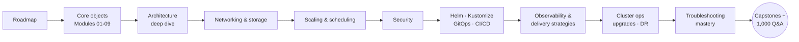
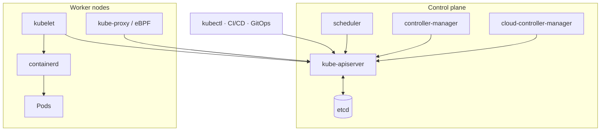
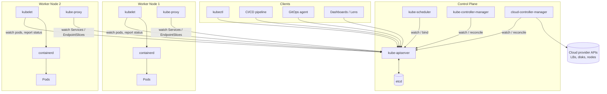
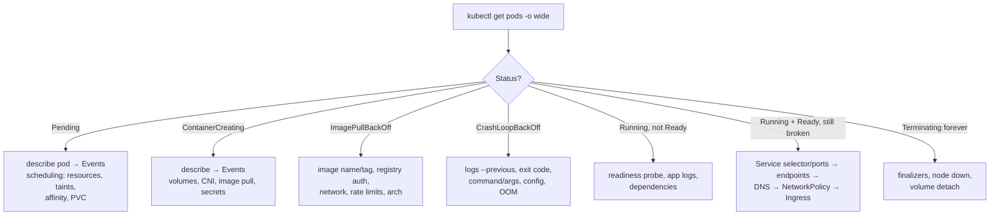
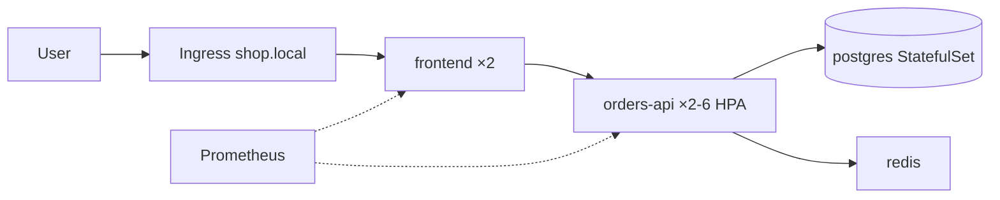
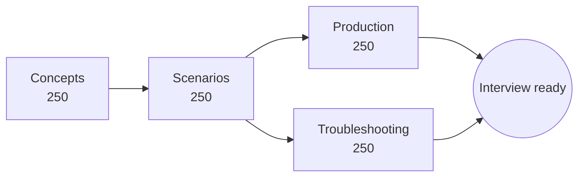
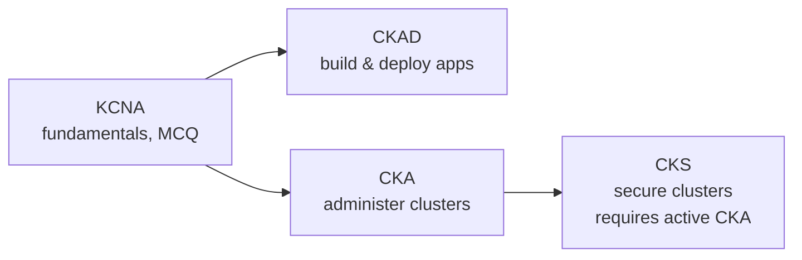

<!-- devopsshack:header -->
> ☸️ **Kubernetes Mastery: Zero to Production** · by **DevOps Shack** · [YouTube](https://www.youtube.com/@devopsshack) · [Hindi channel](https://www.youtube.com/@shackverse) · [devopsshack.com](https://devopsshack.com)
<!-- /devopsshack:header -->

# Diagrams · Roadmap, Labs, Cheat Sheets & Guides

## Kubernetes Mastery: Zero to Production — by DevOps Shack

Source: [Kubernetes Mastery: Zero to Production — by DevOps Shack](../README.md)

### 1. 🧭 Learning path

### 2. The architecture at a glance

## 00 · The Kubernetes Roadmap

Source: [00 · The Kubernetes Roadmap](../00-roadmap/README.md)

### 3. 00 · The Kubernetes Roadmap

```mermaid
flowchart LR
    S0[Week 0<br/>Prerequisites] --> S1[Weeks 1-2<br/>Core objects]
    S1 --> S2[Week 3<br/>Architecture]
    S2 --> S3[Weeks 4-5<br/>Networking & storage]
    S3 --> S4[Week 6<br/>Scheduling, resources, autoscaling]
    S4 --> S5[Week 7<br/>Security]
    S5 --> S6[Week 8<br/>Helm, Kustomize, GitOps, CI/CD]
    S6 --> S7[Week 9<br/>Observability & delivery strategies]
    S7 --> S8[Week 10<br/>Cluster ops, upgrades, DR]
    S8 --> S9[Week 11<br/>Troubleshooting mastery]
    S9 --> S10[Week 12<br/>Capstone + interview prep]
```

## 01 · Kubernetes Architecture: The Deep Dive

Source: [01 · Kubernetes Architecture: The Deep Dive](../01-architecture/README.md)

### 4. The whole system on one page

## Cheat Sheet · Troubleshooting

Source: [Cheat Sheet · Troubleshooting](../03-cheatsheets/troubleshooting.md)

### 5. The universal order

## Lab 25 · End-to-End Microservices Platform

Source: [Lab 25 · End-to-End Microservices Platform](../04-labs/lab-25-end-to-end-microservices/README.md)

### 6. Lab 25 · End-to-End Microservices Platform

## 07 · Interview Questions: 1,000 Q&A

Source: [07 · Interview Questions: 1,000 Q&A](../07-interview-questions/README.md)

### 7. 07 · Interview Questions: 1,000 Q&A

## 09 · Certification Prep: CKA, CKAD, CKS

Source: [09 · Certification Prep: CKA, CKAD, CKS](../09-certification-prep/README.md)

### 8. 09 · Certification Prep: CKA, CKAD, CKS

<!-- devopsshack:footer -->
---

  Made with ❤️ by <b><a href="https://devopsshack.com">DevOps Shack</a></b> · Part of <b>Kubernetes Mastery: Zero to Production</b> 
  <a href="https://www.youtube.com/@devopsshack">YouTube · DevOps Shack</a> · <a href="https://www.youtube.com/@shackverse">YouTube · DevOps Shack Hindi</a> · <a href="https://devopsshack.com">devopsshack.com</a> · <a href="https://www.instagram.com/devopsshack">Instagram · @devopsshack</a> 
  © DevOps Shack. Original content created by DevOps Shack. Free to learn from and share with credit to DevOps Shack. See <a href="../LICENSE">LICENSE</a>.

<!-- /devopsshack:footer -->
