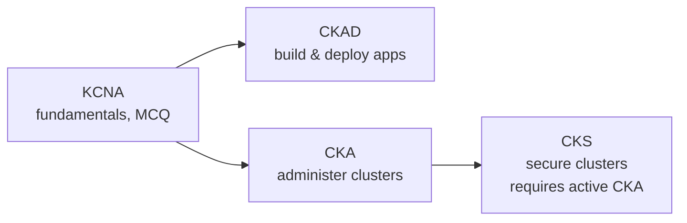

<!-- devopsshack:header -->
> ☸️ **Kubernetes Mastery: Zero to Production** · by **DevOps Shack** · [YouTube](https://www.youtube.com/@devopsshack) · [Hindi channel](https://www.youtube.com/@shackverse) · [devopsshack.com](https://devopsshack.com)
<!-- /devopsshack:header -->

# 09 · Certification Prep: CKA, CKAD, CKS

The three hands-on Kubernetes certifications from the CNCF and Linux Foundation are performance-based: you solve tasks in live clusters in a browser terminal, against the clock. This repository covers every domain; these guides map the curriculum to the right modules, labs and assignments and give you exam technique.

| Exam | Guide | Best for |
|---|---|---|
| CKAD | [CKAD guide](ckad.md) | Developers and DevOps engineers who deploy apps |
| CKA | [CKA guide](cka.md) | DevOps, SRE and platform engineers who run clusters |
| CKS | [CKS guide](cks.md) | Engineers responsible for cluster and workload security |

> Exam domains and weights change over time. Always check the current curriculum on the Linux Foundation / CNCF site before you book.

## Exam technique that applies to all three

- **Set up speed aliases** at the start: `alias k=kubectl`, `export do="--dry-run=client -o yaml"`, and enable completion.
- **Generate, don't write:** `k create deploy ... $do > f.yaml`, then edit. Use `k explain` instead of searching docs.
- **Always check the context** given at the top of each task (`kubectl config use-context ...`). Wrong cluster = zero points.
- **Skip and return.** Flag hard questions; easy points first.
- **Verify every task** (`get`, `describe`, a quick curl) before moving on.
- **Know the docs layout** (kubernetes.io/docs) for the few things you'll copy, like NetworkPolicy and PV examples.

<!-- devopsshack:footer -->
---

  Made with ❤️ by <b><a href="https://devopsshack.com">DevOps Shack</a></b> · Part of <b>Kubernetes Mastery: Zero to Production</b> 
  <a href="https://www.youtube.com/@devopsshack">YouTube · DevOps Shack</a> · <a href="https://www.youtube.com/@shackverse">YouTube · DevOps Shack Hindi</a> · <a href="https://devopsshack.com">devopsshack.com</a> · <a href="https://www.instagram.com/devopsshack">Instagram · @devopsshack</a> 
  © DevOps Shack. Original content created by DevOps Shack. Free to learn from and share with credit to DevOps Shack. See <a href="../LICENSE">LICENSE</a>.

<!-- /devopsshack:footer -->
