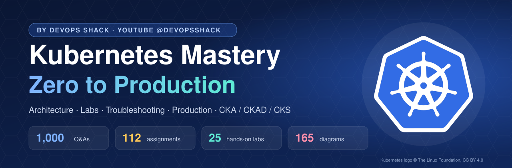
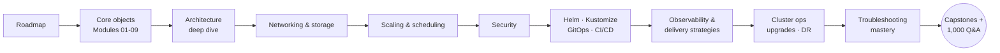
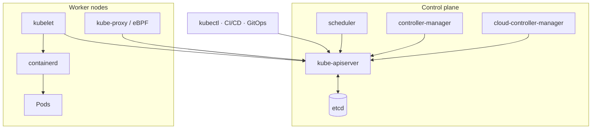

<div align="center">



# Kubernetes Mastery: Zero to Production — by DevOps Shack

**The single resource for learning Kubernetes end to end.** Architecture deep dives with 165 diagrams, 33 learning modules, 25 hands-on labs, 30 troubleshooting playbooks, 112 real-world assignments, cheat sheets, CKA/CKAD/CKS guides and **1,000 interview questions with answers**. All free.

[](07-interview-questions/README.md)
[](06-assignments/README.md)
[](04-labs/README.md)
[](08-diagrams-gallery/README.md)
[](https://github.com/jaiswaladi246/Kubernetes-Mastery-Zero-to-Production-by-DevOps-Shack/stargazers)

**⭐ Star this repo** so you can find it the night before your interview, and so it reaches more engineers.

</div>

<!-- devopsshack:header -->
<p align="center">
  <a href="https://www.youtube.com/@devopsshack"></a>
  <a href="https://www.youtube.com/@shackverse"></a>
  <a href="https://devopsshack.com"></a>
  <a href="https://www.instagram.com/devopsshack"></a>
  <a href="https://github.com/jaiswaladi246/Kubernetes-Mastery-Zero-to-Production-by-DevOps-Shack"></a>
</p>
<p align="center"><sub>☸️ <b>Kubernetes Mastery: Zero to Production</b> · by <b>DevOps Shack</b>. Free to learn from; please credit DevOps Shack when sharing.</sub></p>
<!-- /devopsshack:header -->

---

## Why this repo exists

Most Kubernetes material either stops at "here's a pod" or jumps straight to production advice nobody explains. Interviews and real jobs need both: you have to know **why** the scheduler made a decision, **what** to run when a pod is stuck at 2 a.m., and **how** to run a cluster that survives a zone outage and a bad deploy on the same day.

This repo takes you through that whole journey in one place. Every concept is explained with diagrams, every module links to a lab you can run on your laptop, every lab breaks something on purpose so you learn to fix it, and every topic ends in interview questions written the way senior engineers answer them.

---

## 🗺️ What's inside

| # | Section | What you get |
|:-:|---|---|
| 00 | 🧭 [**Roadmap**](00-roadmap/README.md) | A 12-week plan from zero to production-ready, with "done when" checkpoints |
| 01 | 🏛️ [**Architecture Deep Dive**](01-architecture/README.md) | 18 chapters on every component: API server, etcd, scheduler, controllers, kubelet, networking, DNS, storage, security, HA, Gateway API, operators, EKS/AKS/GKE |
| 02 | 📚 [**Learning Modules**](02-modules/README.md) | 33 chapters from first pod to GitOps, observability, service mesh, multi-cluster, cost and AI/ML workloads |
| 03 | 📝 [**Cheat Sheets**](03-cheatsheets/README.md) | kubectl, troubleshooting, production YAML, Helm & Kustomize, networking & security |
| 04 | 🧪 [**Hands-On Labs**](04-labs/README.md) | 25 guided labs with real, validated manifests for a local kind cluster |
| 05 | 🚑 [**Troubleshooting Playbooks**](05-troubleshooting-playbooks/README.md) | 30 step-by-step guides: Pending, CrashLoopBackOff, OOMKilled, DNS, Ingress 502s, node NotReady, etcd, webhooks, upgrades... |
| 06 | 🎯 [**Assignments**](06-assignments/README.md) | 112 real-world assignments from beginner to expert, including 4 capstones |
| 07 | 🎤 [**Interview Questions**](07-interview-questions/README.md) | **1,000 Q&As**: 250 concepts · 250 scenarios · 250 production · 250 troubleshooting |
| 08 | 🖼️ [**Diagrams Gallery**](08-diagrams-gallery/README.md) | All 165 diagrams in one place for revision and whiteboard practice |
| 09 | 🏅 [**Certification Prep**](09-certification-prep/README.md) | CKA, CKAD and CKS domain maps, must-know commands and study plans |

---

## 🧭 Learning path



## The architecture at a glance



Read the full story in [Life of a `kubectl apply`](01-architecture/12-life-of-kubectl-apply.md).

---

## 📂 Repository structure

```text
Kubernetes-Mastery-Zero-to-Production/
├── 00-roadmap/                    12-week plan, levels, daily routine
├── 01-architecture/               18 deep-dive chapters, 64 diagrams
├── 02-modules/                    33 learning modules
├── 03-cheatsheets/                kubectl · troubleshooting · YAML · Helm · security
├── 04-labs/                       25 labs, each with README + manifests/
│   ├── lab-01-first-cluster/
│   ├── ...
│   └── lab-25-end-to-end-microservices/
├── 05-troubleshooting-playbooks/  30 symptom → cause → fix guides
├── 06-assignments/                A001 … A112
├── 07-interview-questions/
│   ├── 01-concepts/               250 Q&A
│   ├── 02-scenario-based/         250 Q&A
│   ├── 03-production-based/       250 Q&A
│   └── 04-troubleshooting/        250 Q&A
├── 08-diagrams-gallery/           every diagram in one place
└── 09-certification-prep/         CKA · CKAD · CKS
```

---

## 🚀 How to use this repository

**Starting from zero?** Follow the [Roadmap](00-roadmap/README.md) week by week. Read a module, run the linked lab, then attempt the assignment.

**Already use Kubernetes at work?** Read the [Architecture deep dive](01-architecture/README.md), then the [Troubleshooting playbooks](05-troubleshooting-playbooks/README.md) and the production modules (23–33).

**Preparing for interviews?** Work through the four [interview banks](07-interview-questions/README.md) out loud, redraw the [diagrams](08-diagrams-gallery/README.md) from memory, and turn your [assignments](06-assignments/README.md) into stories.

**Preparing for CKA / CKAD / CKS?** Use the [certification guides](09-certification-prep/README.md); each maps every exam domain to modules, labs and assignments here.

**Teaching Kubernetes?** Every lab is self-contained and reproducible on kind, so a whole classroom starts from the same state.

### Run your first lab in two minutes

```bash
git clone https://github.com/jaiswaladi246/Kubernetes-Mastery-Zero-to-Production-by-DevOps-Shack.git
cd Kubernetes-Mastery-Zero-to-Production-by-DevOps-Shack/04-labs
kind create cluster --config lab-01-first-cluster/manifests/kind-3node.yaml
kubectl apply -f lab-01-first-cluster/manifests/hello.yaml
curl localhost:30080
```

You need Docker, `kubectl` and `kind`. Some labs also use `helm`.

---

## 🎓 Want to go further?

This repository is free forever. If you want live classes, real production projects, mock interviews and 5 years of doubt support on Discord, DevOps Shack's **DevSecOps + Cloud + AI** bootcamps cover Kubernetes end to end alongside CI/CD, security, cloud and AI tooling. Details at **[devopsshack.com](https://devopsshack.com)**.

---

## 📜 License & credits

Created by **DevOps Shack** and released under [CC BY-NC-SA 4.0](LICENSE): free for personal learning and sharing **with credit to DevOps Shack**. Commercial use (paid courses, paid training, paywalled re-uploads) needs written permission from office@devopsshack.com. See [NOTICE](NOTICE) and [AUTHORS](AUTHORS.md).

Every file carries DevOps Shack credits, and an automated [branding check](.github/workflows/branding-check.yml) blocks contributions that remove them. Kubernetes® and the Kubernetes logo are trademarks of The Linux Foundation; the logo is used under [CC BY 4.0](https://github.com/cncf/artwork). This project is independent and not endorsed by the CNCF.

<!-- devopsshack:footer -->
---

<div align="center">

### ☸️ Made with ❤️ by [DevOps Shack](https://www.youtube.com/@devopsshack)

**Learn DevOps, DevSecOps, Cloud and Kubernetes the practical way.**

[▶️ YouTube — DevOps Shack](https://www.youtube.com/@devopsshack) · [▶️ Hindi — @shackverse](https://www.youtube.com/@shackverse) · [🎓 devopsshack.com](https://devopsshack.com) · [📸 Instagram @devopsshack](https://www.instagram.com/devopsshack)

<sub>© DevOps Shack. Original content created by DevOps Shack. Free to learn from and share with credit to DevOps Shack. See <a href="LICENSE">LICENSE</a>.</sub>

</div>
<!-- /devopsshack:footer -->
